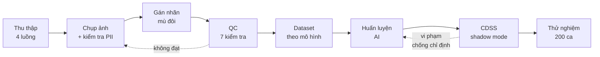

<!-- generated by scripts/sync_from_source.py from docs/appendices/case-study-drmayday.md; do not edit -->
# Phụ lục: Case Study — Quản trị dữ liệu cho dự án DrMayDay (mày đay, Bệnh viện Da liễu Trung ương)

**Loại tài liệu:** phụ lục case study cho sách RDM y sinh (repo `fossbk-spec/biomedical-rdm`).
**Vị trí đề xuất trong repo:** `docs/appendices/case-study-drmayday.md` (phụ lục riêng, không đổi số chương).
**Phiên bản:** v2 — ngày 25/11/2026 (v1 ngày 21/11/2026 là file `rdm-case-study-drmayday-workflow.md`, chỉ nằm local).
**Ngày chốt nội dung (content freeze):** 25/11/2026. Rà soát 6 tháng/lần theo quy tắc của sách.
**Trạng thái:** Bản v2 đã nằm trên `main`; chưa qua reviewer ngoài (pháp lý, nghiên cứu lâm sàng); liên kết chéo từ các chương chưa thêm.
**Quyết định liên quan:** Ben chốt 25/11/2026 — phụ lục riêng, case study thật (không ẩn danh); các chương ch02–ch07 và capstone ch07 vẫn giữ tình huống giả định theo quyết định 22/11/2026. **Đồng ý công khai: đã có** (Ben xác nhận 25/11/2026 — chủ nhiệm đề tài / bệnh viện đã đồng ý đăng case study dùng tên dự án và bệnh viện thật). Phạm vi số liệu: bản v2 này dùng phạm vi chi tiết (số liệu vận hành từ DMP v1.1 và trang Pipeline); Ben có thể yêu cầu gọn lại thành khung 7 giai đoạn.

> **Nguyên tắc an toàn của case study này:** chỉ dùng tài liệu và số liệu tổng hợp đã công bố trong kế hoạch/thuyết minh/DMP của dự án. **Không có dữ liệu bệnh nhân thật nào** trong case study; mọi ví dụ bản ghi đều là giả lập và ghi rõ như vậy. Học viên làm việc với case study này không bao giờ chạm vào dữ liệu thật của dự án. Repo `fossbk-spec/drmayday` là private — case study phải **tự chứa đầy đủ** nội dung cần thiết, không yêu cầu học viên truy cập repo đó.

> **Quy tắc tách nội dung cố định / cập nhật (theo sách):** thân phụ lục chỉ giữ khái niệm và phương pháp ổn định. Mọi con số, ngày tháng, phiên bản chuẩn, tên công cụ và trạng thái dự án nằm trong các bảng có ghi "Ngày chốt: 25/11/2026" — khi dự án sang giai đoạn mới, chỉ cập nhật các bảng đó (một PR riêng cho mỗi lần cập nhật), không viết lại thân chương.

## 1. Bối cảnh dự án thật

**Dự án là gì:** đề tài ứng dụng trí tuệ nhân tạo hỗ trợ khám và chữa bệnh mày đay tại Bệnh viện Da liễu Trung ương, triển khai theo 5 giai đoạn. Hệ thống hoạt động ở mức hỗ trợ giám sát L1–L2: gợi ý, bác sĩ quyết định cuối cùng; không tự chẩn đoán, không tự kê đơn, không tự ghi kết luận vào bệnh án điện tử.

**Dữ liệu của dự án (Ngày chốt: 25/11/2026 — các con số là mục tiêu theo thuyết minh và kế hoạch, trừ khi ghi rõ là thực tế):**

| Loại dữ liệu | Quy mô | Dùng cho |
|---|---|---|
| Hồ sơ bệnh án mày đay (183 biến, Data Dictionary v2.0, 16 phân nhóm) | Mục tiêu ≥ 1.000 hồ sơ | P2A, P2B, P7, P2 |
| Hình ảnh thương tổn sẩn phù, gán nhãn kép | Mục tiêu 10.240 ảnh đạt chuẩn (thực tế: chưa chụp ca nào tính tới 17/11/2026) | P3 (data descriptor), P4 |
| PROMs bệnh nhân tự báo cáo qua app (UAS7, UCT, AAS7, ACT) | Theo dõi dọc 6 tháng | P2A, P5 |
| Biomarker (IgE, anti-TPO, BAT, ASST; ứng viên mới C5a, MRGPRX2, PAF, CRP, D-dimer) | Cùng cohort 1.000 ca | P2B, P7 |
| Thử nghiệm đối đầu AI vs bác sĩ | 200 ca (GĐ4) | P6 |
| Rule engine WAO/EAACI (cảnh báo phản vệ < 30 giây, logic máy chủ < 100 ms) | Code thật, 52/52 tests pass (thực tế, đã kiểm chứng) | P5, P8 |

**Điểm mạnh về RDM (đã có, kiểm chứng 21–22/11/2026):**
- **Data Dictionary v2.0** (ban hành 04/09/2026): 183 biến chuẩn hóa, kiểu dữ liệu, danh mục đóng, nguồn thu thập; phân luồng 4 nguồn (HIS 30 biến, app bệnh nhân 44 biến, hệ thống tự sinh 2 biến, bác sĩ nhập 107 biến).
- **Kiến trúc giả danh hóa (pseudonymisation):** giả danh bằng `patient_uuid` (UUIDv4); bảng ánh xạ mã hóa AES-256, lưu độc quyền trên máy chủ cục bộ tại bệnh viện; dữ liệu huấn luyện AI loại bỏ hoàn toàn trường định danh cấp 1; mọi sự kiện có `encounter_id` + timestamp ISO 8601 UTC. *(Sửa ở v2: bản v1 gọi đây là "Zero-PII" — gọi như vậy là sai. Dùng mã giả danh + bảng ánh xạ chính là giả danh hóa, không phải zero-PII. Xem §7, lỗi 3.)*
- **Rule engine thật:** 52/52 tests pass — dữ liệu kiểm thử có thật, không phải Projected.
- **Kế hoạch xuất bản rõ ràng:** 10 bài (P1, P2, P2A, P2B, P3, P4, P5, P6, P7, P8), thứ tự nộp đề xuất P8 → P1 → P2A/P2B → P3 → P7 → P2 → P5 → P4 → P6.
- **DMP v1.1 (mới ở v2):** bản thảo DMP theo mẫu NIH 2026 (7 yếu tố), bổ sung Phần III vận hành chi tiết — thu thập 4 luồng, SOP chụp ảnh + gán nhãn, PROMs, dataset theo từng mô hình, QC trước huấn luyện. Bản thảo, chờ duyệt trước khi khép GĐ1.

**Điểm yếu về RDM (Ngày chốt: 25/11/2026 — đây chính là nội dung case study):**
- **Chưa chốt CSDL/ERD và docker-compose**; `data/raw` và `data/processed` chưa có dữ liệu; `docs/reports` (BC-01–BC-12) và `docs/sop` còn trống.
- **App/Web v1.0 chưa có code trong repo** — kênh thu thập dữ liệu chính chưa tồn tại.
- **Số quyết định IRB chưa có** — IRB đã duyệt nhưng số quyết định vẫn [TODO]; bài báo P1 không nộp được nếu thiếu. **Không tuyển bệnh nhân GĐ2 khi chưa có số này.**
- **Ngưỡng Tier 1/2 và Bảng 7 WAO chưa được Hội đồng lâm sàng xác nhận** — cổng an toàn lâm sàng chưa khóa.
- **Căn cứ pháp lý lỗi thời trong chính tài liệu của dự án:** README §4 và Data Dictionary v2.0 đều trích **Nghị định 13/2023/NĐ-CP** — nghị định này hết hiệu lực từ 01/01/2026 (Nghị định 356/2025, Điều 42 khoản 2), thay bằng Luật 91/2025 + Nghị định 356/2025. Data Dictionary còn trích EAACI 2021 / WAO 2020 làm chuẩn kỹ thuật trong khi một bản cập nhật quốc tế năm 2026 đã công bố (phần nội dung điều trị cần đối chiếu toàn văn — xem §11) `[CẦN KIỂM CHỨNG]`.
- **Chưa có DPIA, chưa có quy trình hủy dữ liệu, chưa có data availability statement cho các bài báo.** (SOP chụp ảnh/gán nhãn đã có bản thảo trong DMP v1.1 — mới ở v2.)
- **Rủi ro PII trong SOP chụp ảnh:** README mô tả bệnh nhân chụp ảnh sẩn phù "có vật đối chuẩn kích thước (thước kẻ/thẻ CCCD)" — chụp thẻ CCCD làm vật đối chuẩn là **rủi ro lộ PII nghiêm trọng** (số CCCD, ảnh chân dung trên thẻ). SOP phải quy định chỉ dùng thước kẻ/thẻ màu chuẩn, **tuyệt đối không dùng CCCD**. (Xem §4.)

## 2. Vòng đời 7 giai đoạn, áp vào một dự án thật

Bảng dưới đây là khung 7 giai đoạn của khóa học, áp vào DrMayDay. Cột "Bằng chứng vận hành" là phần mới ở v2 — lấy từ DMP v1.1 Phần III, tức là những thứ đội dự án có thể làm ngay, không chỉ nguyên tắc chung.

| Giai đoạn (khung khóa học) | Nội dung cho DrMayDay | Bằng chứng vận hành (DMP v1.1) | Hạn |
|---|---|---|---|
| **1. Thiết kế & DMP** | Viết DMP theo mẫu NIH 2026 (7 yếu tố); loại dữ liệu (183 biến lâm sàng, 10.240 ảnh, PROMs, biomarker, log rule engine), kho lưu trữ (Zenodo cho dataset P3; dữ liệu lâm sàng truy cập có kiểm soát tại bệnh viện, không đưa lên kho mở), ngân sách quản lý dữ liệu, thời hạn lưu trữ theo TT33/2025 | DMP v1.1 (Yếu tố 4: 209 từ ≤ 300; Yếu tố 6: 93 từ ≤ 100); checklist nghiệm thu 14 mục | Trước khi tuyển GĐ2 |
| **2. Thu thập** | Vận hành 4 luồng theo DD v2.0 (HIS 30 / app 44 / hệ thống 2 / bác sĩ 107); eCRF từ DD v2.0 với ràng buộc kiểu dữ liệu + danh mục đóng ngay tại nhập liệu; SOP chụp ảnh (chỉ thước kẻ, không CCCD); gán nhãn kép + đồng thuận liên-đánh giá (Fleiss κ mục tiêu 0,842); ICF + đồng thuận chia sẻ dữ liệu | Phụ lục D (checklist 10 mục trước khi mở thu thập GĐ2); Phụ lục E (SOP chụp ảnh từng bước + gán nhãn mù đôi) | GĐ2–GĐ3 |
| **3. Làm sạch & kiểm tra** | Khung Kahn 3×2 (Conformance/Completeness/Plausibility × Verification/Validation); kiểm tra khoảng sinh lý (UAS7 0–42, tuổi ≥ 18, IgE > 0); tỷ lệ khuyết PROMs theo cơ chế Rubin (bệnh nhân nặng bỏ đo = MNAR → phân tích độ nhạy, không xóa dòng); DQD chạy trên bản OMOP sau khi ánh xạ; nhật ký kiểm toán AES-256 | Phụ lục G.7 (bảng QC 7 kiểm tra chạy trước mỗi lần huấn luyện: rò rỉ, đầy đủ, phù hợp, hợp lý, nhãn, phiên bản, PII) | Liên tục, chốt trước mỗi lần phân tích |
| **4. Chuẩn hóa (CDISC/FHIR/OMOP)** | Ánh xạ 183 biến DD v2.0 sang: **SDTM** cho thử nghiệm 200 ca (miền DM/VS/QS/LB/AE/CM; UAS7 là biến QS — miền Questionnaires — vì UAS7 là thang đo do bệnh nhân báo cáo, không phải xét nghiệm; xem §7, lỗi 3); **FHIR R4/R5** để trao đổi với HIS/LIS/PACS qua api-gateway; **OMOP CDM v5.4** cho phân tích dịch tễ (person/condition_occurrence/measurement; chẩn đoán → SNOMED CT, thuốc → RxNorm, đo lường → LOINC); UAS7 đăng ký làm CDE. Phiên bản chuẩn ghi vào Phụ lục D | DD v2.0 dạng máy đọc được (CSV/JSON); khung ánh xạ GĐ2, chạy ETL GĐ3 | GĐ2 (khung ánh xạ), GĐ3 (chạy ETL) |
| **5. FAIR & chia sẻ** | Dataset 10.240 ảnh + metadata → data descriptor P3 (Sci Data, đường lui Data in Brief); siêu dữ liệu công khai + dữ liệu gốc truy cập có kiểm soát + DUA (không CC0 cho dữ liệu sức khỏe); DOI qua Zenodo; RO-Crate đóng gói dataset + Data Dictionary + script; 7 tiêu chí Bridge2AI cho AI-ready (ghi rõ preprint) | Giấy phép dataset P3 [CHƯA CHỐT]; tuyên bố chia sẻ dữ liệu cho từng bài P1–P8 (tạo cùng đợt nộp bài đầu tiên) | GĐ3 (P3), GĐ5 (đóng gói cuối) |
| **6. Bảo mật & pháp lý** | Sửa căn cứ pháp lý: Luật 91/2025 + Nghị định 356/2025 (thay 13/2023) trong README §4 và DD v2.0; lập **hồ sơ đánh giá tác động (DPIA) và gửi 01 bản chính cho cơ quan chuyên trách bảo vệ dữ liệu cá nhân trong 60 ngày** kể từ ngày đầu tiên xử lý dữ liệu (Luật 91/2025, Điều 21 khoản 1; cơ quan chuyên trách là đơn vị thuộc Bộ Công an theo Nghị định 356/2025, Điều 39 khoản 1; tên đơn vị cụ thể như "A05" không có trong hai văn bản này); cập nhật định kỳ 06 tháng khi có thay đổi (Điều 22 khoản 1); thông báo vi phạm chậm nhất 72 giờ (Điều 23 khoản 1). Điều 21 khoản 6 miễn "cơ quan nhà nước có thẩm quyền": bệnh viện công có thuộc diện này hay không là câu hỏi diễn giải `[CẦN REVIEWER PHÁP LÝ]`; bổ sung số quyết định IRB; giả danh hóa `patient_uuid` + bảng ánh xạ AES-256 tại bệnh viện (đã có — giữ nguyên); dữ liệu chia sẻ ngoài bệnh viện phải qua lộ trình Expert Determination (không gọi là Safe Harbor nếu còn ngày tháng đã dịch chuyển); áp dụng tiêu chuẩn an ninh mạng quốc gia liên quan `[CẦN KIỂM CHỨNG: tên, năm và phạm vi chính xác của TCVN 14423; các nguồn tra cứu ngày 26/11 mô tả đây là tiêu chuẩn chung về an ninh mạng cho hệ thống thông tin, chưa thấy nguồn nào gắn với "y tế số"]` | DPIA là file riêng (`docs/DATA_PROTECTION_IMPACT_ASSESSMENT.md`); DMP không thay thế DPIA | Ngay (sửa trích dẫn), GĐ1 (DPIA + IRB) |
| **7. Kết thúc: lưu trữ / hủy** | Lưu trữ theo TT33/2025 (Phụ lục: hồ sơ bệnh án tử vong 30 năm; bệnh án tâm thần/tai nạn lao động/tai nạn giao thông 20 năm; SOP hoạt động thử nghiệm lâm sàng 20 năm; **hồ sơ bệnh án nội trú, ngoại trú 10 năm** là mức chung; Điều 1 khoản 2 điểm b: mức áp dụng không thấp hơn Phụ lục); hồ sơ chính thử nghiệm lâm sàng tối thiểu 25 năm theo EU 536/2014 Điều 58); dữ liệu NIH-style giữ 3 năm sau đóng grant (nếu áp dụng); hủy an toàn theo NIST SP 800-88 Rev. 2 (Clear/Purge/Destroy) + ghi lại việc hủy; hoàn thiện BC-01–BC-12; data availability statement cho từng bài P1–P8 | Bảng thời hạn lưu trữ theo từng loại hồ sơ (DMP v1.1 §6.4); biên bản hủy | GĐ5 (10–12/2027) |

## 3. Sơ đồ workflow 8 chặng (từ trang Pipeline dữ liệu DrMayDay)

Sơ đồ Mermaid dưới đây vẽ lại pipeline 8 chặng của dự án. Nhãn ngắn, không nhét dữ kiện hết hạn vào nhãn (theo `docs/guides/diagrams-math-quiz-web.md`); các con số nằm trong bảng ở §1 và §2, kèm ngày chốt.

Hai vòng lặp phản hồi trong sơ đồ là điểm dạy chính của case study: (1) ảnh/QC không đạt thì quay lại bước chụp ảnh, không "chữa" bằng cách sửa ảnh gốc; (2) chạy ngầm phát hiện gợi ý vi phạm chống chỉ định cứng thì quay lại huấn luyện/thuật toán, không chuyển sang thử nghiệm đối đầu. Cổng kiểm soát GĐ1–GĐ5 (18 mục, DMP v1.1 Phụ lục I) là phiên bản quản trị của hai vòng lặp này: cổng không đạt thì giai đoạn sau không tự động bắt đầu.

## 4. Thu thập: 4 luồng, SOP chụp ảnh, gán nhãn mù đôi

### 4.1. Thu thập theo 4 luồng (Data Dictionary v2.0)

| Luồng | Số biến | Ai thu | Thu bằng gì, thu khi nào | Kiểm tra ngay tại nhập liệu |
|---|---|---|---|---|
| HIS | 30 | Hệ thống thông tin bệnh viện → trích xuất sang eCRF | Trích xuất có cấu trúc theo DD v2.0, tại mỗi lần khám; không nhập tay lại dữ liệu đã có trong HIS. Lộ trình FHIR: nhập liệu có cấu trúc trước, kết nối FHIR **đọc** khi bệnh viện sẵn sàng kỹ thuật + pháp lý, **không ghi tự động vào bệnh án ở mọi giai đoạn** | Khớp `patient_uuid` với bảng ánh xạ; kiểm tra khoảng giá trị theo DD v2.0; biến bắt buộc thiếu thì báo ngay |
| App bệnh nhân | 44 | Bệnh nhân tự nhập qua app | Nhật ký sẩn phù + ngứa hằng ngày **dưới 1 phút/ngày**; UAS7 hằng ngày (7 ngày liên tiếp); UCT mỗi 4 tuần; AAS7 cùng đợt UAS7 khi có phù mạch; ACT chỉ khi có hen đồng mắc và có chỉ định; chụp ảnh theo SOP §4.2; nhắc tuân thủ; xem điểm của bản thân; nhận cảnh báo khẩn cấp | UAS7 mỗi ngày 0–6 (sẩn 0–3 + ngứa 0–3), tổng 7 ngày 0–42; UCT mỗi câu 0–4, tổng 0–16; không nhập ngày tương lai; một ngày chỉ một bộ UAS7 |
| Hệ thống tự sinh | 2 | Hệ thống tự sinh | Định danh phiên làm việc + dấu thời gian theo DD v2.0 (kiểm chứng lại tên biến chính xác khi xuất DD dạng CSV/JSON) | Mọi bản ghi phải có `encounter_id` + timestamp ISO 8601 UTC |
| Bác sĩ nhập | 107 | Bác sĩ điều trị trên dashboard | Tại mỗi lần khám và mỗi lần chuyển bậc điều trị (tăng liều, chuyển bậc, giảm bậc, tái khám); dashboard hiển thị xu hướng UAS7/UCT/AAS7, tuân thủ, ảnh theo thời gian, biomarker, gợi ý bước điều trị (đặc biệt đối chiếu omalizumab vs ciclosporin ở ca kháng trị) kèm giải thích nêu căn cứ hướng dẫn, dữ liệu đầu vào và chống chỉ định đã kiểm tra | Danh mục đóng theo DD v2.0 (không nhập tự do); thuốc + liều khớp danh mục và chống chỉ định; bác sĩ ghi nhận **đồng ý / bác bỏ gợi ý kèm lý do** — lý do bác bỏ là dữ liệu nghiên cứu, không được bỏ trống |

**Checklist trước khi mở thu thập đợt 1 (GĐ2) — tất cả phải tick mới được tuyển:** số quyết định IRB đã có; DPIA đã lập; DMP v1.1 đã duyệt; CSDL/ERD đã chốt, docker-compose chạy được, sao lưu + phục hồi đã kiểm thử; DD v2.0 dạng máy đọc được đã xuất; SOP chụp ảnh + gán nhãn đã duyệt, người gán nhãn đã tập huấn; mẫu đồng thuận ICF có đủ 3 điều khoản (tham gia / chụp ảnh / chia sẻ dữ liệu); lớp an toàn rule-engine kiểm thử bao phủ 100% và đã khoá phiên bản; phân quyền theo vai trò đã cấp, audit trail đã bật; kế hoạch theo dõi tuyển theo tháng đã có (mục tiêu 1.000 ca).

### 4.2. SOP chụp ảnh — từng bước

1. **Chuẩn bị:** giải thích cho bệnh nhân, lấy đồng thuận chụp ảnh (điều khoản riêng trong ICF); kiểm tra ánh sáng (tự nhiên hoặc đèn trắng, không đèn vàng, không bóng đổ lên tổn thương); nền sạch, không vật dụng cá nhân trong khung hình.
2. **Vật đối chuẩn:** chỉ dùng **thước kẻ / thẻ màu chuẩn**. **Tuyệt đối không dùng thẻ CCCD, thẻ BHYT, giấy tờ tùy thân, hay bất kỳ vật nào có chữ/số định danh.** Ảnh tự chụp ở nhà vô tình kèm giấy tờ thì bị loại ngay ở bước kiểm tra PII, không lưu bản gốc vào kho nghiên cứu.
3. **Khung hình:** chụp tổn thương rõ nét, lấy đủ vùng tổn thương + vùng da lành xung quanh để đối chiếu; thước kẻ đặt cạnh tổn thương, cùng mặt phẳng, không che tổn thương; chụp thêm một ảnh toàn cảnh vị trí tổn thương để ghi vị trí giải phẫu.
4. **Thiết bị và metadata:** ghi thiết bị chụp, điều kiện ánh sáng, ngày giờ chụp (tự động từ app, không nhập tay); ảnh lưu JPEG gốc + metadata; không chỉnh sửa ảnh (không crop làm mất thước kẻ, không filter, không tăng sáng sau chụp — mọi xử lý ảnh cho mô hình ghi lại riêng trong pipeline, không sửa file gốc).
5. **Đặt tên file:** `patient_uuid` + `encounter_id` + số thứ tự ảnh + ngày chụp (ISO 8601) — **không** dùng tên bệnh nhân, mã bệnh nhân thật, hay ngày sinh trong tên file.
6. **Kiểm tra PII trước khi nhập kho (bắt buộc):** quét từng ảnh xem có CCCD, số điện thoại, tên, khuôn mặt không liên quan, biển số, hay chữ viết tay chứa thông tin định danh không; quét cả text tự do kèm ảnh. Ảnh vi phạm → loại, ghi lý do vào log, không lưu bản gốc vào kho nghiên cứu. Người kiểm tra PII không phải là người gán nhãn (tách nhiệm vụ).

**Tiêu chuẩn loại ảnh:** mờ/nhòe không thấy rõ tổn thương; thiếu vật đối chuẩn hoặc vật đối chuẩn che tổn thương; ánh sáng quá tối/quá chói; có PII; trùng lặp; không khớp `encounter_id` / ngày chụp. **Mục tiêu 10.240 ảnh là số ảnh *đạt chuẩn chất lượng*, không phải số ảnh đã chụp** — con số cuối cùng báo cáo ở nghiệm thu theo số đạt thực tế, không theo số cam kết.

### 4.3. Gán nhãn mù đôi — từng bước

1. **Người gán nhãn:** hai chuyên gia gán nhãn độc lập (mù đôi — không thấy nhãn của nhau, không thấy thông tin bệnh nhân ngoài ảnh + metadata chụp).
2. **Nhãn:** theo trường nhãn trong DD v2.0 (kiểm chứng lại danh mục nhãn chính xác trong DD v2.0 khi xuất bản CSV/JSON — case study này không tự đặt ra danh mục nhãn mới).
3. **Bất đồng:** hai người gán khác nhau thì chuyên gia thứ ba phân xử; quyết định phân xử ghi lại cùng lý do.
4. **Báo cáo:** tỉ lệ đồng thuận và hệ số thống nhất giữa các người gán nhãn (Fleiss κ, **mục tiêu 0,842**) được báo cáo công khai. Nếu κ thực tế thấp hơn mục tiêu thì không giấu — báo cáo kèm phân tích nguyên nhân (nhóm tổn thương nào gây bất đồng nhiều nhất) và biện pháp (tập huấn lại, làm rõ định nghĩa nhãn, hay loại nhóm ảnh đó khỏi tập huấn luyện).
5. **Cổng GĐ2:** chất lượng gán nhãn phải đạt ngưỡng mới qua cổng sang GĐ3. Ngưỡng κ tối thiểu do Hội đồng lâm sàng chốt trước khi gán nhãn đợt 1 **[CHƯA CHỐT — cần Hội đồng lâm sàng chốt]**.

### 4.4. PROMs: thang đo, tần suất, xử lý thiếu

| Thang đo | Cách tính | Diễn giải | Tần suất | Xử lý khi thiếu |
|---|---|---|---|---|
| UAS7 | Tổng sẩn (0–3) + ngứa (0–3) mỗi ngày, cộng 7 ngày; 0–42 | 0 sạch; 1–6 kiểm soát tốt; 7–15 nhẹ; 16–27 trung bình; 28–42 nặng | Hằng ngày, 7 ngày liên tiếp | Thiếu 1–2 ngày: tính theo quy tắc chốt trong đề cương [CHƯA CHỐT]; thiếu ≥3 ngày: UAS7 tuần đó không tính, ghi rõ lý do |
| UCT | 4 câu, mỗi câu 0–4; 0–16; hỏi 4 tuần gần nhất | ≥12 kiểm soát tốt; 16 kiểm soát hoàn toàn; <12 chưa kiểm soát, cân nhắc chuyển bậc | Mỗi 4 tuần | Thiếu 1 câu: không tính UCT kỳ đó; không tự điền câu thiếu |
| AAS / AAS7 | Điểm phù mạch mỗi ngày / tổng 7 ngày | Dùng cho bệnh nhân có phù mạch; theo dõi cùng đợt với UAS7 | Cùng đợt UAS7 khi có phù mạch | Như UAS7 |
| ACT | 5 câu; 5–25 | Chỉ khi bệnh nhân có hen đồng mắc và có chỉ định của bác sĩ | Theo chỉ định | Không thu khi không có chỉ định — không ghi 0 |
| DLQI / CU-Q2oL | Bảng hỏi chất lượng sống (da / chuyên biệt mày đay mạn tính) | Đánh giá theo mốc nghiên cứu, không thu hằng ngày | Tần suất: [chốt trong đề cương] | Ghi rõ mốc nào thiếu và lý do |

**Nguyên tắc chung:** bác sĩ phải thấy rõ **mức đầy đủ của dữ liệu** (bao nhiêu ngày đã nhập trên 7 ngày, UCT có đủ 4 câu không) trước khi tin vào thang đo — hệ thống hiển thị mức đầy đủ cùng với điểm số, không hiển thị điểm số đơn độc. **Không tự điền giá trị thiếu.** Mọi giá trị khuyết ghi rõ cơ chế theo Rubin (MCAR/MAR/MNAR); bệnh nhân nặng bỏ đo là dấu hiệu MNAR → phân tích độ nhạy, không xóa dòng. **Bản dịch tiếng Việt của thang đo:** dùng bản dịch đã được kiểm chứng, hoặc kiểm chứng ngôn ngữ theo quy trình trước khi đưa vào thử nghiệm [trạng thái bản dịch: cần xác nhận].

## 5. Xây dựng dataset huấn luyện AI theo từng mô hình

*Nguyên tắc chung cho mọi dataset: chia tập theo **bệnh nhân** (patient-level split) — cùng một bệnh nhân không bao giờ xuất hiện ở hai tập khác nhau, kể cả khi bệnh nhân đó có nhiều ảnh, nhiều lần khám, hay nhiều bản ghi. Chia theo bản ghi/ảnh là rò rỉ (leakage) và làm số đo hiệu năng bị thổi phồng. Mọi dataset đều có manifest (danh sách file + checksum + phiên bản DD + phiên bản code + ngày xuất + số ca) và được khoá trước khi huấn luyện/đánh giá.*

### 5.1. Dataset ảnh — D-vision (P3 dataset, P4 vision/UAS7)

- **Nguồn:** 10.240 ảnh đạt chuẩn (§4.2–4.3) + nhãn kép + metadata chụp.
- **Tỉ lệ chia:** **80/10/10** (Train/Val/Test) theo README dự án — chia theo bệnh nhân, không theo ảnh. Test set được **khoá** (frozen) trước khi huấn luyện mô hình đầu tiên; không dùng test để chọn mô hình, không huấn luyện lại trên test.
- **Phân tầng (stratification):** giữ tỉ lệ các nhóm sau giống nhau ở 3 tập: dải UAS7 (0 / 1–6 / 7–15 / 16–27 / 28–42), loại mày đay (cấp / mạn tính tự phát / mạn tính do kích phát), nhóm tuổi. Nhóm quá nhỏ thì ghi rõ và xử lý theo quyết định của Hội đồng lâm sàng, không tự ý gộp nhóm.
- **Nhiệm vụ mô hình (P4):** phân vùng sẩn phù (segmentation) + đếm/ước lượng UAS từ ảnh; đánh giá trên test set đã khoá. **P4 chỉ viết tiếp khi có benchmark thật** (JBHI không có loại Study Protocol; nộp khi chưa có benchmark thật có nguy cơ desk-reject 50–60%).
- **Tiền xử lý ảnh:** mọi bước (resize, chuẩn hoá, augmentation) ghi lại trong pipeline có phiên bản; file gốc không bao giờ bị sửa; augmentation chỉ áp dụng trên train, không áp dụng trên val/test.
- **Phiên bản dataset:** D-vision v1.0, v1.1, … — mỗi phiên bản ghi số ảnh, số bệnh nhân, số ảnh loại, κ gán nhãn, ngày khoá, checksum. Mô hình nào huấn luyện trên phiên bản nào phải ghi rõ trong báo cáo.

### 5.2. Dataset bảng — D-tabular (P2A PROMs validation, P2B biomarkers, P7 endotype)

- **Nguồn:** cohort 1.000 ca, 183 biến DD v2.0 + PROMs dọc 6 tháng + biomarker.
- **Nhiệm vụ:** P2A kiểm chứng thang đo PROMs; P2B biomarker (đặc biệt MPV từ công thức máu thường quy) và phân loại endotype; P7 dịch tễ + ngưỡng cắt biomarker theo endotype. Endotype: aaCSU (tự dị ứng) vs aiCSU (tự miễn) — nhãn do Hội đồng lâm sàng thống nhất, không tự suy ra từ mô hình.
- **Chia tập:** theo bệnh nhân, 80/10/10; phân tầng theo endotype + dải UAS7 + nhóm tuổi. **Cấm dùng biến `time` (thời gian theo dõi) làm đặc trưng** — biến này mã hoá nhãn (đã kiểm chứng ở repo suy tim/đột quỵ: thêm `time` thổi ROC-AUC từ 0,79 lên 0,92). Danh sách biến cấm ghi trong manifest và kiểm tra bằng test tự động trước mỗi lần huấn luyện.
- **Xử lý khuyết:** theo cơ chế Rubin + phân tích độ nhạy; **không** dùng single imputation rồi gọi là MICE; MICE thật = *m* bộ dữ liệu + Rubin pooling.
- **Nhãn mục tiêu:** nhãn cho từng bài (P2A/P2B/P7) định nghĩa trong đề cương và ghi vào manifest; nhãn nào do bác sĩ xác nhận, nhãn nào là Projected (khung) phải phân biệt rõ — dữ liệu Projected không bao giờ đưa vào huấn luyện.

### 5.3. Dataset ngôn ngữ — D-nlp (trích xuất yếu tố khởi phát từ bệnh sử tự do)

- **Nguồn:** text bệnh sử tự do trong 183 biến — đã khử định danh trước khi đưa cho NLP.
- **Nhiệm vụ:** bóc tách biến số hoàn cảnh khởi phát (yếu tố kích phát, thuốc, tiền sử) thành biến có cấu trúc; đầu ra khớp danh mục đóng trong DD v2.0, không tạo danh mục mới.
- **Kiểm tra PII:** text tự do qua quét PII (tên, số điện thoại, CCCD, địa chỉ) trước khi vào pipeline NLP; đoạn text chứa PII được che hoặc loại, ghi log.
- **Đánh giá:** đo trên tập test đã khoá, theo bệnh nhân; báo cáo precision/recall theo từng loại yếu tố khởi phát, không chỉ một số chung.

### 5.4. Dataset CDSS — D-cdss (P5 rule engine + lõi gợi ý, P8 phân biệt sốc phản vệ)

- **Nguồn:** log rule-engine (52 rule, 52/52 tests pass) + log gợi ý điều trị kèm giải thích + log bác sĩ đồng ý/bác bỏ kèm lý do + dữ liệu chạy ngầm GĐ3.
- **Lớp an toàn tách biệt:** dữ liệu đánh giá lớp an toàn (bộ kiểm thử bao phủ 100% tổ hợp trong bảng luật WAO, gồm ca dương tính, âm tính và ca biên) là dataset riêng, **không trộn** với dữ liệu huấn luyện mô hình gợi ý. Lớp an toàn được nghiệm thu độc lập, trước các thành phần AI.
- **Chạy ngầm (shadow mode, GĐ3):** hệ thống ghi nhận gợi ý nhưng **không hiển thị** cho bác sĩ, để đo mức phù hợp và tỉ lệ gợi ý nguy hiểm tiềm tàng trong điều kiện thật mà không ảnh hưởng điều trị. Dữ liệu chạy ngầm gắn nhãn "shadow", tách khỏi dữ liệu sau khi hiển thị; phân tích chạy ngầm và phân tích sau hiển thị báo cáo riêng.
- **Ngưỡng đánh giá đặt trước:** đăng ký nội bộ các ngưỡng đạt/không đạt cho từng tiêu chí **trước khi mở khoá dữ liệu đánh giá**; ngưỡng an toàn tuyệt đối: không chấp nhận bất kỳ gợi ý liều hoặc thuốc nào vi phạm chống chỉ định cứng trong tập đánh giá; mọi trường hợp vi phạm đều phải phân tích nguyên nhân gốc và sửa trước khi chuyển giai đoạn. Một quyết định không an toàn có trọng số cao hơn mọi cải thiện về tốc độ hay độ phù hợp trung bình.
- **Cập nhật guideline 2026:** thuật toán trong CDSS hiện theo EAACI 2022; bản cập nhật quốc tế 2026 (Zuberbier và cs., *Allergy*, DOI 10.1111/all.70210) đã công bố. Theo bản tóm tắt thứ cấp: omalizumab bổ sung cho ca không đáp ứng kháng histamin liều cao, dupilumab và remibrutinib "có thể cân nhắc" (có thể ngoài chỉ định), ciclosporin khi thuốc được cấp phép không hiệu quả hoặc không có; **chưa đọc được toàn văn nên chưa xác nhận bậc của từng thuốc và chưa xác nhận việc bỏ montelukast** `[CẦN KIỂM CHỨNG]`. **Dataset D-cdss phải ghi rõ phiên bản guideline nào** (2022 hay 2026) cho từng lần đánh giá; không trộn kết quả đánh giá theo hai phiên bản guideline khác nhau.

### 5.5. Dataset thử nghiệm — D-trial (P6, 200 ca đối đầu)

- **Nguồn:** 200 ca bệnh chuẩn hoá từ hồ sơ thật đã khử định danh, có đáp án tham chiếu do Hội đồng lâm sàng thống nhất **trước** khi mở dữ liệu.
- **Nhóm so sánh:** hệ thống; nhóm bác sĩ trẻ; nhóm bác sĩ có kinh nghiệm; nhóm chuyên gia mày đay. Số lượng mỗi nhóm: [chốt trong đề cương].
- **Tiêu chí chính:** tỉ lệ quyết định phù hợp đáp án tham chiếu; tỉ lệ quyết định không an toàn theo định nghĩa đặt trước.
- **Tiêu chí phụ:** thời gian ra quyết định; mức phù hợp theo phân tầng độ khó của ca; tỉ lệ gợi ý bị bác bỏ và phân loại lý do bác bỏ.
- **Cỡ mẫu:** con số 200 ca là thiết kế hiện tại và cần được Trung tâm Thử nghiệm lâm sàng **tính toán lại** dựa trên hiệu ứng kỳ vọng và tỉ lệ không an toàn nền trước khi khoá đề cương. Case study này không dùng lại cỡ mẫu của các đề tài khác.
- **Khoá trước khi mở:** đề cương + kế hoạch thống kê + ngưỡng đánh giá được khoá trước khi mở dữ liệu (cổng GĐ4). Sau khi mở, không thay đổi tiêu chí hay ngưỡng.

### 5.6. Dữ liệu tổng hợp (synthetic) — chỉ cho kiểm thử, không cho huấn luyện

- **Mục đích duy nhất:** kiểm thử phần mềm, đào tạo người dùng, trình diễn.
- **Quy tắc:** synthetic được tạo có kiểm soát, ghi rõ nguồn gốc trong metadata, lưu ở kho riêng tách biệt kho dữ liệu thật. **Không bao giờ** trộn synthetic vào D-vision, D-tabular, D-nlp, D-cdss hay D-trial. Dùng hồ sơ thật rồi thay đổi số định danh không được coi là dữ liệu kiểm thử hợp lệ.
- **Kiểm tra:** trước mỗi lần huấn luyện, pipeline kiểm tra manifest và từ chối nếu phát hiện bản ghi synthetic trong tập huấn luyện/đánh giá.

### 5.7. QC dataset — chạy trước mỗi lần huấn luyện/đánh giá

| Kiểm tra | Cách làm | Ngưỡng / hành động |
|---|---|---|
| Rò rỉ (leakage) | Kiểm tra `patient_uuid` không trùng giữa train/val/test; kiểm tra biến cấm (`time`) không có trong đặc trưng | 0 trùng lặp, 0 biến cấm — vi phạm thì dừng huấn luyện, sửa pipeline |
| Đầy đủ (completeness) | Tỉ lệ khuyết theo từng biến, theo từng tập | Báo cáo theo biến; biến khuyết > ngưỡng đã chốt trong đề cương thì ghi rõ, không tự điền |
| Phù hợp (conformance) | Kiểu dữ liệu, danh mục đóng, khoảng giá trị theo DD v2.0 | 0 vi phạm kiểu/danh mục trong tập đã khoá — vi phạm thì trả về bước làm sạch |
| Hợp lý (plausibility) | Khoảng sinh lý (UAS7 0–42, tuổi ≥ 18, IgE > 0); ảnh đúng `encounter_id`/ngày | Vi phạm thì ghi log, kiểm tra nguồn, không tự sửa giá trị |
| Nhãn | κ gán nhãn, tỉ lệ bất đồng, tỉ lệ phân xử | Báo cáo κ; κ dưới ngưỡng Hội đồng chốt thì không khoá dataset |
| Phiên bản | Manifest đầy đủ (DD, code, ngày, số ca, checksum) | Thiếu manifest thì không huấn luyện |
| PII | Quét lại toàn bộ tập trước khi chia sẻ/huấn luyện ngoài bệnh viện | Phát hiện PII thì dừng, loại bản ghi, ghi log |

## 6. Lộ trình theo cổng kiểm soát (thuyết minh §11)

| Giai đoạn | Việc dữ liệu phải xong | Cổng kiểm soát (không đạt thì giai đoạn sau không tự động bắt đầu) |
|---|---|---|
| GĐ1| DMP v1.1 duyệt; IRB có số; DPIA lập; CSDL/ERD chốt; SOP chụp ảnh + gán nhãn duyệt; DD dạng máy đọc được; rule-engine kiểm thử 100% bao phủ, cảnh báo <30 giây, logic <100 ms | IRB phê duyệt; Hội đồng lâm sàng duyệt bảng luật |
| GĐ2| Tuyển đợt 1; thu thập 4 luồng; gán nhãn mù đôi đợt 1; QC Kahn chạy theo đợt; lõi gợi ý + giải thích hoàn thiện; kiểm thử chấp nhận người dùng | Chất lượng gán nhãn đạt ngưỡng (κ); kiểm thử an toàn 100% bao phủ |
| GĐ3| Chạy ngầm (shadow mode); D-vision + D-tabular v1.0 khoá; mapping OMOP chạy ETL; chốt kho + giấy phép P3 | Không còn gợi ý vi phạm chống chỉ định cứng; go/no-go của Hội đồng lâm sàng |
| GĐ4| D-trial 200 ca khoá đề cương + kế hoạch thống kê trước khi mở dữ liệu; chạy đối đầu | Đề cương + kế hoạch thống kê đã khoá |
| GĐ5| Đánh giá FAIR lần 2; tuyên bố chia sẻ dữ liệu P1–P8; lưu trữ/hủy theo §2 giai đoạn 7; đóng DMP (phiên bản cuối) | Báo cáo đầy đủ tiêu chí an toàn + hiệu quả, kể cả kết quả không đạt |

*Lưu ý về lịch: lịch các giai đoạn lấy theo thuyết minh §11. Kế hoạch cũ trong README repo ghi khác — mâu thuẫn này được ghi rõ trong DMP v1.1 Phụ lục H, lấy thuyết minh làm chuẩn.*

## 7. Ba lỗi thật làm bài tập (đã sửa ở v2 — đọc kỹ trước khi làm bài tập §9)

Ba lỗi dưới đây đều có thật trong tài liệu của dự án. Ở bản v1 (21/11) chúng được nêu nhưng chưa sửa triệt để; bản v2 sửa như sau:

**Lỗi 1 — Trích văn bản pháp luật đã hết hiệu lực.** README §4 và Data Dictionary v2.0 trích Nghị định 13/2023/NĐ-CP làm căn cứ khử định danh. Nghị định này đã hết hiệu lực từ 01/01/2026. Căn cứ đúng: Luật 91/2025/QH15 + Nghị định 356/2025/NĐ-CP. Bài học: trích dẫn pháp luật phải kiểm chứng hiệu lực tại thời điểm viết, và rà soát lại mỗi 6 tháng — đây là lý do sách tách nội dung cập nhật (pháp lý) ra khỏi thân chương.

**Lỗi 2 — Thẻ CCCD làm vật đối chuẩn trong SOP chụp ảnh.** README mô tả chụp ảnh sẩn phù "có vật đối chuẩn kích thước (thước kẻ/thẻ CCCD)". Thẻ CCCD chứa số định danh + ảnh chân dung — đưa vào ảnh nghiên cứu là rò rỉ PII không thu hồi được sau khi dataset đã chia sẻ có DOI. Quy định đúng: chỉ thước kẻ/thẻ màu chuẩn, kiểm tra PII trước khi nhập kho (§4.2). Bài học: rủi ro PII thường nằm trong chi tiết thao tác (SOP), không nằm trong kiến trúc bảo mật.

**Lỗi 3 — Gọi sai tên kỹ thuật (hai lỗi gộp).** (a) Bản v1 gọi kiến trúc của dự án là "Zero-PII" — sai. Dự án dùng `patient_uuid` + bảng ánh xạ mã hóa AES-256: đó là **giả danh hóa (pseudonymisation)** — dữ liệu vẫn có thể liên kết lại danh tính qua bảng ánh xạ do bệnh viện giữ. "Zero-PII" chỉ đúng khi không còn bất kỳ trường nào có thể liên kết lại danh tính, kể cả qua bảng ánh xạ. Gọi sai tên làm người đọc đánh giá sai mức rủi ro tái định danh. (b) Bản v1 xếp UAS7 vào miền **LB** (Laboratory) của SDTM — sai. UAS7 là thang đo do bệnh nhân báo cáo (patient-reported outcome) nên thuộc miền **QS** (Questionnaires). Xếp sai miền làm dataset thử nghiệm không tương thích khi nộp cho cơ quan quản lý. Bài học: tên gọi kỹ thuật không phải chuyện hình thức — nó quyết định cách đánh giá rủi ro và cách nộp dữ liệu.

## 8. Hai trường hợp đối chiếu từ mẫu DMP

> Hai trường hợp dưới đây không phải là case study thứ hai và thứ ba — chúng là **mẫu DMP công khai** để học viên đối chiếu với bản thảo DMP v1.1 của DrMayDay. Chỉ lấy nội dung DMP; không chép thông tin hành chính của hai dự án mẫu (tên người, số grant, ngày tháng). Cả hai mẫu đều viết theo **mẫu NIH cũ** (6 yếu tố, khuyến nghị không quá 2 trang, trước 25/05/2026); mẫu NIH hiện hành đã rút gọn theo NOT-OD-26-046 (mẫu thí điểm 2026, 7 yếu tố) — lấy hai mẫu này làm mẫu *nội dung*, không phải mẫu *biểu mẫu*. DMP v1.1 của DrMayDay dùng mẫu 2026. Bảng đối chiếu §8.3 dùng khung 6 yếu tố cũ để so sánh nội dung; không dùng bảng này để suy ra số thứ tự yếu tố của mẫu 2026.

### 8.1. Trường hợp A — mẫu chính thức của NIH: dữ liệu lâm sàng người + genomics

- **Quy mô:** 1.000 người tham gia — cùng cỡ với cohort mục tiêu 1.000 hồ sơ của DrMayDay, nên so sánh được từng yếu tố.
- **Loại dữ liệu:** dữ liệu lâm sàng từ bệnh án điện tử (nhân khẩu, bảo hiểm, tiền sử, thuốc, xét nghiệm, khám lâm sàng) thu thập hằng ngày tới 2 tuần rồi hằng tháng tới 12 tháng; xét nghiệm cytokine/miễn dịch từ mẫu sinh học; dữ liệu genomics cá thể (WES, WGS nông, methylation EPIC), tổng 10 TB.
- **Công cụ (Yếu tố 2):** thu thập bằng REDCap (phân quyền theo vai trò, tài khoản riêng cho từng người dùng); phân tích bằng R mã nguồn mở; genomics dùng workflow container hóa tương đương GATK, công khai qua GitHub.
- **Chuẩn (Yếu tố 3):** chuẩn hóa theo CDISC khi có thể; xét nghiệm chuẩn hóa bằng LOINC; dữ liệu chia sẻ đã khử định danh, dữ liệu gốc giữ tại cơ sở nghiên cứu; dùng Common Data Elements của NIH.
- **Kho + thời gian (Yếu tố 4):** dữ liệu lâm sàng/xét nghiệm → DASH (DOI do DASH cấp); genomics → dbGaP/SRA (mã truy cập nghiên cứu). Lô đầu nộp sau khi tuyển 500 người; phần còn lại trong 2,5 năm sau lần khám cuối của người tham gia cuối, 4 tháng trước ngày xuất bản, hoặc 6 tháng trước khi hết thời gian thực hiện — mốc nào đến trước thì theo mốc đó. Genomics nộp trong 3 tháng sau khi tạo dữ liệu, công bố trong 6 tháng sau khi nộp kho hoặc khi bài được chấp nhận.
- **Truy cập (Yếu tố 5):** truy cập có kiểm soát, giới hạn "General Research Use" theo đồng thuận và chứng nhận của cơ sở; khử định danh bằng cách loại bỏ toàn bộ 18 định danh HIPAA trước khi chia sẻ; có Certificate of Confidentiality của NIH; đồng thuận ghi rõ cho phép dùng thứ cấp với chia sẻ rộng có kiểm soát.
- **Giám sát (Yếu tố 6):** quản lý dữ liệu của nhóm dự án giám sát thu thập–phân tích–lưu trữ–chia sẻ; họp hằng tháng kiểm tra tính kịp thời và chất lượng nhập liệu.

**Điểm DrMayDay học được:** mẫu A viết rõ *mốc thời gian nộp từng lô* và *ai giám sát việc tuân thủ DMP* — hai thứ DMP v1.1 của DrMayDay chưa có (chưa có người giám sát DMP, chưa có lịch nộp kho theo lô).

### 8.2. Trường hợp B — DMP thật trên DMPTool: nghiên cứu PERSIST

- **Loại dữ liệu:** cohort tiền cứu; dữ liệu nhân khẩu/bệnh nhân, khảo sát (tiền sử, triệu chứng, tác dụng phụ sau tiêm, hành vi phòng ngừa), xét nghiệm (ELISA, Mesoscale Discovery, TCR repertoire, trình tự virus đột phá). Cỡ tuyển tối đa 600 người.
- **Công cụ:** khảo sát lưu REDCap; nhân khẩu lưu CRIMSON/CSV; phân tích bằng R, interARTIC, Nextclade/Pangolin; code + dữ liệu mô phỏng chia sẻ mở trên GitHub qua Zenodo.
- **Chuẩn:** dữ liệu lâm sàng theo OMOP CDM; dữ liệu xét nghiệm theo mẫu ImmPort; trình tự theo chuẩn GISAID; TCR theo định nghĩa IMGT.
- **Kho + khử định danh:** dữ liệu khử định danh nộp kho ImmPort (mã nghiên cứu SDY1234); trình tự chất lượng cao (>90% bao phủ) nộp GISAID, trình tự bao phủ thấp nộp Zenodo. Khử định danh bằng che dữ liệu (masking), nhiễu (perturbation) hoặc tổng quát hóa (generalization) theo từng biến.
- **Phân biệt rõ hai tầng dữ liệu:** dữ liệu gốc chứa PII/PHI giữ trong hệ thống an toàn của cơ sở, không chia sẻ ra ngoài; chỉ dữ liệu khử định danh mới được chia sẻ. Metadata chia sẻ theo mẫu ImmPort và DataCite (Zenodo); giao thức và đồng thuận đăng trên ClinicalTrials.gov.

**Điểm DrMayDay học được:** mẫu B *ghi tên kho + mã truy cập cụ thể* (ImmPort SDY1234) và *phân biệt rạch ròi* dữ liệu gốc (không chia sẻ) với dữ liệu khử định danh (chia sẻ) — đúng hai chỗ DMP v1.1 của DrMayDay còn [CHƯA CHỐT] (giấy phép dataset P3, kho lưu trữ chưa chốt tên).

### 8.3. Bảng đối chiếu nhanh (3 DMP, cùng khung NIH cũ)

| Yếu tố NIH (mẫu cũ) | DMP DrMayDay v1.1 (bản thảo) | Mẫu A (NIH) | Mẫu B (PERSIST) |
|---|---|---|---|
| 1. Loại dữ liệu | 183 biến lâm sàng, 10.240 ảnh, PROMs, biomarker | 1.000 người; lâm sàng EHR + genomics 10 TB | Cohort; nhân khẩu, khảo sát, xét nghiệm, trình tự |
| 2. Công cụ | eCRF [CHƯA CHỐT]; rule engine 52/52 tests | REDCap + R; workflow GATK công khai | REDCap + R/interARTIC; code mở qua Zenodo |
| 3. Chuẩn | SDTM/FHIR/OMOP (khung GĐ2) | CDISC, LOINC | OMOP CDM, ImmPort, GISAID, IMGT |
| 4. Kho + thời gian | Zenodo cho dataset P3 [CHƯA CHỐT kho chính] | DASH + dbGaP/SRA; mốc nộp theo lô | ImmPort SDY1234; GISAID/Zenodo |
| 5. Truy cập | Truy cập có kiểm soát tại BV; không CC0 | Truy cập có kiểm soát, General Research Use | Khử định danh (masking/perturbation); gốc không chia sẻ |
| 6. Giám sát | Chưa có người giám sát DMP | Quản lý dữ liệu + họp hằng tháng | — (không trích trong hộp này; xem nguồn) |

## 9. Bài tập và thảo luận

**Mục tiêu học tập:** sau case study, học viên (1) viết được DMP yếu tố 6 (bảng loại dữ liệu + kho) cho một dự án thật; (2) phát hiện được lỗi pháp lý (Nghị định 13/2023) và lỗi PII (thẻ CCCD làm vật đối chuẩn) trong tài liệu thật; (3) ánh xạ được 5 biến DD v2.0 sang OMOP; (4) phân biệt được Safe Harbor và Expert Determination trên một pipeline thật; (5) đọc được pipeline 8 chặng và chỉ ra điểm rò rỉ khi chia tập sai; (6) đối chiếu một bản thảo DMP với hai mẫu công khai và kể tên 3 điểm còn thiếu.

**Bài tập (6 bài, có đáp án):**

1. **Tìm lỗi pháp lý:** README §4 và DD v2.0 trích văn bản nào đã hết hiệu lực? Viết lại câu đó theo khung hiện hành. *(Đáp án: Nghị định 13/2023/NĐ-CP, hết hiệu lực 01/01/2026; viết lại theo Luật 91/2025/QH15 + Nghị định 356/2025/NĐ-CP. Xem §7, lỗi 1.)*
2. **Tìm rủi ro PII:** SOP chụp ảnh dùng thẻ CCCD làm vật đối chuẩn có vấn đề gì? Viết lại quy định. *(Đáp án: CCCD chứa số định danh + ảnh chân dung — rò rỉ PII không thu hồi được sau khi chia sẻ có DOI; quy định lại: chỉ thước kẻ/thẻ màu chuẩn, kiểm tra PII trước khi nhập kho. Xem §4.2 và §7, lỗi 2.)*
3. **Ánh xạ chuẩn:** lấy 5 biến từ DD v2.0 (`ma_benh_nhan`, `ngay_sinh`, `gioi_tinh`, UAS7, IgE) và ánh xạ sang OMOP (bảng + concept). *(Đáp án: `ma_benh_nhan` → person.person_source_value (giả danh, không phải person_id thật); `ngay_sinh` → person.birth_datetime (đã dịch chuyển ngày theo lộ trình Expert Determination); `gioi_tinh` → person.gender_concept_id; UAS7 → observation (concept thang đo UAS7, giá trị 0–42) — và khi chuyển sang SDTM thì UAS7 thuộc miền QS, không phải LB; IgE → measurement (LOINC). Đối chiếu phụ lục standards của sách.)*
4. **Viết DMP:** điền bảng yếu tố 6 của mẫu NIH 2026 cho DrMayDay (loại dữ liệu + kho lưu trữ, tối đa 100 từ). *(Đáp án mẫu: bảng ở DMP v1.1 Yếu tố 6 — 93 từ: hồ sơ lâm sàng 183 biến + PROMs + biomarker + log rule-engine + dữ liệu thử nghiệm 200 ca ở máy chủ BV Da liễu TW (truy cập kiểm soát); ảnh 10.240 + nhãn kép ở Zenodo (sau khử định danh) + máy chủ BV.)*
5. **Tìm điểm rò rỉ (mới ở v2):** cho pipeline 8 chặng ở §3, nếu đội dự án chia D-vision theo ảnh thay vì theo bệnh nhân thì điều gì xảy ra với số đo hiệu năng của mô hình P4? *(Đáp án: cùng một bệnh nhân có nhiều ảnh sẽ xuất hiện ở cả train và test — mô hình "nhớ" bệnh nhân thay vì học đặc trưng tổn thương, số đo hiệu năng bị thổi phồng; test set không còn đo khả năng tổng quát hóa. Cách đúng: chia theo bệnh nhân, test set khoá trước khi huấn luyện. Xem §5 và §5.7.)*
6. **Đọc cổng kiểm soát (mới ở v2):** dùng bảng §6, kể tên 3 điều kiện chặn mở tuyển bệnh nhân GĐ2. *(Đáp án: bất kỳ 3 trong các điều kiện sau — số quyết định IRB, DPIA đã lập và gửi cơ quan chuyên trách, DMP v1.1 đã duyệt, CSDL/ERD đã chốt, SOP chụp ảnh + gán nhãn đã duyệt, ICF đủ 3 điều khoản, rule-engine kiểm thử bao phủ 100% đã khoá. Xem §4.1 checklist.)*

7. **Đối chiếu DMP (mới ở v2):** dùng bảng §8.3, kể tên 3 điểm bản thảo DMP v1.1 của DrMayDay còn thiếu hoặc còn [CHƯA CHỐT] so với hai mẫu A và B. *(Đáp án: bất kỳ 3 trong các điểm sau — người giám sát việc tuân thủ DMP (mẫu A có quản lý dữ liệu + họp hằng tháng); lịch nộp kho theo lô/mốc thời gian cụ thể (mẫu A nộp lô đầu sau 500 người); tên kho + mã truy cập cụ thể cho dataset chính (mẫu B: ImmPort SDY1234); giấy phép dataset (mẫu B chia sẻ code mở qua Zenodo; DrMayDay còn [CHƯA CHỐT]); phân biệt rạch ròi dữ liệu gốc không chia sẻ với dữ liệu khử định danh được chia sẻ (mẫu B); phương pháp khử định danh cụ thể (mẫu A: loại 18 định danh HIPAA; mẫu B: masking/perturbation/generalization). Xem §8.)*

**Quy tắc quiz (theo sách):** bài tập không hỏi dữ kiện dễ đổi (số ca, ngày, phiên bản chuẩn, tên công cụ) — chỉ hỏi khái niệm, suy luận và kỹ năng phát hiện lỗi.

**Câu hỏi thảo luận:**
- Vì sao Data Dictionary đầy đủ (183 biến) vẫn chưa đủ để gọi là đã quản trị dữ liệu tốt? (Thiếu DMP, SOP, DPIA, quyết định lưu trữ/hủy.)
- Dự án có kiến trúc giả danh hóa nhưng README vẫn trích luật hết hiệu lực — điều này nói gì về khác biệt giữa bảo mật kỹ thuật và tuân thủ pháp lý?
- Khi nào nên giữ dữ liệu ở bệnh viện (truy cập có kiểm soát) thay vì đưa lên kho mở, dù FAIR khuyến khích chia sẻ?

## 10. Ghi chú cho người đưa case study vào sách và khóa học

- **Đưa vào sách:** đặt file này vào repo `biomedical-rdm` tại `docs/appendices/case-study-drmayday.md`, trên nhánh riêng + PR riêng (theo quy trình repo: một việc một nhánh + một PR, chỉ merge khi Ben bảo; không ghi tên công cụ AI trong commit/PR). Cập nhật `docs/appendices/appendices-CHANGELOG.md` và thêm liên kết chéo từ ch01 (DMP), ch02 (thu thập), ch03 (chuẩn), ch04 (QC), ch05 (riêng tư), ch06 (FAIR/AI-ready) tới phụ lục này; chương kết thúc/lưu trữ dùng số hiệu theo `editorial/chapter-map.yml` (đánh số chương đang được đổi, xem `docs/HANDOFF.md`).
- **Đưa vào khóa học:** sau khi merge ở repo gốc, đồng bộ một chiều sang `biomedical-rdm-course` theo hướng dẫn 21/11 (`course/case-study-drmayday.md` + `course/capstone.md` + cập nhật syllabus + DECISIONS) — **làm đúng hướng dẫn 21/11 vốn chưa thực hiện**, nhưng với bản v2 này thay vì bản 21/11. Capstone của khóa học dùng DrMayDay làm tình huống chính; đề tài viêm xoang ở chương 6 §6.2 giữ lại làm tình huống thay thế. Không viết riêng một bản khác ở repo khóa học.
- **Cập nhật case study** mỗi khi dự án sang giai đoạn mới (GĐ2: 12/2026); ghi "Ngày chốt" ở đầu file và rà soát 6 tháng/lần như các phụ lục. Mỗi lần cập nhật là một PR riêng.
- **Mọi số liệu** trong file này lấy từ repo và kế hoạch tại thời điểm review (Ngày chốt: 25/11/2026); nếu dự án cập nhật (ví dụ đã chụp được ảnh, đã có số IRB, đã chốt CSDL), cập nhật file và ghi vào CHANGELOG.
- **Lưu ý về trang Pipeline:** mặc định cohort trên trang Pipeline đang là 200 ca trong lúc kiểm thử (22/11) — theo thuyết minh phải là 1.000 ca / 10.240 ảnh. Sửa mặc định đó trước khi trích bất kỳ số suy ra nào (tổng ảnh, giờ gán nhãn) vào case study.

## 11. Nguồn (mức trang/mục — theo quy tắc verified của sách)

| Số liệu / khẳng định | Nguồn (mức trang/mục) | Trạng thái |
|---|---|---|
| Đề tài AI hỗ trợ khám chữa mày đay, BV Da liễu TW, 5 giai đoạn | Thuyết minh §1, §11 | Đã kiểm chứng |
| 1.000 hồ sơ, 10.240 ảnh (mục tiêu); 200 ca đối đầu; cảnh báo <30 giây, logic <100 ms | Thuyết minh §4, §6, §7, §9 | Đã kiểm chứng (mục tiêu, không phải kết quả) |
| 183 biến, 16 nhóm; phân luồng HIS 30 / app 44 / hệ thống 2 / bác sĩ 107 | Data Dictionary v2.0 (04/09/2026), tiêu đề mục III và mục I.3 | Đã kiểm chứng 183 biến, 16 nhóm (theo tiêu đề mục III) và các số 30/44/107 (đọc 26/11); các tiêu đề phụ trong mục III gồm 19 nhóm nên cách đếm "16" chưa được đối chiếu `[CẦN KIỂM CHỨNG]` |
| `patient_uuid` UUIDv4 + bảng ánh xạ AES-256; `encounter_id` + timestamp ISO 8601 UTC | README drmayday; DMP v1.1 §6.3 | Đã kiểm chứng |
| Rule engine: 52 test đạt | Repo drmayday, commit `8f3777f`, `tests/test_anaphylaxis_rules.py` + `tests/test_diagnostic_cascade.py`: 52 passed (chạy 26/11); toàn bộ `tests/`: 77 passed | Đã kiểm chứng (đo được). Lưu ý: 52 là **số test**, không phải số luật; "52 rule" ở §5.4 và "bao phủ 100%" chưa được kiểm |
| 0 ảnh đã chụp tính tới 17/11/2026; IRB đã duyệt nhưng chưa có số quyết định | Đánh giá khả thi 17/11/2026 | Đã kiểm chứng |
| Fleiss κ mục tiêu 0,842 | Kế hoạch xuất bản / DMP v1.1 §6.1 | Mục tiêu, không phải kết quả |
| DMP 7 yếu tố NIH 2026; Yếu tố 4: 209 từ; Yếu tố 6: 93 từ | DMP v1.1 Phần I (đếm bằng script 22/11) | Đã kiểm chứng |
| UAS7 0–42; UCT 0–16, ≥12 kiểm soát tốt; AAS7; ACT 5–25 | Thuyết minh §3.2, Phụ lục A | Đã kiểm chứng |
| Luật 91/2025/QH15: hiệu lực 01/01/2026 (Điều 38); DPIA: lập, lưu và gửi 01 bản chính cho cơ quan chuyên trách trong 60 ngày kể từ ngày đầu tiên xử lý (Điều 21 khoản 1); cập nhật 06 tháng (Điều 22); thông báo vi phạm 72 giờ (Điều 23) | Bản PDF ký số của Cổng TTĐT Chính phủ, tr. 12, 13, 22, 23 | Đã kiểm chứng ở văn bản gốc (đọc 26/11, bản quét, đọc bằng hình ảnh) |
| NĐ 356/2025/NĐ-CP: hiệu lực 01/01/2026; NĐ 13/2023/NĐ-CP hết hiệu lực từ ngày đó (Điều 42 khoản 1–2); cơ quan chuyên trách là đơn vị thuộc Bộ Công an (Điều 39 khoản 1) | Bản PDF ký số của Cổng TTĐT Chính phủ, tr. 35–36 | Đã kiểm chứng ở văn bản gốc (26/11). Tên "A05" không có trong văn bản: chưa kiểm chứng |
| TT33/2025/TT-BYT: ban hành và hiệu lực 01/07/2025 (Điều 2); Phụ lục STT 15 (SOP thử nghiệm lâm sàng) 20 năm; STT 39 (bệnh án tử vong) 30 năm; STT 40 (tâm thần/tai nạn lao động/tai nạn giao thông) 20 năm; STT 44 (bệnh án nội trú, ngoại trú) 10 năm | Bản PDF ký số của Cổng TTĐT Chính phủ (ngày ký 16/07/2025), Điều 1–2 và Phụ lục tr. 2–4 | Đã kiểm chứng ở văn bản gốc (26/11). Chưa rà các dòng khác của Phụ lục (ví dụ hồ sơ nghiên cứu khoa học) |
| EU 536/2014 Điều 58 (25 năm) | Sổ `docs/legal-verification.md` [54], EUR-Lex (21/11) | Đã kiểm chứng (sổ của sách) |
| NIST SP 800-88 Rev. 2: công bố 09/2025, thay Rev. 1 (17/12/2014) | Trang CSRC của NIST; ngày 26/09/2025 theo thông báo của NIST qua kết quả tìm kiếm | Đã kiểm chứng mức tháng/năm; ngày chính xác chưa đọc trực tiếp trên văn bản |
| Zuberbier và cs. 2026, *Allergy*, DOI 10.1111/all.70210 (có tồn tại); nội dung về dupilumab/remibrutinib; "bỏ montelukast" | Chỉ bản tóm tắt thứ cấp (HCPLive, 06/02/2026); toàn văn bị chặn truy cập tự động (403) | **Chưa kiểm chứng nội dung**. Chỉ xác nhận bản cập nhật tồn tại; nguồn thứ cấp không nhắc montelukast. Cần đọc toàn văn trước khi dùng |
| EAACI/GA²LEN/EuroGuiDerm/APAAACI 2022, *Allergy* 2022;77(3):734-766, DOI 10.1111/all.15090 | Danh mục tham khảo của bản tóm tắt thứ cấp; trang nhà xuất bản bị chặn (403) | Chưa đối chiếu trực tiếp với nhà xuất bản |
| TCVN 14423 ("an ninh mạng y tế số", 2026) | Tìm kiếm 26/11: chỉ thấy tiêu chuẩn chung về an ninh mạng hệ thống thông tin (bản 2025; bản 2026 chỉ qua một trang thương mại) | **Chưa kiểm chứng**; mô tả "y tế số" chưa có nguồn |
| UAS7 thuộc miền QS của SDTM (không phải LB) | PROJECT-STATE §6.12 (repo biomedical-rdm) | Đã kiểm chứng (sửa ở v2) |
| Lịch các giai đoạn theo thuyết minh | Thuyết minh §11 | Đã kiểm chứng (mâu thuẫn với README cũ — ghi rõ ở §6) |
| Thứ tự nộp P8 → P1 → P2A/P2B → P3 → P7 → P2 → P5 → P4 → P6 | Đánh giá khả thi 17/11/2026 | Đề xuất, không phải cam kết |
| Repo có 18 vấn đề mở và 2 PR mở (tính tới 22/11/2026) | Review repo 22/11/2026 | Đã kiểm chứng (tại thời điểm đó) |
| Mẫu DMP NIH: dữ liệu lâm sàng người + genomics (1.000 người, REDCap, DASH/dbGaP, khử 18 định danh HIPAA, quản lý dữ liệu + họp hằng tháng) | Mẫu chính thức NIH (grants.nih.gov, đọc toàn văn 26/11) | Đã kiểm chứng |
| DMP PERSIST trên DMPTool (cohort, REDCap, ImmPort SDY1234, GISAID/Zenodo, khử định danh masking/perturbation) | DMPTool, DOI 10.48321/D13K8S (đọc toàn văn 26/11) | Đã kiểm chứng |

*Mục nào trong bảng trên chưa có nguồn mức trang/mục thì không được ghi là "đã kiểm chứng" — giữ ở dạng nháp hoặc bỏ ra. Danh mục tham khảo của phụ lục chỉ dùng các mục đã có trong `references.bib` của sách hoặc thêm mới qua quy trình Gate 1 (PR #29).*

## Lịch sử phiên bản

| Phiên bản | Ngày | Thay đổi |
|---|---|---|---|
| v1 | 21/11/2026 | Bản đầu tiên: khung 7 giai đoạn, điểm mạnh/yếu, 4 bài tập, 3 câu hỏi thảo luận. |
| v2 | 25/11/2026 | Sửa 3 lỗi (giả danh hóa thay "Zero-PII"; UAS7 → miền QS SDTM; căn cứ pháp lý Luật 91/2025 + NĐ 356/2025); cập nhật trạng thái dự án 25/11; bổ sung DMP v1.1 Phần III (4 luồng, SOP, PROMs, dataset theo mô hình, QC) + sơ đồ pipeline 8 chặng (Mermaid) + lộ trình cổng kiểm soát + 2 bài tập mới (rò rỉ, cổng GĐ2); tách nội dung cố định/cập nhật; bảng nguồn mức trang/mục; quyết định vị trí: phụ lục riêng, case study thật (Ben chốt 25/11); đồng ý công khai: đã có (Ben xác nhận 25/11); bỏ thông tin hành chính không cần thiết (tên người, số issue, ngày hành chính); thêm 2 trường hợp đối chiếu (mẫu NIH + DMPTool PERSIST) + bài tập 7. |
