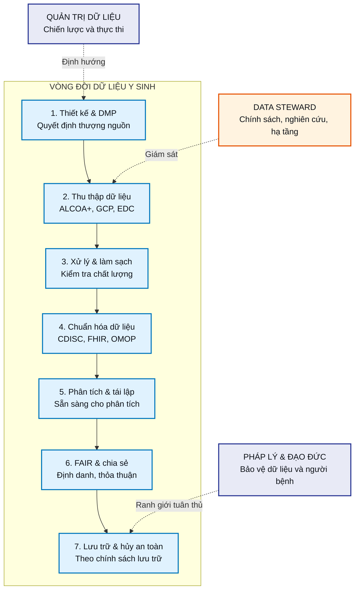
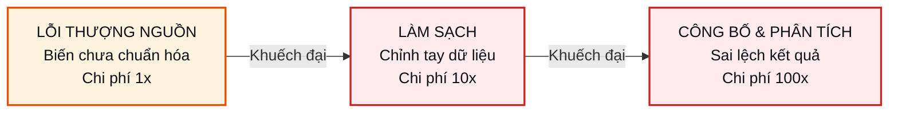

<!-- generated by scripts/sync_from_source.py from docs/chapters/ch01_overview_and_dmp.md; do not edit -->
# CHƯƠNG 1. TỔNG QUAN RDM, VÒNG ĐỜI DỮ LIỆU VÀ KẾ HOẠCH QUẢN LÝ DỮ LIỆU (DMP)

> **Khóa học:** Quản lý dữ liệu nghiên cứu y sinh (Biomedical Research Data Management - BioRDM)
> **Hình thức:** Khóa học mở miễn phí, tự học theo nhịp người đọc (Free, Self-paced)
> **Tác giả:** TS. Hoàng Quang Huy (Đại học Bách khoa Hà Nội, iBME Lab · ORCID: [0000-0002-4603-1297](https://orcid.org/0000-0002-4603-1297))
> **Thời gian học gợi ý:** Đọc lý thuyết & làm quiz: 30–40 phút; Thực hành Lab 1: 45 phút (tự chọn)
> **Tài liệu tham khảo nền tảng:** `references/references.bib` (xem danh mục được sinh từ các khóa trích dẫn sử dụng trong chương).

---

## 1. MỤC TIÊU HỌC TẬP & KHUNG NĂNG LỰC (LEARNING OBJECTIVES)

Sau khi hoàn thành chương này, người học đạt được các năng lực cụ thể sau:

1. **Hiểu & Phân tích (Bloom 2 & 4):**
   * Giải thích được bản chất của cuộc khủng hoảng khả năng tái lập trong nghiên cứu y sinh và cơ chế khuếch đại lỗi từ thượng nguồn (Upstream Error Amplification).
   * Phân biệt rạch ròi bản chất và vai trò của bộ ba tài liệu: **Protocol (Đề cương)**, **DMP (Kế hoạch quản lý dữ liệu)**, và **CRF (Biểu mẫu thu thập dữ liệu)**.
   * Trình bày được cấu trúc khung quản trị dữ liệu y tế (DAMA-DMBOK, HIMSS AMAM) và mô hình 3 hồ sơ Data Steward chuyên nghiệp (Policy, Research, Infrastructure).
2. **Áp dụng & Thiết kế (Bloom 3):**
   * Nhận diện 7 yếu tố của định dạng DMSP NIH hiện hành và biết khi nào cần đối chiếu yêu cầu riêng của NOFO.
   * Tự tay xây dựng được một DMSP theo mẫu NIH hiện hành trên nền tảng trực tuyến **DMPTool** cho một đề tài nghiên cứu y sinh cụ thể.

---

## 2. BẢN ĐỒ KHÁI NIỆM & KIẾN TRÚC TỔNG QUAN (CONCEPT MAP)

**Hình 1. Bản đồ vòng đời dữ liệu y sinh và lớp kiểm soát.** Sơ đồ mô tả bảy giai đoạn liên tiếp của dữ liệu, cùng các điểm quản trị, stewardship và tuân thủ tác động vào chuỗi.

---

## 3. CƠ SỞ LÝ THUYẾT & CHUẨN MỰC NGÀNH

### 3.1. Khủng hoảng khả năng tái lập và sự ra đời của RDM y sinh
Trong suốt hai thập kỷ qua, cộng đồng khoa học y sinh toàn cầu đối mặt với **cuộc khủng hoảng khả năng tái lập (Reproducibility Crisis)**. Một khảo sát thực hiện bởi Baker (2016) trên tạp chí *Nature* trên 1.576 nhà nghiên cứu cho thấy hơn **70% nhà khoa học thừa nhận từng thất bại khi cố gắng tái lập thí nghiệm của người khác**, và hơn 50% cảm nhận sâu sắc về cuộc khủng hoảng độ tin cậy trong các công bố khoa học [33](/course/book/references#ref-33).

Begley & Ellis (2012) báo cáo chỉ 6/53 công trình tiền lâm sàng ung thư được đánh giá có thể tái lập [105](/course/book/references#ref-105). Freedman và cộng sự (2015) ước tính chi phí nghiên cứu tiền lâm sàng không tái lập được ở Hoa Kỳ khoảng 28 tỷ USD mỗi năm [106](/course/book/references#ref-106). Đây là các ước tính/bằng chứng lịch sử, không phải chỉ tiêu hiện hành.

Nguyên nhân cốt lõi không chỉ nằm ở sai số sinh học hay thiết kế thực nghiệm, mà phần lớn xuất phát từ những thiếu sót trong quản trị dữ liệu:
- Dữ liệu thô bị thất lạc sau khi học viên tốt nghiệp hoặc sau khi bài báo xuất bản.
- Tập tin bảng tính bị lỗi định dạng tự động (ví dụ: tự động đổi tên gen `SEPT2` thành ngày tháng `2-Sep`).
- Không có từ điển dữ liệu (Data Dictionary); sau 2 năm chính tác giả cũng không thể nhớ các cột mã hóa `0`, `1`, `99` mang ý nghĩa gì.
- Thiếu nhật ký kiểm toán (Audit Trail) ghi lại quá trình tiền xử lý, lọc ngoại lai và lựa chọn mô hình thống kê.

**Quản lý dữ liệu nghiên cứu y sinh (Biomedical RDM)** đáp ứng nhu cầu của phương pháp luận khoa học hiện đại về dữ liệu toàn vẹn, có thể kiểm chứng độc lập và có khả năng tái sử dụng an toàn.

---

### 3.2. Vòng đời dữ liệu y sinh & Nguyên lý khuếch đại lỗi thượng nguồn
Dữ liệu y sinh không phải là một tập tin tĩnh được lưu trữ một lần, mà vận động qua **vòng đời 6 giai đoạn tương thuộc**:

1. **Thiết kế & Lập kế hoạch (Plan):** Xác định loại dữ liệu, khối lượng dự kiến, công cụ thu thập, chuẩn dữ liệu, ngân sách và soạn thảo Kế hoạch Quản lý Dữ liệu (DMP).
2. **Thu thập dữ liệu (Collect):** Triển khai biểu mẫu điện tử (eCRF), nhập liệu tuân thủ chuẩn ALCOA+ và GCP, kiểm soát quyền truy cập.
3. **Xử lý & Làm sạch (Process & Clean):** Kiểm tra tính hợp chuẩn, xử lý dữ liệu khuyết (missing data), phát hiện và hiệu chỉnh bất thường có vết kiểm toán.
4. **Chuẩn hóa & Tích hợp (Standardize):** Ánh xạ cấu trúc sang CDISC SDTM, HL7 FHIR hoặc OMOP CDM; mã hóa thuật ngữ bằng SNOMED CT, LOINC, RxNorm.
5. **Phân tích, FAIR & Chia sẻ (Analyze, FAIR & Share):** Thực hiện phân tích minh bạch, đóng gói siêu dữ liệu theo nguyên tắc FAIR [12](/course/book/references#ref-12), cấp định danh số vĩnh viễn và thiết lập điều khoản cấp phép phù hợp.
6. **Bảo mật, lưu trữ & Hủy an toàn (Secure, Preserve & Dispose):** Duy trì kho lưu trữ bảo mật và áp dụng thời hạn theo [Phụ lục thời hạn lưu trữ](/course/book/appendices/retention) (chốt 21/11/2026), hoặc tiêu hủy an toàn theo chuẩn phù hợp.

**Hình 2. Khuếch đại lỗi từ thượng nguồn.** Sơ đồ cho thấy một thiếu sót ở khâu lập kế hoạch có thể làm tăng gánh nặng làm sạch và ảnh hưởng đến độ tin cậy của kết quả cuối.

> **Nguyên lý:** *Hiệu ứng khuếch đại lỗi từ thượng nguồn (Upstream Error Amplification).* Sơ đồ trên minh họa logic chi phí: một thiếu sót ở giai đoạn lập kế hoạch có thể làm tăng gánh nặng ở khâu làm sạch và làm giảm giá trị tái sử dụng của tập dữ liệu.

---

### 3.3. Khung Quản trị Dữ liệu Y tế (Data Governance Frameworks)
Quản trị dữ liệu là hệ thống các quyền quyết định, trách nhiệm giải trình và chính sách điều phối nhằm đảm bảo dữ liệu y tế được bảo vệ và khai thác có trách nhiệm. ICH E6(R3) có các yêu cầu về quản trị dữ liệu trong thực hành lâm sàng tốt [4](/course/book/references#ref-4) [CẦN KIỂM CHỨNG: số mục/phụ lục].

Trong môi trường viện nghiên cứu và bệnh viện đại học, hai khung tham chiếu quốc tế được áp dụng rộng rãi:

#### 1. Mô hình bánh xe DAMA-DMBOK (2nd Edition) [14](/course/book/references#ref-14)
DAMA-DMBOK đặt **Quản trị dữ liệu (Data Governance)** ở vị trí trục tâm trung tâm, chỉ huy và điều phối 10 miền tri thức chức năng: Kiến trúc dữ liệu, Mô hình hóa & Thiết kế, Lưu trữ & Vận hành, An toàn dữ liệu, Tích hợp & Liên thông, Tài liệu & Nội dung, Dữ liệu chủ & Tham chiếu, Kho dữ liệu & Phân tích, Quản lý Siêu dữ liệu, và Chất lượng dữ liệu.

#### 2. Thước đo trưởng thành phân tích HIMSS AMAM [2](/course/book/references#ref-2)
HIMSS AMAM mô tả năng lực dữ liệu của tổ chức y tế theo 8 cấp độ, từ Cấp 0 đến Cấp 7 [2](/course/book/references#ref-2) [CẦN KIỂM CHỨNG: nguồn đang BIB_PENDING]. Theo phạm vi của review, năng lực nghiên cứu và AI chỉ được xem là hình thành từ Cấp 5 trở lên; các mô tả chi tiết theo từng nhóm cấp cần đối chiếu bản tiêu chí gốc.

#### 3. Cơ cấu quản trị 3 tầng tại Bệnh viện Đại học [15](/course/book/references#ref-15)
Theo khuyến nghị quản trị dữ liệu y tế hàn lâm của Hiệp hội các Trường Y khoa Hoa Kỳ (AAMC, 2015) [15](/course/book/references#ref-15), các tổ chức có thể tham khảo cơ cấu tổ chức 3 tầng:
1. **Tầng điều hành (Executive Data Council):** Ban Giám đốc viện/trường, phê duyệt chiến lược, ngân sách và chính sách dữ liệu tổng thể.
2. **Tầng chiến lược (Data Stewardship Steering Committee):** Lãnh đạo các khoa lâm sàng, phòng CNTT, Hội đồng Đạo đức; giải quyết xung đột chia sẻ dữ liệu và định hướng chuẩn hóa.
3. **Tầng chiến thuật:** Cán bộ chuyên trách phối hợp giám sát từ điển biến số, quy trình làm sạch và cấp phát quyền dữ liệu. Cấu trúc này là mô hình minh họa; phạm vi áp dụng cần được tổ chức xác định.

---

### 3.4. Chuyên nghiệp hóa nhân lực: Mô hình 3 hồ sơ Data Steward [17](/course/book/references#ref-17)
Một hạ tầng CNTT cần gắn với con người vận hành. Chương trình Khoa học Mở Quốc gia Hà Lan (NPOS) qua công trình của Jetten và cộng sự (2021) [17](/course/book/references#ref-17) mô tả 3 hồ sơ năng lực Data Steward trong nghiên cứu:

| Hồ sơ Data Steward | Vai trò trọng tâm | Năng lực cốt lõi | Bối cảnh làm việc |
| :--- | :--- | :--- | :--- |
| **Policy Data Steward** *(Chính sách & Tuân thủ)* | Xây dựng quy chế dữ liệu cơ sở; giám sát tuân thủ đạo đức nghiên cứu và pháp luật bảo vệ dữ liệu cá nhân (xem [Phụ lục pháp lý](/course/book/appendices/legal), chốt 21/11/2026). | Am hiểu luật y tế, quy trình IRB, quy định sở hữu trí tuệ và thỏa thuận chuyển giao dữ liệu (DUA/DTA). | Văn phòng Quản lý Nghiên cứu Khoa học, Hội đồng Đạo đức. |
| **Research/Domain Data Steward** *(Chuyên môn Y sinh)* | Đồng hành cùng nhóm nghiên cứu; trực tiếp tư vấn thiết kế DMP, từ điển biến số, lựa chọn eCRF và chuẩn hóa thuật ngữ lâm sàng. | Trình độ sau đại học y sinh; hiểu sâu về logic bệnh học, phương pháp dịch tễ và thống kê sinh học. | Nhúng trực tiếp trong các Bộ môn, Khoa lâm sàng hoặc Viện nghiên cứu. |
| **Infrastructure Data Steward** *(Hạ tầng & Kỹ thuật)* | Thiết lập và bảo trì môi trường kỹ thuật: hệ thống REDCap, cổng API FHIR, đường ống ETL OMOP, môi trường nghiên cứu tin cậy (TRE). | Kỹ sư CNTT/Khoa học dữ liệu; thành thạo SQL, Python/R, Docker, bảo mật mạng và hạ tầng máy chủ y tế. | Trung tâm CNTT, Phòng Tin học Y tế. |

---

### 3.5. Kế hoạch Quản lý và Chia sẻ Dữ liệu (DMP / DMSP)

#### 1. Phân biệt Protocol vs DMP vs CRF
Ba khái niệm này thường xuyên bị người làm nghiên cứu nhầm lẫn:

| Thuộc tính | Protocol (Đề cương nghiên cứu) | DMP (Kế hoạch quản lý dữ liệu) | CRF / eCRF (Biểu mẫu thu thập) |
| :--- | :--- | :--- | :--- |
| **Bản chất** | Hợp đồng khoa học và lâm sàng | Hợp đồng dữ liệu và bảo mật | Công cụ thu thập dữ liệu cụ thể |
| **Câu hỏi trả lời** | *Nghiên cứu làm gì, vì sao, trên ai, can thiệp thế nào?* | *Dữ liệu là gì, lưu ở đâu, chuẩn nào, chia sẻ ra sao, lưu bao lâu?* | *Mỗi bệnh nhân có giá trị biến số nào tại thời điểm nào?* |
| **Người đọc chính** | Hội đồng Khoa học, Hội đồng Đạo đức, Bác sĩ nghiên cứu | Tổ quản trị dữ liệu, Nhà tài trợ, Kỹ sư hệ thống | Nghiên cứu viên, Điều phối viên (CRC), Giám sát viên (CRA) |

#### 2. Yêu cầu của các Nhà tài trợ quốc tế lớn
* **Chính sách NIH DMSP [7](/course/book/references#ref-7), [8](/course/book/references#ref-8):**
  - Từ ngày 25/01/2023, mọi hồ sơ xin tài trợ từ NIH tạo ra dữ liệu khoa học đều bắt buộc phải nộp bản DMSP $\le 2$ trang.
  - Thông tri **NOT-OD-26-046** năm 2026 được ghi nhận là bản cập nhật cần đối chiếu; trạng thái áp dụng và các yếu tố thay đổi vẫn `CONTENT_PENDING` [5](/course/book/references#ref-5) [CẦN KIỂM CHỨNG] (xem [Phụ lục funder-templates](/course/book/appendices/funder-templates), chốt 21/11/2026).
* **Chính sách Horizon Europe (Ủy ban châu Âu) [3](/course/book/references#ref-3) [CẦN KIỂM CHỨNG: nguồn/bibliographic mismatch]:**
  - Áp dụng nguyên tắc vàng: *"Càng mở càng tốt, chỉ đóng khi cần thiết"* (As open as possible, as closed as necessary).
  - Bản DMP sơ bộ nộp cùng hồ sơ; bản DMP chi tiết phải nộp chậm nhất vào tháng thứ 6 của dự án. Dữ liệu công bố phải đi kèm giấy phép mở (CC BY hoặc CC0).

#### 3. Sáu thành tố bắt buộc của NIH DMSP ($\le 2$ trang)
Theo thông tri NOT-OD-21-014 [8](/course/book/references#ref-8), một bản DMSP chuẩn mực phải giải trình đầy đủ 6 phần (xem đối chiếu với bản cập nhật đang `CONTENT_PENDING` tại [Phụ lục funder-templates](/course/book/appendices/funder-templates), chốt 21/11/2026):
1. **Loại dữ liệu (Data Type):** Tóm tắt dữ liệu sẽ được tạo ra (số lượng, định dạng text, hình ảnh, tín hiệu, dữ liệu omics); phân biệt dữ liệu thô và dữ liệu phân tích.
2. **Công cụ, Phần mềm và Mã nguồn liên quan (Related Tools, Software, Code):** Nêu rõ phần mềm chuyên dụng cần thiết để mở, xử lý hoặc tái lập dữ liệu (ví dụ: Python, R script, REDCap, Docker container).
3. **Tiêu chuẩn dữ liệu (Standards):** Các chuẩn cấu trúc và từ vựng sẽ áp dụng (ví dụ: CDISC SDTM, HL7 FHIR, SNOMED CT, LOINC).
4. **Bảo tồn dữ liệu, Kho lưu trữ và Thời hạn chia sẻ (Data Preservation, Repositories, Timelines):** Tên kho lưu trữ dữ liệu được chỉ định (kho truy cập mở như Zenodo, PhysioNet; hoặc kho truy cập có kiểm soát như dbGaP); cam kết thời điểm mở dữ liệu.
5. **Hạn chế tiếp cận, Ràng buộc đạo đức và Bảo vệ quyền riêng tư (Access, Distribution, or Reuse Considerations):** Biện pháp khử định danh; thỏa thuận chấp thuận của bệnh nhân (Informed Consent); kiểm soát rủi ro tái định danh phù hợp pháp luật bảo vệ dữ liệu cá nhân hiện hành (xem [Phụ lục legal](/course/book/appendices/legal)).
6. **Giám sát và Thực thi Kế hoạch (Oversight of Data Management and Sharing):** Nêu đích danh người chịu trách nhiệm giám sát định kỳ (Data Steward, Principal Investigator).

#### 4. Kế hoạch Quản lý Dữ liệu Máy đọc được (Machine-actionable DMPs - maDMPs)
DMP truyền thống là tài liệu văn bản tĩnh (Word/PDF). Xu hướng hiện đại chuyển đổi sang **maDMP**: dữ liệu hóa bản DMP dưới định dạng JSON có cấu trúc (theo khuyến nghị của Research Data Alliance - RDA). Điều này cho phép hệ thống tự động:
- Thông báo cho bộ phận CNTT cấp trước dung lượng lưu trữ an toàn khi nghiên cứu bắt đầu.
- Tự động đồng bộ thông tin đề tài sang hệ thống kho lưu trữ (Zenodo API) mà không cần nhập liệu lại thủ công.

---

## 4. NGHIÊN CỨU TÌNH HUỐNG THỰC TẾ & BÀI HỌC (CASE STUDIES)

### Case Study minh họa: Sự việc rút bài liên quan đến cơ sở dữ liệu Surgisphere (2020)
> Đây là tình huống minh họa cần đối chiếu với nguồn gốc; chương không sử dụng dữ liệu thật.
* **Bối cảnh:** Trong giai đoạn đầu đại dịch COVID-19 năm 2020, hai bài báo quan trọng được xuất bản trên hai tạp chí y khoa hàng đầu:
  1. Bài báo trên *The Lancet* phân tích dữ liệu trên khoảng 96.000 bệnh nhân từ hàng trăm bệnh viện về hiệu quả của thuốc Hydroxychloroquine.
  2. Bài báo trên *The New England Journal of Medicine (NEJM)* phân tích dữ liệu trên khoảng 8.900 bệnh nhân về tác dụng của nhóm thuốc tim mạch (ức chế men chuyển ACEi và chẹn thụ thể angiotensin ARB).
* **Khủng hoảng:** Các công trình sử dụng dữ liệu do Surgisphere cung cấp; các tác giả cho biết họ không thể xác nhận nguồn dữ liệu khi dữ liệu thô và tài liệu cần thiết không được cung cấp cho kiểm toán độc lập [107](/course/book/references#ref-107) [108](/course/book/references#ref-108).
* **Hậu quả được nêu trong tình huống:** Bài trên *The Lancet* và bài trên *NEJM* đều có thông báo rút bài năm 2020 [107](/course/book/references#ref-107) [108](/course/book/references#ref-108). Các con số quy mô mẫu của bài gốc không được dùng ở đây vì chưa được đối chiếu trực tiếp trong đợt này.
* **Bài học RDM cốt lõi:** Một công trình nghiên cứu cần cơ chế truy vết nguồn gốc dữ liệu, Kế hoạch Quản lý Dữ liệu minh bạch và khả năng kiểm chứng độc lập.

---

## 5. ĐIỂM CẦN NHỚ (KEY TAKEAWAYS)

1. **Protocol trả lời câu hỏi nghiên cứu; DMP trả lời câu hỏi quản trị dữ liệu; CRF là công cụ thu thập cụ thể.**
2. **Quyết định ở thượng nguồn càng sớm thì chi phí khắc phục ở hạ nguồn càng thấp.** Thiếu chuẩn hóa biến số và thiếu thỏa thuận chia sẻ dữ liệu ngay từ DMP sẽ làm vô hiệu hóa khả năng tái sử dụng dữ liệu sau này.
3. **Quản trị dữ liệu y sinh cần sự phối hợp của 3 hồ sơ Data Steward:** Chính sách (Policy), Chuyên môn y sinh (Research), và Hạ tầng kỹ thuật (Infrastructure).
4. **DMP là văn bản sống:** DMP cần được rà soát định kỳ và cập nhật mỗi khi có thay đổi trong đề cương nghiên cứu.

---

## Quiz tự kiểm tra — Bài 1 (5 câu hỏi)

*(Hãy tự chọn đáp án trước khi mở xem phần giải thích bên dưới)*

### **Câu 1.1. Bản Kế hoạch Quản lý Dữ liệu (DMP) khác Đề cương nghiên cứu (Protocol) ở điểm cốt lõi nào?**
- A. DMP quản trị dữ liệu; Protocol mô tả câu hỏi và thiết kế nghiên cứu.
- B. DMP thường dài hơn Protocol vì bao quát thêm các quyết định quản trị dữ liệu.
- C. DMP có thể cần thiết trong nhiều nghiên cứu, không riêng nghiên cứu có ứng dụng Trí tuệ Nhân tạo.
- D. Protocol và DMP là hai tên gọi của cùng một tài liệu hành chính.

> **Đáp án đúng: A.**
> *Giải thích:* Protocol là bản hợp đồng khoa học và lâm sàng giải quyết câu hỏi nghiên cứu; DMP là bản hợp đồng dữ liệu giải quyết bài toán quản trị, an toàn và chia sẻ thông tin.

---

### **Câu 1.2. Khi lập DMSP, nhóm nghiên cứu nên làm gì?**
- A. Mô tả nơi lưu tệp cuối cùng nhưng bỏ qua các quyết định quản trị khác.
- B. Nêu dữ liệu, công cụ, chuẩn, chia sẻ, riêng tư và trách nhiệm quản trị.
- C. Nộp tên kho lưu trữ nhưng bỏ qua giới hạn chia sẻ hoặc quyền truy cập.
- D. Lập DMSP sau khi đề tài kết thúc, khi dữ liệu đã sẵn sàng để lưu trữ.

> **Đáp án đúng: B.**
> *Giải thích:* DMSP cần bao quát các quyết định quản trị dữ liệu và đối chiếu yêu cầu của nhà tài trợ. Xem §3.5.

---

### **Câu 1.3. Vì sao siêu dữ liệu (Metadata) lại có vai trò sống còn trong quản lý dữ liệu nghiên cứu y sinh?**
- A. Để làm tăng kích thước tệp dữ liệu lưu trữ mà không đổi nội dung.
- B. Để thay thế cho Từ điển dữ liệu trong một số nghiên cứu.
- C. Để dữ liệu còn hiểu được về cách thu thập, thiết bị và phiên bản sau nhiều năm.
- D. Siêu dữ liệu chủ yếu cần cho dữ liệu công khai trên mạng, không cần cho dữ liệu hạn chế.

> **Đáp án đúng: C.**
> *Giải thích:* Không có metadata, dữ liệu y sinh sẽ mất ngữ cảnh khoa học; sau 2–3 năm tệp dữ liệu sẽ trở thành "dữ liệu chết" không ai có thể giải mã hay tái sử dụng an toàn.

---

### **Câu 1.4. Tình huống: Trong một nghiên cứu đo huyết áp đa trung tâm, Trung tâm A nhập giá trị dạng "120/80", Trung tâm B nhập "120", Trung tâm C ghi bằng chữ "Huyết áp cao". Thiếu sót này bắt nguồn từ giai đoạn nào của vòng đời dữ liệu?**
- A. Giai đoạn Phân tích thống kê, khi nhóm bắt đầu chạy các mô hình cuối cùng.
- B. Giai đoạn Lưu trữ dài hạn, khi dữ liệu được chuyển vào kho lưu trữ.
- C. Đây là linh hoạt bình thường trong thu thập dữ liệu lâm sàng đa trung tâm.
- D. Giai đoạn Thiết kế & Lập kế hoạch, do thiếu từ điển và quy chuẩn đo lường.

> **Đáp án đúng: D.**
> *Giải thích:* Lỗi định nghĩa và chuẩn hóa biến số phải được chặn từ khâu thiết kế DMP và Từ điển dữ liệu. Nếu để xảy ra ở khâu thu thập, việc xử lý ở khâu phân tích sẽ vô cùng tốn kém và dễ gây sai lệch.

---

### **Câu 1.5. Mục tiêu của một DMP máy đọc được (maDMP) là gì?**
- A. Biểu diễn kế hoạch bằng cấu trúc phần mềm có thể xử lý và liên kết với dự án.
- B. Thay CRF bằng một tệp văn bản không cấu trúc, không cần trường dữ liệu.
- C. Giảm bớt yêu cầu về bảo mật, quyền truy cập và chia sẻ dữ liệu.
- D. Lưu tên tệp nhưng không mô tả dữ liệu hoặc trách nhiệm quản trị.
> **Đáp án đúng: A.**
> *Giải thích:* maDMP giúp thông tin quản trị dữ liệu có cấu trúc và có thể được hệ thống sử dụng lại. Xem §3.5.

---

## 7. HƯỚNG DẪN THỰC HÀNH PHÒNG MÁY (HANDS-ON LAB 1 GUIDE)

### Bài thực hành tự chọn: Soạn thảo DMSP chuẩn NIH trên DMPTool

* **Mục tiêu:** Đọc hướng dẫn trong [Phụ lục funder-templates](/course/book/appendices/funder-templates), sau đó sử dụng **DMPTool** để soạn thảo DMSP theo mẫu NIH hiện hành cho một nghiên cứu giả định. Chốt nội dung phụ lục: 21/11/2026.
* **Đề bài tình huống minh họa:** Bạn là Research Data Steward cho một đề tài giả định về ứng dụng trí tuệ nhân tạo trong theo dõi bệnh mày đay mạn tính tại Việt Nam; không sử dụng dữ liệu thật.

#### Các bước thực hiện:
1. **Bước 1:** Truy cập `https://dmptool.org` sau khi đọc [Phụ lục funder-templates](/course/book/appendices/funder-templates), tạo tài khoản (sử dụng email cá nhân hoặc tài khoản ORCID).
2. **Bước 2:** Chọn nhà tài trợ và mẫu NIH hiện hành theo [Phụ lục funder-templates](/course/book/appendices/funder-templates); kiểm tra lại tên mẫu trên production trước khi dạy.
3. **Bước 3:** Trả lời 7 yếu tố: chia sẻ tối đa phù hợp; thời điểm chia sẻ; thời gian duy trì; giới hạn chia sẻ (có giới hạn từ; xem phụ lục); riêng tư theo NOT-OD-22-213; bảng loại dữ liệu/kho (tối đa 100 từ); và 7a/7b về GDS, genomics và Institutional Certification nếu áp dụng.
4. **Bước 4:** Với tình huống này, mô tả dữ liệu (.csv, .jpeg), công cụ, chuẩn, kho, quyền riêng tư và giám sát trong đúng trường hỏi; không sử dụng dữ liệu thật và không mặc định chọn kho nếu chưa đối chiếu yêu cầu loại dữ liệu.
5. **Bước 5:** Xuất tài liệu theo định dạng DMPTool cung cấp và lưu bản kiểm tra.

#### Bảng Tiêu chí Tự đối chiếu Bài Lab 1 (Self-Assessment Checklist /20 điểm):
- [ ] **Đủ 7 yếu tố NIH:** Trả lời đúng các câu hỏi hiện hành; bảng phần 6 không vượt 100 từ và phần giới hạn chia sẻ nằm trong giới hạn từ của mẫu (xem phụ lục) *(6 điểm)*.
- [ ] **Lựa chọn kho lưu trữ (Repository):** Kho lưu trữ được chỉ định có uy tín, cấp PID/DOI cố định *(4 điểm)*.
- [ ] **Phương án bảo vệ quyền riêng tư & Căn cứ pháp lý:** Phân định rõ Safe Harbor vs Date Shifting, dẫn chiếu văn bản pháp luật hiện hành *(6 điểm)*.

---

## 8. CÂU HỎI THẢO LUẬN TÌNH HUỐNG

1. **Câu hỏi thảo luận 1:** Một bác sĩ lâm sàng cho rằng: *"Tôi chỉ cần tập trung khám chữa bệnh và lấy mẫu cho bệnh nhân, còn việc dữ liệu lưu ở đâu và quản lý thế nào là việc của phòng CNTT"*. Bạn dùng những luận điểm nào của Chương 1 để giải thích giúp đồng nghiệp hiểu vai trò của nghiên cứu viên trong RDM?
2. **Bài tập tình huống 2:** Nhóm nghiên cứu của bạn nộp bài báo cho tạp chí quốc tế. Ban biên tập yêu cầu: *"Tác giả phải công khai dữ liệu của bệnh nhân lên kho lưu trữ mở để bạn đọc tái lập phân tích"*. Tuy nhiên, trong thỏa thuận đồng thuận (Informed Consent) ký với bệnh nhân cách đây 2 năm, nhóm bạn quên không ghi điều khoản cho phép chia sẻ dữ liệu thứ cấp. Nhóm bạn đang đối mặt với nguy cơ gì và cách giải quyết phù hợp với đạo đức nghiên cứu?

---

## 9. DANH MỤC TÀI LIỆU THAM KHẢO

1. **Healthcare Information and Management Systems Society. (n.d.).** *Adoption Model for Analytics Maturity*. [2](/course/book/references#ref-2) [CẦN KIỂM CHỨNG]
2. **European Commission. (n.d.).** *Horizon Europe data management plan*. [3](/course/book/references#ref-3) [CẦN KIỂM CHỨNG: nguồn/bibliographic mismatch]
3. **International Council for Harmonisation. (2025).** *ICH E6(R3) Guideline for Good Clinical Practice*. [4](/course/book/references#ref-4)
4. **National Institutes of Health. (2026).** *Updated elements of an NIH Data Management and Sharing Plan*. [5](/course/book/references#ref-5) [CẦN KIỂM CHỨNG]
5. **National Institutes of Health. (2020).** *Final NIH Policy for Data Management and Sharing*. [7](/course/book/references#ref-7)
6. **National Institutes of Health. (2020).** *Supplemental information to the NIH Policy for Data Management and Sharing: Elements of an NIH Data Management and Sharing Plan*. [8](/course/book/references#ref-8)
7. **Wilkinson, M. D., Dumontier, M., Aalbersberg, I. J., Appleton, G., Axton, M., Baak, A., Blomberg, N., Boiten, J.-W., da Silva Santos, L. B., Bourne, P. E., Bouwman, J., Brookes, A. J., Clark, T., Crosas, M., Dillo, I., Dumon, O., Edmunds, S., Evelo, C. T., Finkers, R., � Mons, B. (2016).** *The FAIR Guiding Principles for scientific data management and stewardship*. [12](/course/book/references#ref-12)
8. **DAMA International. (2017).** *DAMA-DMBOK: Data Management Body of Knowledge*. [14](/course/book/references#ref-14)
9. **Association of American Medical Colleges. (2015).** *Data governance in academic medicine*. [15](/course/book/references#ref-15)
10. **Jetten, M., Grootveld, M., Mordant, A., Jansen, M., Bloemers, M., Miedema, M., \& van Gelder, C. W. G. (2021).** *Professionalising data stewardship in the Netherlands: Competences, training and education. Dutch roadmap towards national implementation of FAIR data stewardship*. [17](/course/book/references#ref-17)
11. **Baker, M. (2016).** *1,500 scientists lift the lid on reproducibility*. [33](/course/book/references#ref-33)
12. **Begley, C. G., \& Ellis, L. M. (2012).** *Drug development: Raise standards for preclinical cancer research*. [105](/course/book/references#ref-105)
13. **Freedman, L. P., Cockburn, I. M., \& Simcoe, T. S. (2015).** *The economics of reproducibility in preclinical research*. [106](/course/book/references#ref-106)
14. **Mehra, M. R., Ruschitzka, F., \& Patel, A. N. (2020).** *Retraction—Hydroxychloroquine or chloroquine with or without a macrolide for treatment of COVID-19*. [107](/course/book/references#ref-107)
15. **Mehra, M. R., Desai, S. S., Kuy, S., Henry, T. D., \& Patel, A. N. (2020).** *Retraction: Cardiovascular disease, drug therapy, and mortality in Covid-19*. [108](/course/book/references#ref-108)
