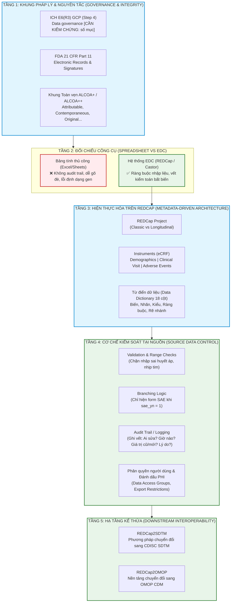

<!-- generated by scripts/sync_from_source.py from docs/chapters/ch02_collection_and_redcap.md; do not edit -->
# CHƯƠNG 2. THU THẬP DỮ LIỆU LÂM SÀNG, NGUYÊN TẮC ALCOA+, GCP VÀ HỆ THỐNG THU THẬP DỮ LIỆU ĐIỆN TỬ (EDC / REDCap)

> **Thời lượng ước lượng:** đọc ≈ 35–45 phút; lab tùy chọn ≈ 45–60 phút (tùy tốc độ đọc và thao tác).
> **Bộ tài liệu:** *Giáo trình Quản lý Dữ liệu Nghiên cứu Y sinh học (Biomedical Research Data Management)*  
> **Lab:** tự chọn; rubric /20 chỉ để tự đối chiếu, không yêu cầu nộp bài.

---

## 1. MỤC TIÊU HỌC TẬP VÀ KHUNG NĂNG LỰC (LEARNING OBJECTIVES)

Sau khi hoàn thành Chương 2, người học có khả năng đạt được các chuẩn đầu ra (CLOs) sau:

1. **Hiểu và Giải thích (Bloom Mức 2 - CLO1):**
   - Phân tích 9 thuộc tính của khung toàn vẹn dữ liệu **ALCOA+** (*Attributable, Legible, Contemporaneous, Original, Accurate + Complete, Consistent, Enduring, Available*) và thuộc tính truy vết (*Traceable*) của **ALCOA++** (10 thuộc tính).
   - Giải thích vai trò của Thực hành lâm sàng tốt (**ICH E6(R3) GCP**) và quy định **FDA 21 CFR Part 11** trong việc ràng buộc pháp lý đối với hệ thống máy tính, chữ ký điện tử và vết kiểm toán (*audit trail*).
   - Chỉ ra được những rủi ro chí mạng của "văn hóa bảng tính" (*spreadsheet-driven research*) so với hệ thống thu thập dữ liệu lâm sàng điện tử chuyên dụng (**EDC - Electronic Data Capture**).

2. **Áp dụng và Thực hành (Bloom Mức 3 - CLO2):**
   - Vận hành thành thạo hệ thống REDCap (*Research Electronic Data Capture*) để khởi tạo dự án thu thập dữ liệu y sinh học đạt chuẩn bảo mật và quản trị.
   - Thiết kế biểu mẫu thu thập dữ liệu điện tử (**eCRF - electronic Case Report Form**) với đầy đủ các ràng buộc kiểm tra hợp lệ (*data validation, range checks*), logic rẽ nhánh (*branching logic*), và các trường tính toán tự động (*calculated fields*).
   - Xuất khẩu, biên tập và tái nhập **Từ điển dữ liệu (Data Dictionary .csv)** 18 cột theo chuẩn quốc tế của REDCap.

3. **Phân tích và Kiểm soát (Bloom Mức 4 - CLO2/CLO3):**
   - Cấu hình phân quyền người dùng (*User Rights / Role-Based Access Control - RBAC*), đánh dấu biến định danh cá nhân y tế (*PHI - Protected Health Information*) để bảo đảm an toàn dữ liệu trước khi trích xuất.
   - Khai thác nhật ký vết kiểm toán (*Audit Trail / Logging*) để phát hiện các hành vi sửa đổi dữ liệu bất thường, phục vụ thanh tra/kiểm toán nghiên cứu lâm sàng.

---

## 2. BẢN ĐỒ KHÁI NIỆM (CONCEPT MAP)

Sơ đồ dưới đây minh họa mối quan hệ giữa các quy định pháp lý, nguyên tắc toàn vẹn dữ liệu và quy trình hiện thực hóa kỹ thuật trên nền tảng EDC / REDCap:



---

## 3. CƠ SỞ LÝ THUYẾT VÀ CHUẨN MỰC NGÀNH

### 3.1. Khủng hoảng toàn vẹn dữ liệu tại nguồn và Sự sụp đổ của "Văn hóa Bảng tính"

Trong nghiên cứu y sinh học và dịch tễ học, việc sử dụng các phần mềm bảng tính phổ thông (như Microsoft Excel hoặc Google Sheets) để thu thập dữ liệu lâm sàng ban đầu đã trở thành một "thói quen tai hại" kéo dài nhiều thập kỷ. Mặc dù bảng tính có ưu điểm giao diện trực quan và dễ tiếp cận, việc sử dụng chúng làm công cụ thu thập dữ liệu chính thức (*primary data capture*) tiềm ẩn những nguy cơ phá hủy hoàn toàn giá trị khoa học của nghiên cứu:

1. **Lỗi tự động chuyển đổi định dạng (Silent Data Corruption):** Bảng tính tự động suy đoán kiểu dữ liệu và tự ý chuyển đổi dữ liệu chuỗi thành ngày tháng hoặc số thực. Điển hình trong nghiên cứu bộ gen, các ký hiệu gen chuẩn như *SEPT2* (Septin 2) hay *MARCH1* (Membrane Associated Ring-CH-Type Finger 1) bị Excel tự động biến đổi thành `02-Sep` và `01-Mar`. Ziemann và cộng sự (2016) sàng lọc tệp Excel bổ sung của 18 tạp chí giai đoạn 2005–2015 và phát hiện 19,6% số bài có danh sách gen Excel (704 bài) chứa lỗi tên gen [104](/course/book/references#ref-104).
2. **Không có vết kiểm toán bất biến (Lack of Immutable Audit Trail):** Bảng tính cho phép bất kỳ ai mở tệp sửa đổi giá trị tế bào (cell), xóa dòng, sao chép đè mà không để lại bất kỳ bản ghi tự động nào về việc *ai đã sửa, sửa vào thời điểm nào, giá trị gốc trước khi sửa là gì, và lý do sửa đổi là gì*.
3. **Thiếu cơ chế kiểm soát chất lượng tại thời điểm nhập (No Real-Time Validation):** Nghiên cứu viên có thể vô tình gõ `1200` thay vì `120` cho huyết áp tâm thu, hoặc nhập ngày khám bệnh trước ngày sinh mà phần mềm hoàn toàn không cảnh báo hay ngăn chặn.
4. **Hỗn loạn kiểm soát phiên bản (Version Control Nightmare):** Tình trạng phổ biến khi nhiều cộng sự cùng lưu các tệp `Data_Final.xlsx`, `Data_Final_v2.xlsx`, `Data_Final_v2_HuyFix.xlsx` dẫn đến mất tính nhất quán (*version drift*), mất dữ liệu do ghi đè tệp, và vi phạm nghiêm trọng nguyên tắc truy vết khoa học.

Vì các rủi ro trên, việc dùng bảng tính rời rạc làm nguồn dữ liệu chính cần được đánh giá, kiểm soát và biện minh theo bối cảnh nghiên cứu; không thể suy ra một kết quả phê duyệt chung cho mọi hồ sơ.

---

### 3.2. Khung toàn vẹn dữ liệu: ALCOA, ALCOA+ và ALCOA++

ALCOA là một từ ghi nhớ (*mnemonic*) cho các thuộc tính của dữ liệu đáng tin cậy. Các cơ quan quản lý đã nêu khung mở rộng ALCOA+ trong hướng dẫn về dữ liệu điện tử và toàn vẹn dữ liệu, gồm tài liệu của EMA (2010) [109](/course/book/references#ref-109), MHRA (2018) [110](/course/book/references#ref-110) và hướng dẫn EMA về hệ thống máy tính và dữ liệu điện tử trong thử nghiệm lâm sàng (2023) [111](/course/book/references#ref-111). Việc ALCOA do một viên chức FDA (Stan Woollen) đặt ra là thông tin thường được dẫn nhưng chưa được đối chiếu với nguồn gốc trực tiếp [CẦN KIỂM CHỨNG: nguồn gốc ALCOA]. ALCOA+ gồm 9 thuộc tính; ALCOA++ thêm **Traceable** thành 10 thuộc tính.

| Ký tự | Nguyên tắc | Định nghĩa chuẩn mực lâm sàng | Hiện thực hóa kỹ thuật trên hệ thống EDC |
| :--- | :--- | :--- | :--- |
| **A** | **Attributable** *(Quy được trách nhiệm)* | Mọi bản ghi dữ liệu, chỉnh sửa, hoặc ghi chú phải xác định chính xác danh tính của người thực hiện và thiết bị/hệ thống tạo ra. | Xác thực người dùng bằng tài khoản định danh duy nhất (không dùng chung `admin`), chữ ký điện tử PKI, ghi nhận địa chỉ IP và phiên làm việc. |
| **L** | **Legible** *(Đọc được & Rõ ràng)* | Dữ liệu phải dễ đọc, rõ ràng, duy trì khả năng diễn giải trong suốt vòng đời lưu trữ, bao gồm cả các ghi chú sửa đổi. | Giao diện chuẩn hóa, hiển thị mã từ điển đi kèm nhãn mô tả tường minh (*coded values + display labels*), ngăn chặn chữ viết tay mờ/rách. |
| **C** | **Contemporaneous** *(Ghi nhận kịp thời)* | Dữ liệu phải được ghi lại ngay tại thời điểm quan sát hoặc đo đạc trên bệnh nhân; không ghi nhớ rồi ghi lại sau. | Dấu thời gian do máy chủ tạo ra tự động (*server-generated timestamp*), ghi nhận chính xác giây/phút dữ liệu được đẩy lên cơ sở dữ liệu. |
| **O** | **Original** *(Bản gốc)* | Dữ liệu phải là bản ghi đầu tiên (*primary source data*) hoặc bản sao có chứng thực (*certified true copy*). | Lưu trữ bản ghi gốc; khi có chỉnh sửa, bản ghi gốc không bị xóa đè mà được lưu vào bảng lịch sử phiên bản (*historical log table*). |
| **A** | **Accurate** *(Chính xác)* | Dữ liệu phản ánh trung thực thực tế lâm sàng, không có lỗi tính toán, không sai lệch do nhập liệu thủ công. | Ràng buộc kiểu dữ liệu (*data type constraints*), kiểm tra khoảng hợp lý (*range checks*), tính toán tự động qua công thức (*calculated fields*). |
| **+ C** | **Complete** *(Đầy đủ)* | Toàn bộ dữ liệu được thu thập, bao gồm tất cả các lần khám, các xét nghiệm, và cả các dữ liệu đã bị sửa/hủy kèm lý do. | Trường bắt buộc (*Required fields*), quản lý form chưa hoàn tất (*Incomplete status*), cảnh báo truy vấn dữ liệu khuyết (*Missing data queries*). |
| **+ C** | **Consistent** *(Nhất quán)* | Dữ liệu không mâu thuẫn về logic thời gian và logic chuyên môn giữa các phân hệ hoặc các lần khám khác nhau. | Logic rẽ nhánh (*Branching logic*), kiểm tra logic liên trường (ví dụ: ngày sinh phải trước ngày chẩn đoán, nam giới không có biến cố thai sản). |
| **+ E** | **Enduring** *(Bền vững)* | Dữ liệu được lưu trữ trên môi trường an toàn, có khả năng tồn tại và phục hồi nguyên vẹn trong hàng thập kỷ theo luật định. | Cơ sở dữ liệu chuẩn hóa (MySQL/PostgreSQL), sao lưu tự động định kỳ (*daily snapshots*), lưu trữ dự phòng địa lý (*geo-redundant backup*). |
| **+ A** | **Available** *(Sẵn sàng truy xuất)* | Dữ liệu và hồ sơ kiểm toán phải sẵn sàng để thanh tra, kiểm tra hoặc truy vấn bởi các bên có thẩm quyền trong thời hạn quy định. | Công cụ trích xuất dữ liệu nhanh (*Data Export Tool*), hỗ trợ các định dạng mở và phân tích thống kê (CSV, SPSS, SAS, R, CDISC ODM). |
| **++ T** | **Traceable** *(Truy vết được)* | Khả năng tái dựng toàn bộ lịch sử dữ liệu từ điểm thu thập đầu tiên cho đến bảng tổng kết báo cáo cuối cùng. | Vết kiểm toán toàn diện (*Comprehensive Audit Trail / Logging*) ghi nhận chi tiết: *Timestamp - User ID - Action - Field - Old Value - New Value - Change Reason*. |

---

### 3.3. Các Chuẩn mực Quốc tế Điều chỉnh Hoạt động Thu thập Dữ liệu

#### 3.3.1. Hướng dẫn ICH E6(R3) về Thực hành Lâm sàng Tốt (GCP)
ICH E6(R3) là hướng dẫn Thực hành Lâm sàng Tốt quốc tế [4](/course/book/references#ref-4). Bản Step 4 ngày 06/01/2025 trình bày các nguyên tắc về chất lượng theo thiết kế, quản lý chất lượng dựa trên rủi ro và quản trị dữ liệu; số mục chi tiết cần đối chiếu tài liệu gốc [CẦN KIỂM CHỨNG: số mục].
- **Nguyên tắc "Chất lượng thiết kế ngay từ đầu" (Quality by Design - QbD):** Dữ liệu phải được bảo đảm chất lượng thông qua việc thiết kế biểu mẫu thu thập đơn giản, rõ ràng, tránh thu thập dữ liệu dư thừa không phục vụ mục tiêu khoa học của đề cương (*protocol*).
- **Quản lý chất lượng dựa trên rủi ro (Risk-Based Quality Management - RBQM):** Đối soát dữ liệu nguồn (**Source Data Verification - SDV**) cần được cân nhắc theo rủi ro và mục tiêu chất lượng; tóm tắt của Sheetz và cộng sự cho thấy SDV tổng quát có giá trị hạn chế [29](/course/book/references#ref-29).
- **Trách nhiệm giải trình đối với hệ thống máy tính:** Nhà tài trợ (*Sponsor*) và Nghiên cứu viên chính (*PI*) chịu trách nhiệm pháp lý cao nhất về tính toàn vẹn của dữ liệu thu thập qua các hệ thống điện tử, đòi hỏi hệ thống phải được thẩm định (*validated*) đầy đủ trước khi đưa vào vận hành thực tế.

#### 3.3.2. Quy định FDA Hoa Kỳ: 21 CFR Part 11
**Title 21 CFR Part 11** là quy định của FDA Hoa Kỳ về hồ sơ điện tử và chữ ký điện tử; đây không phải là một “tiêu chuẩn toàn cầu”. eCFR nêu phạm vi và các kiểm soát áp dụng cho hồ sơ điện tử, gồm thẩm định hệ thống, kiểm soát truy cập, bản sao phục vụ thanh tra và audit trail tạo bởi máy tính [112](/course/book/references#ref-112). Nguồn `ref_024` hiện là tài liệu Q&A của FDA năm 2024, không phải toàn văn Part 11; xem [Phụ lục pháp lý](/course/book/appendices/legal) (chốt 21/11/2026).
1. **Thẩm định hệ thống (System Validation):** Chứng minh bằng tài liệu rằng hệ thống phần mềm và hạ tầng máy chủ hoạt động chính xác, đáng tin cậy và đạt đúng hiệu năng dự kiến trong môi trường vận hành thực tế.
2. **Khả năng sinh vết kiểm toán do máy tính tự tạo (Computer-Generated Audit Trails):** Nhật ký kiểm toán phải được ghi tự động bởi hệ thống, độc lập với người dùng, có gắn nhãn thời gian thực (*time-stamped*), không thể sửa đổi, làm mờ hoặc xóa bởi bất kỳ ai (kể cả quản trị viên hệ thống - *System Administrator*).
3. **Kiểm soát truy cập và bảo mật phiên (Access Controls & Session Timeouts):** Mỗi cá nhân phải có tên người dùng và mật khẩu riêng biệt; hệ thống tự động khóa phiên làm việc khi không hoạt động trong một khoảng thời gian quy định để ngăn chặn việc người khác nhập liệu thay.
4. **Quy định về chữ ký điện tử:** Chữ ký điện tử phải bao gồm tối thiểu hai thành phần xác thực (tên đăng nhập + mật khẩu/mã OTP), hiển thị rõ ràng họ tên người ký, thời điểm ký và ý nghĩa của việc ký (ví dụ: *"Tôi xác nhận đã kiểm tra và phê duyệt dữ liệu này"*).

#### 3.3.3. Thực hành Quản lý Dữ liệu Lâm sàng Tốt (SCDM GCDMP)
Hiệp hội Quản lý Dữ liệu Lâm sàng (Society for Clinical Data Management - SCDM) ban hành tài liệu **GCDMP (Good Clinical Data Management Practices)** [13](/course/book/references#ref-13), chuẩn hóa toàn bộ quy trình công tác của Data Manager từ việc thiết kế eCRF, kiểm định logic (*Edit Checks*), quản lý truy vấn dữ liệu (*Query Management*), đến quy trình khóa cơ sở dữ liệu (*Database Lock*).

---

### 3.4. Hệ thống Thu thập Dữ liệu Điện tử (EDC) và Nền tảng REDCap

#### 3.4.1. Lịch sử và Kiến trúc Hướng Siêu Dữ Liệu (Metadata-Driven Architecture)
**REDCap (Research Electronic Data Capture)** được khởi xướng và phát triển từ năm 2004 tại Đại học Vanderbilt (Hoa Kỳ) bởi Paul A. Harris và các cộng sự [6](/course/book/references#ref-6). Khác với các hệ thống cơ sở dữ liệu lâm sàng thương mại đắt đỏ (như Medidata Rave hay Oracle InForm) hoặc các phần mềm độc quyền đòi hỏi lập trình viên chuyên trách cấu hình bảng SQL riêng cho từng nghiên cứu, REDCap tạo ra một cuộc cách mạng trong tin học y sinh nhờ **Kiến trúc hướng siêu dữ liệu (Metadata-Driven Architecture)**:

```mermaid
flowchart LR
    A["Thiết kế viên / Data Manager"] -->|"Khai báo biểu mẫu qua UI hoặc File CSV"| B["Từ điển Siêu dữ liệu<br/>(Metadata Dictionary Table)"]
    B -->|"Động hóa cấu trúc hiển thị & logic"| C["Giao diện eCRF / Khảo sát Web"]
    C -->|"Người dùng nhập liệu lâm sàng"| D["Bảng dữ liệu lưu trữ hợp nhất<br/>(EAV Model: redcap_data)"]
    D -->|"Kiểm toán tự động từng giao dịch"| E["Bảng Vết kiểm toán<br/>(redcap_log_event)"]

    classDef core fill:#e3f2fd,stroke:#1565c0,stroke-width:2px;
    class A,B,C,D,E core;
```



Trong REDCap:
- Toàn bộ cấu hình của một nghiên cứu (tên biến, loại câu hỏi, giới hạn kiểm tra, logic nhảy) được lưu trữ dưới dạng các hàng dữ liệu mô tả (*metadata*) trong các bảng hệ thống, thay vì tạo mới các cột hoặc bảng SQL trong cơ sở dữ liệu quan hệ truyền thống.
- Dữ liệu lâm sàng thực tế của bệnh nhân được lưu trữ theo mô hình **Thực thể - Thuộc tính - Giá trị (Entity-Attribute-Value - EAV)** trong bảng duy nhất `redcap_data` (`project_id`, `event_id`, `record`, `field_name`, `value`).
- Kiến trúc này cho phép các nhà nghiên cứu lâm sàng không chuyên về công nghệ thông tin có thể tự thiết kế và hiệu chỉnh biểu mẫu nghiên cứu một cách an toàn, linh hoạt mà không làm sập cấu trúc cơ sở dữ liệu máy chủ.
- Theo trang tài nguyên REDCap được kiểm tra ngày 21/11/2026, các số liệu hiện hành của Consortium được cập nhật trong [Phụ lục standards](/course/book/appendices/standards) (chốt 21/11/2026); bài năm 2019 [102](/course/book/references#ref-102) không được dùng như số liệu hiện tại. Thông tin Castor EDC giữ ở mức cần đối chiếu vì `ref_025` đang `BIB_PENDING`.

#### 3.4.2. Cấu trúc Thực thể của một Dự án REDCap
Một dự án nghiên cứu trên REDCap được phân cấp quản lý theo mô hình:
1. **Dự án (Project):** Thực thể cao nhất, chứa toàn bộ dữ liệu, người dùng, cấu hình và lịch sử của đề tài. Dự án có thể ở trạng thái *Development* (đang phát triển/thiết kế) hoặc *Production* (đang thu thập dữ liệu thực tế, mọi sửa đổi từ điển đều phải qua kiểm duyệt để không làm mất dữ liệu đã nhập).
2. **Loại dự án (Project Type):**
   - *Cổ điển (Classic):* Thích hợp cho nghiên cứu cắt ngang (*cross-sectional*), mỗi bệnh nhân/hồ sơ chỉ thu thập biểu mẫu một lần duy nhất.
   - *Theo dõi dọc (Longitudinal):* Thích hợp cho nghiên cứu đoàn hệ hoặc thử nghiệm lâm sàng, bệnh nhân được theo dõi qua nhiều mốc thời gian (*Events* như Tuyển chọn, Tuần 4, Tuần 12, Kết thúc nghiên cứu), có thể phân nhánh điều trị (*Arms*).
3. **Công cụ thu thập (Data Collection Instruments):** Thường gọi là các Biểu mẫu (Forms) hoặc Khảo sát (Surveys). Ví dụ: *Demographics, Physical Examination, Laboratory Tests, Adverse Events*.
4. **Trường dữ liệu (Fields):** Đơn vị nguyên tử thu thập thông tin (ví dụ: `age`, `sbp`, `sae_yn`).

#### 3.4.3. Siêu Dữ Liệu và Cấu trúc 18 Cột của REDCap Data Dictionary
Trái tim của một dự án REDCap là tệp **Từ điển dữ liệu (Data Dictionary)** định dạng `.csv`. Tệp này bao gồm chính xác 18 cột quy chuẩn:

| STT | Tên cột (Header) | Mục đích kỹ thuật & Ý nghĩa | Ví dụ dữ liệu |
| :---: | :--- | :--- | :--- |
| **1** | `Variable / Field Name` | Tên biến định danh duy nhất (chữ thường, không dấu, không khoảng trắng, bắt đầu bằng chữ cái). | `pt_age`, `sys_bp`, `uas7_score` |
| **2** | `Form Name` | Tên công cụ (Instrument) chứa trường dữ liệu này. | `demographics`, `clinical_visit` |
| **3** | `Section Header` | Tiêu đề phân đoạn giao diện giúp nhóm các trường liên quan trực quan. | `Chỉ số sinh tồn lâm sàng` |
| **4** | `Field Type` | Kiểu trường thu thập: `text`, `notes`, `radio`, `dropdown`, `checkbox`, `calc`, `descriptive`, `yesno`, `truefalse`. | `radio` |
| **5** | `Field Label` | Nhãn câu hỏi hiển thị cho người dùng trên giao diện eCRF. | `Huyết áp tâm thu (mmHg):` |
| **6** | `Choices, Calculations, OR Slider Labels` | Danh sách lựa chọn mã hóa dạng `mã, nhãn | mã, nhãn` hoặc biểu thức tính toán toán học. | `1, Nam | 2, Nữ | 99, Khác` hoặc `[weight]/(([height]/100)*([height]/100))` |
| **7** | `Field Note` | Ghi chú hướng dẫn nhập liệu hiển thị ngay dưới ô nhập. | `Nhập số nguyên trong khoảng 60-250` |
| **8** | `Text Validation Type OR Show Slider Number` | Kiểu kiểm tra tính hợp lệ: `number`, `integer`, `date_ymd`, `datetime_seconds_ymd`, `email`, `phone`. | `integer` |
| **9** | `Text Validation Min` | Giá trị tối thiểu cho phép nhập (chặn lỗi ngoài ngưỡng sinh lý). | `60` |
| **10** | `Text Validation Max` | Giá trị tối đa cho phép nhập (chặn lỗi ngoài ngưỡng sinh lý). | `250` |
| **11** | `Identifier?` | Đánh dấu trường có chứa thông tin định danh cá nhân y tế (PHI) hay không (`y` hoặc rỗng). | `y` (đối với tên, mã BHYT, SĐT) |
| **12** | `Branching Logic (Show field only if...)` | Logic rẽ nhánh (biểu thức điều kiện quyết định khi nào trường này hiển thị trên màn hình). | `[sae_yn] = '1'` |
| **13** | `Required Field?` | Bắt buộc phải nhập trước khi lưu biểu mẫu (`y` hoặc rỗng). | `y` |
| **14** | `Custom Alignment` | Tùy chỉnh căn lề hiển thị trên giao diện (`RH` - phải, `LV` - trái dọc...). | `RH` |
| **15** | `Question Number (surveys only)` | Đánh số thứ tự câu hỏi khi hiển thị dưới dạng khảo sát công cộng. | `1.a` |
| **16** | `Matrix Group Name` | Tên nhóm ma trận (đối với các câu hỏi Likert có chung lựa chọn). | `uas7_group` |
| **17** | `Matrix Ranking?` | Ràng buộc xếp hạng duy nhất trong nhóm ma trận hay không (`y` hoặc rỗng). | *(Để trống)* |
| **18** | `Field Annotation` | Siêu dữ liệu ẩn dành cho nhà phát triển/Data Manager, dùng để gán mã CDE, mã FHIR/OMOP hoặc CDISC SDTM. | `@READONLY`, `@HIDDEN`, `OMOP:4180186` |

#### 3.4.4. Yếu tố Dữ liệu Dùng chung (Common Data Elements - CDEs)
Việc đặt tên biến tùy tiện giữa các nghiên cứu lâm sàng khác nhau (ví dụ: nghiên cứu A đặt `age`, nghiên cứu B đặt `tuoi`, nghiên cứu C đặt `patient_age_years`) gây cản trở nghiêm trọng đến khả năng gộp dữ liệu phân tích đa trung tâm (*meta-analysis*). Để giải quyết vấn đề này, Viện Sức khỏe Quốc gia Hoa Kỳ (NIH) và Viện Ung thư Quốc gia (NCI) đã xây dựng kho lưu trữ **Common Data Elements (CDEs)** [23](/course/book/references#ref-23). Mỗi biến số chuẩn được định nghĩa rõ ràng về mặt ngữ nghĩa (*semantic definition*), mã danh pháp liên kết (SNOMED-CT, LOINC, NCIt), định dạng dữ liệu và giá trị cho phép. Sử dụng cột `Field Annotation` trong REDCap để gắn mã CDE là phương pháp tốt nhất để bảo đảm dữ liệu có khả năng tái sử dụng ngay từ khâu thiết kế eCRF.

#### 3.4.5. Khả năng Tương tác Kế thừa (Downstream Interoperability)
Dữ liệu được thu thập trên nền tảng REDCap có thể được chuyển đổi có hệ thống sang các chuẩn dữ liệu quốc tế lớn:
- **REDCap sang CDISC SDTM (REDCap2SDTM):** Một phương pháp được mô tả để chuyển đổi dữ liệu từ điển và dữ liệu lâm sàng sang các bảng miền CDISC SDTM [26](/course/book/references#ref-26); không kết luận rằng đầu ra đương nhiên được chấp nhận khi nộp hồ sơ.
- **REDCap sang OMOP CDM (REDCap2OMOP):** Một nền tảng/phương pháp được mô tả để ánh xạ dữ liệu REDCap sang OMOP CDM [27](/course/book/references#ref-27); nguồn hiện được giữ cờ cần audit độc lập.

---

## 4. NGHIÊN CỨU TÌNH HUỐNG VÀ BÀI HỌC THẤT BẠI (FAILURE ANALYSIS)

### Case Study 1: Tình huống giả định minh họa — rủi ro bảng tính Excel
- **Bối cảnh:** Đây là tình huống giả định minh họa. Một nhóm nghiên cứu chia sẻ một tệp Microsoft Excel qua dịch vụ đám mây để nhiều người cùng nhập dữ liệu hằng ngày.
- **Diễn biến sai sót:**
  1. *Lỗi định dạng ngày tháng:* Bác sĩ tại bệnh viện A cài đặt máy tính theo định dạng ngày Mỹ (`MM/DD/YYYY`), trong khi bác sĩ tại bệnh viện B cài đặt định dạng Châu Âu/Việt Nam (`DD/MM/YYYY`). Khi nhập ngày tái khám `05/06/2025`, Excel tự động chuyển thành ngày 06 tháng 5 tại máy này và ngày 05 tháng 6 tại máy kia, làm sai lệch toàn bộ khoảng thời gian sống còn (*survival time*) của hơn 300 bệnh nhân.
  2. *Lỗi trượt dòng khi sắp xếp (Sorting Desynchronization):* Một nghiên cứu viên muốn tìm bệnh nhân có nồng độ kali huyết thanh cao nhất nên đã chọn một cột để sắp xếp (*Sort*). Do không bôi đen toàn bộ bảng dữ liệu, chỉ duy nhất cột xét nghiệm bị đảo lộn thứ tự, trong khi các cột mã bệnh nhân và thông tin nhân khẩu học vẫn giữ nguyên vị trí cũ. Toàn bộ kết quả xét nghiệm của 1.200 người bệnh bị gán nhầm lẫn chéo cho nhau mà không ai hay biết trong suốt 3 tháng.
  3. *Bài học:* Nếu không có vết kiểm toán và bản gốc được bảo toàn, nhóm nghiên cứu khó xác định thời điểm và phạm vi sự cố; cần đánh giá khả năng phục hồi trước khi dùng dữ liệu.

### Case Study 2: Tình huống giả định minh họa — tài khoản và audit trail
- **Bối cảnh:** Đây là tình huống giả định minh họa về một điểm nghiên cứu dùng hệ thống điện tử nhưng chưa kiểm soát tốt tài khoản và audit trail; không phải mô tả một thư cảnh báo cụ thể.
- **Phát hiện thanh tra:**
  1. *Chia sẻ tài khoản đăng nhập:* Người dùng minh họa dùng chung tài khoản `user_demo`, nên hệ thống khó quy trách nhiệm cho từng thao tác.
  2. *Thiếu vết kiểm toán khi sửa đổi dữ liệu:* Một bản ghi minh họa được sửa gần thời điểm khóa cơ sở dữ liệu nhưng không lưu đủ giá trị trước/sau, lý do và thời gian.
  3. *Bài học:* Cần tài khoản cá nhân, phân quyền phù hợp, audit trail có thể kiểm tra và quy trình xử lý sai lệch; không suy ra hậu quả pháp lý cụ thể từ tình huống này.

---

## 5. HƯỚNG DẪN THỰC HÀNH PHÒNG MÁY - LAB TÙY CHỌN

### 5.1. Bối cảnh Nghiên cứu và Đề bài
Trong bài thực hành này, học viên đóng vai trò là **Chuyên viên Quản lý Dữ liệu Nghiên cứu (Lead Clinical Data Manager)** cho **ví dụ minh họa (bệnh nhân mày đay mạn tính tự phát)**.

**Nhiệm vụ:** Thiết kế hoàn chỉnh một dự án thu thập dữ liệu lâm sàng trên hệ thống REDCap hướng tới các yêu cầu của ICH E6(R3) và quy định FDA 21 CFR Part 11 (chưa kiểm chứng sự tuân thủ), bao gồm:
1. Tạo dự án và cấu hình 3 biểu mẫu thu thập dữ liệu điện tử (Instruments):
   - `demographics`: Thu thập thông tin định danh và đặc điểm ban đầu.
   - `clinical_visit`: Đánh giá chỉ số sinh tồn và Thang điểm hoạt động mày đay 7 ngày (**UAS7 - Urticaria Activity Score**).
   - `adverse_events`: Ghi nhận biến cố bất lợi có sử dụng logic rẽ nhánh.
2. Cấu hình kiểm tra tính hợp lệ dữ liệu (*Validation & Range Checks*) và trường tính toán tự động (*Calculated Field*).
3. Xuất khẩu, biên tập trên tệp bảng tính CSV và tái nhập Từ điển Dữ liệu (**Data Dictionary**).
4. Thiết lập phân quyền người dùng (*User Rights*) và kiểm thử cơ chế vết kiểm toán (*Audit Trail*).

---

### 5.2. Các Bước Triển Khai Chi Tiết

#### Bước 1: Khởi tạo Dự án trên REDCap
1. Đăng nhập vào hệ thống REDCap được cấp quyền (hoặc phiên bản REDCap Sandbox / Docker cục bộ).
2. Nhấp vào tab **New Project**.
3. Điền thông tin dự án:
   - *Project Title:* `Example - Chronic Urticaria Cohort Study (Optional Lab)`
   - *Purpose of this project:* Chọn **Research**.
   - *Primary use of project:* Chọn **Clinical Research Study / Trial**.
   - *Project design:* Chọn **Start from scratch (clean slate)**.
4. Nhấp nút **Create Project**.

#### Bước 2: Thiết kế Biểu mẫu Trực quan (Online Designer)
Truy cập tab **Project Setup** $\rightarrow$ bấm vào **Online Designer**:
1. Đổi tên công cụ đầu tiên thành `demographics` (Nhãn hiển thị: *Thông tin nhân khẩu học & Tiền sử*).
2. Tạo thêm 2 công cụ mới:
   - `clinical_visit` (Nhãn: *Khám lâm sàng & Điểm hoạt động bệnh UAS7*).
   - `adverse_events` (Nhãn: *Theo dõi Biến cố bất lợi - AE*).

#### Bước 3: Cấu hình Từ điển Dữ liệu (Data Dictionary CSV)
Thay vì tạo từng biến thủ công trên giao diện web, cách chuyên nghiệp nhất của một Clinical Data Manager là biên soạn Từ điển Dữ liệu dưới dạng tệp CSV. 

Bảng thông số kỹ thuật chuẩn dưới đây định nghĩa đầy đủ cấu trúc các trường cần thiết:

| Variable / Field Name | Form Name | Section Header | Field Type | Field Label | Choices, Calculations, OR Slider Labels | Field Note | Text Validation Type | Min | Max | Identifier? | Branching Logic | Required? | Field Annotation |
| :--- | :--- | :--- | :--- | :--- | :--- | :--- | :--- | :--- | :--- | :--- | :--- | :--- | :--- |
| `record_id` | demographics | *(Trống)* | text | Mã số hồ sơ nghiên cứu (Study ID) | *(Trống)* | Tự động tăng hoặc định dạng CSU-xxx | *(Trống)* | *(Trống)* | *(Trống)* | *(Trống)* | *(Trống)* | y | `@READONLY` |
| `pt_name` | demographics | Thông tin hành chính | text | Họ và tên bệnh nhân | *(Trống)* | Viết hoa có dấu | *(Trống)* | *(Trống)* | *(Trống)* | y | *(Trống)* | y | Quy ước nội bộ; dùng Identifier?=`y` |
| `pt_dob` | demographics | *(Trống)* | text | Ngày tháng năm sinh | *(Trống)* | Giá trị minh họa, không dùng làm giới hạn nghiên cứu | date_ymd | 1900-01-01 | 2099-12-31 | y | *(Trống)* | y | Quy ước nội bộ; dùng Identifier?=`y` |
| `pt_gender` | demographics | *(Trống)* | radio | Giới tính sinh học | 1, Nam \| 2, Nữ \| 99, Khác | Chọn 1 phương án | *(Trống)* | *(Trống)* | *(Trống)* | *(Trống)* | *(Trống)* | y | `OMOP:4135376` (chưa đối chiếu) |
| `visit_date` | clinical_visit | Đánh giá tại buổi khám | text | Ngày thăm khám | *(Trống)* | Giá trị minh họa, cần cấu hình theo đề cương | date_ymd | 1900-01-01 | 2099-12-31 | *(Trống)* | *(Trống)* | y | `@TODAY` |
| `sys_bp` | clinical_visit | Chỉ số sinh tồn | text | Huyết áp tâm thu (mmHg) | *(Trống)* | Giá trị nguyên từ 60 đến 250 | integer | 60 | 250 | *(Trống)* | *(Trống)* | y | `LOINC:8480-6` (chưa đối chiếu Athena/LOINC) |
| `dia_bp` | clinical_visit | *(Trống)* | text | Huyết áp tâm trương (mmHg) | *(Trống)* | Giá trị nguyên từ 40 đến 140 | integer | 40 | 140 | *(Trống)* | *(Trống)* | y | `LOINC:8462-4` (chưa đối chiếu Athena/LOINC) |
| `heart_rate` | clinical_visit | *(Trống)* | text | Nhịp tim (lần/phút) | *(Trống)* | Đo lúc nghỉ ngơi (30 - 220) | integer | 30 | 220 | *(Trống)* | *(Trống)* | y | `LOINC:8867-4` (chưa đối chiếu Athena/LOINC) |
| `uas_wheals` | clinical_visit | Đánh giá mày đay (Thang điểm UAS7) | radio | Mức độ nổi sẩn phù (Wheals score) | 0, Không có sẩn \| 1, Nhẹ (< 20 sẩn/24h) \| 2, Vừa (20-50 sẩn/24h) \| 3, Nặng (> 50 sẩn hoặc mảng lớn) | Tính trung bình trong ngày | *(Trống)* | *(Trống)* | *(Trống)* | *(Trống)* | *(Trống)* | y | `CDE:UAS7_WHEAL` (chưa đối chiếu) |
| `uas_pruritus` | clinical_visit | *(Trống)* | radio | Mức độ ngứa ngáy (Pruritus score) | 0, Không ngứa \| 1, Nhẹ (không khó chịu nhiều) \| 2, Vừa (ảnh hưởng sinh hoạt) \| 3, Nặng (ảnh hưởng giấc ngủ/công việc) | Tính trung bình trong ngày | *(Trống)* | *(Trống)* | *(Trống)* | *(Trống)* | *(Trống)* | y | `CDE:UAS7_PRURITUS` (chưa đối chiếu) |
| `uas_daily_total` | clinical_visit | *(Trống)* | calc | Điểm hoạt động mày đay trong ngày (UAS ngày) | `[uas_wheals] + [uas_pruritus]` | Tự động tính toán (Thang 0-6) | *(Trống)* | *(Trống)* | *(Trống)* | *(Trống)* | *(Trống)* | *(Trống)* | `@READONLY` |
| `ae_occurred` | adverse_events | Theo dõi an toàn điều trị | yesno | Bệnh nhân có xuất hiện biến cố bất lợi (AE) không? | 1, Có \| 0, Không | Chọn Có nếu ghi nhận bất kỳ dấu hiệu bất thường nào | *(Trống)* | *(Trống)* | *(Trống)* | *(Trống)* | *(Trống)* | y | `CDISC:AE.AETERM` (chưa đối chiếu) |
| `ae_term` | adverse_events | *(Trống)* | text | Tên biến cố bất lợi ghi nhận | *(Trống)* | Ví dụ: Buồn ngủ, Đau đầu, Sốc phản vệ | *(Trống)* | *(Trống)* | *(Trống)* | *(Trống)* | `[ae_occurred] = '1'` | y | `MedDRA` (chưa đối chiếu) |
| `ae_sae_flag` | adverse_events | *(Trống)* | radio | Phân loại biến cố bất lợi nghiêm trọng (SAE)? | 1, Có (Là biến cố nghiêm trọng - SAE) \| 0, Không (AE thông thường) | Đáp ứng tiêu chuẩn đe dọa tính mạng, nhập viện hoặc tử vong | *(Trống)* | *(Trống)* | *(Trống)* | *(Trống)* | `[ae_occurred] = '1'` | y | `ICH:SAE_CRITERIA` (chưa đối chiếu) |
| `ae_sae_reason` | adverse_events | *(Trống)* | checkbox | Tiêu chí xác định SAE (chọn tất cả phương án phù hợp) | 1, Tử vong \| 2, Đe dọa tính mạng \| 3, Nhập viện hoặc kéo dài thời gian nằm viện \| 4, Tàn tật vĩnh viễn \| 5, Dị tật bẩm sinh | Chỉ kích hoạt khi là biến cố SAE | *(Trống)* | *(Trống)* | *(Trống)* | *(Trống)* | `[ae_sae_flag] = '1'` | y | `ICH:SAE_REASON` (chưa đối chiếu) |
| `ae_irb_notif_date`| adverse_events | *(Trống)* | text | Ngày báo cáo Hội đồng Đạo đức (IRB/IEC) | *(Trống)* | Giá trị minh họa | date_ymd | 1900-01-01 | 2099-12-31 | *(Trống)* | `[ae_sae_flag] = '1'` | y | `@TODAY` |

#### Bước 4: Nhập Từ điển Dữ liệu và Kiểm tra Cú pháp
1. Tải mẫu từ điển dạng bảng trên hoặc lưu lại thành tệp văn bản mã hóa UTF-8: `redcap_data_dictionary_lab2.csv`.
2. Trên thanh menu dự án REDCap, chọn **Project Setup** $\rightarrow$ **Data Dictionary**.
3. Bấm nút **Choose File**, chọn tệp `.csv` vừa lưu.
4. Bấm **Upload File**. REDCap sẽ tự động quét toàn bộ cú pháp, kiểm tra logic rẽ nhánh và các trường tính toán.
5. Nếu có cảnh báo màu vàng hoặc đỏ (ví dụ: gõ nhầm tên biến trong logic rẽ nhánh), đọc kỹ thông báo lỗi, sửa lại tệp CSV và upload lại cho đến khi xuất hiện thông báo: *"Your document was uploaded successfully and is ready for review"*.
6. Nhấp **Commit Changes** để chính thức cập nhật cấu trúc dự án.

#### Bước 5: Cấu hình Phân quyền Người dùng (User Rights & Data Privacy)
1. Truy cập tab **User Rights** trên thanh điều hướng bên trái.
2. Thiết lập 2 nhóm quyền phân công điển hình:
   - **Nhóm 1: Clinical Research Coordinator (CRC - Người nhập liệu lâm sàng):**
     * Quyền xem/sửa biểu mẫu: *View & Edit* cho `demographics`, `clinical_visit`, `adverse_events`.
     * Quyền trích xuất dữ liệu (*Data Exports*): Chọn **De-Identified** theo cấu hình của hệ thống; cần đối chiếu tài liệu REDCap về trường `Identifier?`, xử lý ngày và quyền xuất trước khi áp dụng.
     * Quyền quản trị dự án (*Project Design and Setup*): **Không chọn (No Access)** để ngăn việc tự ý thay đổi cấu trúc bảng.
   - **Nhóm 2: Principal Investigator (PI / Sponsor - Nhà nghiên cứu chính):**
     * Toàn quyền truy cập, được trích xuất dữ liệu đầy đủ (*Full Data Set*), có quyền truy cập thanh tra *Logging*.

#### Bước 6: Thử nghiệm Nhập liệu, Kiểm tra Logic và Vết Kiểm toán
1. Nhấp vào **Add / Edit Records** $\rightarrow$ chọn **Add new record**.
2. **Kiểm thử Kiểm tra Khoảng (Range Check):**
   - Mở form `clinical_visit`.
   - Tại trường `sys_bp`, gõ giá trị `300`. Nhấp chuột ra ngoài ô nhập.
   - *Hiện tượng quan sát:* Hệ thống hiển thị hộp thoại cảnh báo vi phạm khoảng giá trị: *"The value you provided is outside the suggested range (60 - 250)"*. Thử gõ ký tự chữ cái `abc`, hệ thống ngay lập tức chặn lại và không cho phép lưu do vi phạm kiểu số nguyên (`integer`).
3. **Kiểm thử Tính toán Tự động (Calculated Field):**
   - Chọn `uas_wheals` = `2` (Vừa) và `uas_pruritus` = `3` (Nặng).
   - Quan sát trường `uas_daily_total`: Hệ thống tự động tính ra giá trị `5` mà người dùng không cần can thiệp.
4. **Kiểm thử Logic Rẽ nhánh (Branching Logic):**
   - Mở form `adverse_events`. Ban đầu, trên giao diện chỉ xuất hiện duy nhất câu hỏi `ae_occurred`.
   - Chọn `ae_occurred` = `0` (Không): Các câu hỏi chi tiết bên dưới vẫn ẩn hoàn toàn.
   - Đổi sang `ae_occurred` = `1` (Có): Các trường `ae_term` và `ae_sae_flag` lập tức xuất hiện.
   - Chọn tiếp `ae_sae_flag` = `1` (Có): Các trường `ae_sae_reason` và `ae_irb_notif_date` bung ra màn hình.
5. **Kiểm tra Vết kiểm toán (Audit Trail / Logging):**
   - Lưu bản ghi bệnh nhân vừa tạo.
   - Quay lại mở form `clinical_visit`, sửa giá trị `sys_bp` từ `120` thành `135` rồi bấm **Save & Exit Form**.
   - Truy cập menu **Logging** trên thanh công cụ bên trái.
    - *Hiện tượng minh họa:* Nhật ký có thể ghi nhận sự kiện tương tự, tùy cấu hình và phiên bản hệ thống:
     ```
      Time: 2026-11-21 00:00:00 | User: user_demo | Action: Update record | Record: EXAMPLE-001 |
     Changes: sys_bp = '135' (previous value = '120')
     ```
      Đây chỉ là ví dụ minh họa; CSV chưa chạy thử trên REDCap Sandbox. Date shifting không đồng nghĩa với HIPAA Safe Harbor; cần đối chiếu cấu hình và tài liệu REDCap.

---

### 5.3. Mẫu Tệp Dữ Liệu Từ Điển Cốt Lõi (Raw CSV Snippet)
Để học viên có thể thực hành nhanh, đoạn mã CSV thô dưới đây có thể được sao chép trực tiếp vào một tệp văn bản có tên `redcap_dict_min.csv`:

```csv
"Variable / Field Name","Form Name","Section Header","Field Type","Field Label","Choices, Calculations, OR Slider Labels","Field Note","Text Validation Type OR Show Slider Number","Text Validation Min","Text Validation Max","Identifier?","Branching Logic (Show field only if...)","Required Field?","Custom Alignment","Question Number (surveys only)","Matrix Group Name","Matrix Ranking?","Field Annotation"
"record_id","demographics","","text","Mã số hồ sơ nghiên cứu","","Tự động tăng","","","","","","y","","","","","@READONLY"
"pt_name","demographics","Thông tin hành chính","text","Họ và tên bệnh nhân","","Viết hoa có dấu","","","","y","","y","","","","",""
"pt_dob","demographics","","text","Ngày sinh","","Giá trị minh họa","date_ymd","1900-01-01","2099-12-31","y","","y","","","","",""
"pt_gender","demographics","","radio","Giới tính sinh học","1, Nam | 2, Nữ | 99, Khác","","","","","","","y","","","","","OMOP:4135376; chưa đối chiếu"
"visit_date","clinical_visit","Đánh giá lâm sàng","text","Ngày khám","","Giá trị minh họa","date_ymd","1900-01-01","2099-12-31","","","y","","","","","@TODAY"
"sys_bp","clinical_visit","Chỉ số sinh tồn","text","Huyết áp tâm thu (mmHg)","","Khoảng 60-250","integer","60","250","","","y","","","","","LOINC:8480-6; chưa đối chiếu Athena/LOINC"
"dia_bp","clinical_visit","","text","Huyết áp tâm trương (mmHg)","","Khoảng 40-140","integer","40","140","","","y","","","","","LOINC:8462-4; chưa đối chiếu Athena/LOINC"
"heart_rate","clinical_visit","","text","Nhịp tim (lần/phút)","","Đo lúc nghỉ ngơi (30-220)","integer","30","220","","","y","","","","","LOINC:8867-4; chưa đối chiếu Athena/LOINC"
"uas_wheals","clinical_visit","Thang điểm UAS7","radio","Điểm sẩn phù","0, Không | 1, Nhẹ | 2, Vừa | 3, Nặng","","","","","","","y","","","","","CDE:UAS7_WHEAL; chưa đối chiếu"
"uas_pruritus","clinical_visit","","radio","Điểm ngứa ngáy","0, Không | 1, Nhẹ | 2, Vừa | 3, Nặng","","","","","","","y","","","","","CDE:UAS7_PRURITUS; chưa đối chiếu"
"uas_daily_total","clinical_visit","","calc","Tổng điểm hoạt động mày đay ngày","[uas_wheals] + [uas_pruritus]","Thang điểm 0 - 6","","","","","","","","","","","@READONLY"
"ae_occurred","adverse_events","Theo dõi an toàn","yesno","Có biến cố bất lợi không?","1, Có | 0, Không","","","","","","","y","","","","","CDISC:AE.AETERM; chưa đối chiếu"
"ae_term","adverse_events","","text","Tên biến cố bất lợi","","","","","","","[ae_occurred] = '1'","y","","","","","MedDRA; chưa đối chiếu"
"ae_sae_flag","adverse_events","","radio","Biến cố nghiêm trọng (SAE)?","1, Có (SAE) | 0, Không","","","","","","[ae_occurred] = '1'","y","","","","","ICH:SAE_CRITERIA; chưa đối chiếu"
"ae_sae_reason","adverse_events","","checkbox","Lý do xác định SAE","1, Tử vong | 2, Đe dọa tính mạng | 3, Nhập viện | 4, Tàn tật | 5, Dị tật bẩm sinh","","","","","","[ae_sae_flag] = '1'","y","","","","","ICH:SAE_REASON; chưa đối chiếu"
"ae_irb_notif_date","adverse_events","","text","Ngày báo cáo IRB","","Giá trị minh họa","date_ymd","1900-01-01","2099-12-31","","[ae_sae_flag] = '1'","y","","","","","@TODAY"
```

---

### 5.4. Rubric Tự Đánh Giá Kết Quả Thực Hành Lab (Thang điểm 20)

Học viên sử dụng bảng tiêu chí dưới đây để tự đối chiếu chất lượng sản phẩm; lab là tùy chọn và không yêu cầu gửi kết quả.

| Tiêu chí | Trọng số | Mức Đạt Tối Đa (Xuất sắc - 100%) | Mức Đạt Trung Bình (Cần bổ sung - 50%) | Mức Không Đạt (0%) |
| :--- | :---: | :--- | :--- | :--- |
| **1. Cấu trúc Dự án & Biểu mẫu (Instruments)** | **4 điểm** | Tạo đủ 3 biểu mẫu với tên kỹ thuật chuẩn xác (`demographics`, `clinical_visit`, `adverse_events`). Phân đoạn Section Header rõ ràng. | Có đủ biểu mẫu nhưng đặt sai tên kỹ thuật hoặc không phân nhóm khoa học. | Thiếu biểu mẫu hoặc không tạo được dự án trên REDCap. |
| **2. Cấu hình Kiểu dữ liệu & Kiểm tra Hợp lệ (Validation)** | **4 điểm** | Tất cả các biến số, ngày tháng, đo lường sinh tồn đều được gán đúng kiểu (`date_ymd`, `integer`) kèm cận trên/cận dưới (Min/Max range check) hợp lý. | Có gán kiểu dữ liệu nhưng thiếu thiết lập khoảng Min/Max sinh lý cho huyết áp hoặc nhịp tim. | Để kiểu dữ liệu dạng text tự do cho toàn bộ các trường số và ngày tháng. |
| **3. Biểu thức Tính toán & Logic Rẽ nhánh (Branching)** | **4 điểm** | Trường tính điểm `uas_daily_total` tự động cập nhật chính xác; logic rẽ nhánh các trường biến cố bất lợi hoạt động mượt mà không lỗi cú pháp. | Logic rẽ nhánh hoạt động nhưng công thức tính điểm bị sai cú pháp hoặc tính sai kết quả. | Không thiết lập được logic rẽ nhánh hoặc công thức tính toán báo lỗi đỏ. |
| **4. Từ điển Dữ liệu & Siêu dữ liệu (Metadata/CDE)** | **4 điểm** | Tệp CSV 18 cột hợp lệ, upload không có cảnh báo lỗi; dùng `Identifier?`=`y` cho biến định danh và ghi mã ánh xạ là chưa đối chiếu khi chưa kiểm tra. | Tệp CSV hợp lệ nhưng thiếu ghi chú hoặc đánh dấu định danh. | Tệp CSV lỗi cú pháp không thể upload được vào REDCap. |
| **5. Phân quyền & Vết Kiểm toán (RBAC & Audit Trail)** | **4 điểm** | Thiết lập đúng 2 nhóm quyền (CRC và PI) với chính sách xuất dữ liệu De-identified cho CRC; minh chứng được bản ghi Logging chứa đầy đủ lịch sử sửa đổi giá trị. | Phân quyền được người dùng nhưng không cấu hình đúng quyền trích xuất dữ liệu khử định danh. | Cho toàn bộ người dùng quyền Full Administrator hoặc không trích xuất được file vết kiểm toán. |

---

## 6. CÂU HỎI THẢO LUẬN VÀ BÀI TẬP TÌNH HUỐNG (DISCUSSION & EXERCISES)

### 6.1. Câu hỏi Thảo luận trên Lớp
1. *"Trong kỷ nguyên nghiên cứu lâm sàng số hóa, có quan điểm cho rằng việc kiểm tra đối soát dữ liệu nguồn (SDV) 100% bằng mắt là tiêu chuẩn vàng không thể thay thế. Dựa trên tinh thần của ICH E6(R3) và phương pháp Quản lý chất lượng dựa trên rủi ro (RBQM), bạn hãy phản biện quan điểm trên?"*
2. *"Tại sao trong tệp Từ điển Dữ liệu REDCap, việc lưu trữ các lựa chọn câu hỏi nhiều phương án (radio/dropdown) bắt buộc phải theo dạng cặp `Mã số, Nhãn hiển thị` (ví dụ: `1, Nam | 2, Nữ`) thay vì lưu trực tiếp chuỗi chữ cái `Nam | Nữ` vào cơ sở dữ liệu?"*

### 6.2. Bài tập Tình huống Nâng cao (Mini-Case Study)
Một nghiên cứu sinh đang tiến hành thu thập dữ liệu về tác dụng phụ của thuốc sinh học điều trị mày đay. Để tiết kiệm thời gian, nghiên cứu sinh này đã tạo một biểu mẫu Google Form công khai và gửi liên kết qua Zalo/Facebook cho bệnh nhân tự điền tại nhà. Biểu mẫu có thu thập: Họ tên, Số điện thoại, Địa chỉ nhà, Hình ảnh tổn thương da, và Tình trạng đáp ứng thuốc.

**Yêu cầu:** Dưới góc độ của một chuyên gia Quản lý Dữ liệu Nghiên cứu Y sinh học (Biomedical Data Steward):
1. Phân tích các vi phạm nghiêm trọng của quy trình thu thập trên đối với:
   - Nguyên tắc bảo mật dữ liệu cá nhân theo [Phụ lục pháp lý](/course/book/appendices/legal) (chốt 21/11/2026); các mục chưa `VERIFIED` phải giữ `CONTENT_PENDING`.
   - Nguyên tắc **ALCOA+** (xác thực danh tính người điền, tính toàn vẹn và vết kiểm toán).
2. Hãy đề xuất một giải pháp kỹ thuật thay thế hoàn toàn dựa trên tính năng **REDCap Survey** (sử dụng *Public Survey Link* kết hợp *Participant Identifier*, mã hóa đường truyền SSL/TLS, chế độ tự động xóa tệp ảnh định danh khuôn mặt, và lưu trữ dữ liệu trên máy chủ nội bộ của bệnh viện/viện nghiên cứu).

---

## 7. TÀI LIỆU THAM KHẢO CHUẨN (REFERENCES)

Danh mục dưới đây được dựng từ các khóa thực sự dùng trong chương bằng cách đối chiếu với `references/references.bib`; các mục chưa audit giữ cờ trong `references/citation-audit.csv`:

1. **Harris et al.** (2009). *Research electronic data capture (REDCap)*. *Journal of Biomedical Informatics*, 42(2), 377–381. DOI: [10.1016/j.jbi.2008.08.010](https://doi.org/10.1016/j.jbi.2008.08.010) `[6](/course/book/references#ref-6)`.
2. **Harris et al.** (2019). *The REDCap consortium*. *Journal of Biomedical Informatics*, 95, 103208. DOI: [10.1016/j.jbi.2019.103208](https://doi.org/10.1016/j.jbi.2019.103208) `[102](/course/book/references#ref-102)`.
3. **International Council for Harmonisation.** (2025). *ICH E6(R3) Guideline for Good Clinical Practice*. `[4](/course/book/references#ref-4)` [CẦN KIỂM CHỨNG: audit nội dung].
4. **U.S. Food and Drug Administration.** (2024). *Electronic systems, electronic records, and electronic signatures in clinical investigations: Questions and answers*. `[24](/course/book/references#ref-24)` [CẦN KIỂM CHỨNG: Q&A, không phải toàn văn Part 11].
5. **Society for Clinical Data Management.** (n.d.). *GCDMP — Good Clinical Data Management Practices*. `[13](/course/book/references#ref-13)` [CẦN KIỂM CHỨNG: audit nội dung].
6. **DAMA International.** (2017). *DAMA-DMBOK: Data Management Body of Knowledge* (2nd ed.). `[14](/course/book/references#ref-14)`.
7. **Villere, S.** (2024). *Common Data Elements Repository*. *Medical Reference Services Quarterly*, 43, 182–190. DOI: [10.1080/02763869.2024.2323896](https://doi.org/10.1080/02763869.2024.2323896) `[23](/course/book/references#ref-23)`.
8. **Yamamoto et al.** (2017). *A pragmatic method for transforming clinical research data from REDCap to CDISC SDTM: Development and evaluation of REDCap2SDTM*. *Journal of Biomedical Informatics*, 70, 65–76. DOI: [10.1016/j.jbi.2017.05.003](https://doi.org/10.1016/j.jbi.2017.05.003) `[26](/course/book/references#ref-26)`.
9. **Gurley et al.** (2021). *REDCap2OMOP*. `[27](/course/book/references#ref-27)` [CẦN KIỂM CHỨNG: nguồn hội nghị].
10. **Sheetz et al.** (2014). *Evaluating source data verification as a quality control measure in clinical trials*. *Therapeutic Innovation & Regulatory Science*, 48, 671–680. DOI: [10.1177/2168479014554400](https://doi.org/10.1177/2168479014554400) `[29](/course/book/references#ref-29)`.
11. **Ziemann et al.** (2016). *Gene name errors are widespread in the scientific literature*. *Genome Biology*, 17, 177. DOI: [10.1186/s13059-016-1044-7](https://doi.org/10.1186/s13059-016-1044-7) `[104](/course/book/references#ref-104)`.
12. **CASRAI.** (n.d.). *Castor EDC & lightweight EDC for IITs*. `[25](/course/book/references#ref-25)` [CẦN KIỂM CHỨNG: nguồn yếu].
13. **European Medicines Agency.** (2010). *Reflection paper on expectations for electronic source data*. `[109](/course/book/references#ref-109)` [VERIFIED_UNAUDITED].
14. **Medicines and Healthcare products Regulatory Agency.** (2018). *Guidance on GxP data integrity*. `[110](/course/book/references#ref-110)` [VERIFIED_UNAUDITED].
15. **European Medicines Agency.** (2023). *Guideline on computerised systems and electronic data in clinical trials*. `[111](/course/book/references#ref-111)` [VERIFIED_UNAUDITED].
16. **U.S. Food and Drug Administration.** (1997). *21 CFR Part 11 — Electronic Records; Electronic Signatures*. `[112](/course/book/references#ref-112)` [VERIFIED_UNAUDITED].
