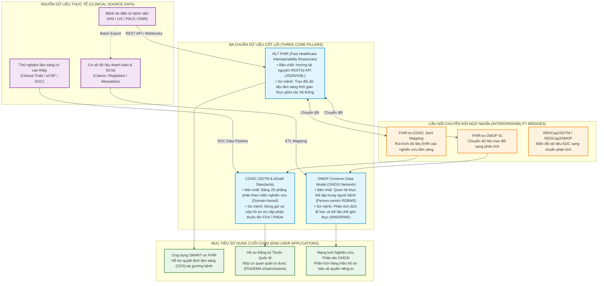

<!-- generated by scripts/sync_from_source.py from docs/chapters/ch03_standards_cdisc_fhir_omop.md; do not edit -->
# CHƯƠNG 3. CHUẨN HÓA DỮ LIỆU Y TẾ QUỐC TẾ: CDISC, HL7 FHIR VÀ OMOP CDM (OHDSI)

> **Thời lượng ước lượng:** đọc ≈ 35–45 phút; lab tự chọn ≈ 45–60 phút (tùy tốc độ đọc và thao tác).
> **Bộ tài liệu:** *Giáo trình Quản lý Dữ liệu Nghiên cứu Y sinh học (Biomedical Research Data Management)*

---

## 1. MỤC TIÊU HỌC TẬP VÀ KHUNG NĂNG LỰC (LEARNING OBJECTIVES)

Sau khi hoàn thành Chương 3, người học đạt được các chuẩn năng lực đầu ra (CLOs):

1. **Hiểu và Phân biệt (Bloom Mức 2 - CLO1):**
   - Phân tích được nguyên nhân gốc rễ của tình trạng "ốc đảo dữ liệu" (*data silos*) và sự bất đồng ngữ nghĩa trong hệ thống tin học y tế.
   - Trình bày rõ ràng triết lý thiết kế, cấu trúc thực thể và mục đích sử dụng chuyên biệt của ba hệ chuẩn dữ liệu y sinh hàng đầu: **CDISC** (thử nghiệm lâm sàng theo quy chuẩn), **HL7 FHIR** (trao đổi dữ liệu lâm sàng thời gian thực), và **OMOP CDM** (nghiên cứu quan sát và phân tích dữ liệu thế giới thực - RWD/RWE).
   - Giải thích vì sao ba chuẩn này có tính chất **bổ trợ lẫn nhau** (*complementary*) trong vòng đời nghiên cứu thay vì cạnh tranh hay thay thế nhau.

2. **Áp dụng và Đối chiếu (Bloom Mức 3 - CLO2/CLO3):**
   - Đọc hiểu và phân rã các cấu trúc tài nguyên chính của FHIR (*Patient, Condition, Observation, Encounter*) dưới định dạng JSON.
   - Đối chiếu và ánh xạ các trường thông tin lâm sàng từ mô hình hướng tài nguyên (*Resource-Oriented Model*) của FHIR sang mô hình quan hệ chuẩn hóa thực thể (*Relational Entity Model*) của OMOP CDM.
   - Ứng dụng các bảng từ vựng chuẩn (*Standardized Vocabularies*) như SNOMED CT, LOINC, RxNorm trong việc thống nhất ngữ nghĩa dữ liệu y tế.

3. **Phân tích và Đánh giá (Bloom Mức 4 - CLO3):**
   - Đánh giá được ưu thế của mô hình phân tích phân tán (*federated analytics*) của mạng lưới OHDSI trong việc bảo toàn quyền riêng tư người bệnh so với mô hình tập trung dữ liệu truyền thống.
   - Nhận diện các điểm nghẽn kỹ thuật khi xây dựng đường ống trích xuất - biến đổi - nạp dữ liệu (*ETL pipeline*) giữa các hệ thống hồ sơ bệnh án điện tử (EHR) và kho dữ liệu nghiên cứu.

---

## 2. BẢN ĐỒ KHÁI NIỆM (CONCEPT MAP)

Sơ đồ dưới đây minh họa hệ sinh thái ba chuẩn dữ liệu y tế lớn và vị trí chiến lược của từng chuẩn trong dòng chảy thông tin y sinh:



---

## 3. CƠ SỞ LÝ THUYẾT VÀ CHUẨN MỰC NGÀNH

### 3.1. Thách thức phân mảnh và Bất đồng Ngữ nghĩa trong Y tế

Dữ liệu y tế vốn phức tạp, phân tán và được thu thập bởi hàng nghìn hệ thống phần mềm độc quyền khác nhau. Sự bất đồng thể hiện ở hai cấp độ:
1. **Bất đồng cấu trúc (Syntactic Heterogeneity):** Hệ thống này lưu dữ liệu dưới dạng bảng quan hệ SQL, hệ thống khác dùng tài liệu JSON không cấu trúc, hệ thống chụp ảnh dùng DICOM, hoặc lưu trữ bằng các tệp XML tùy biến.
2. **Bất đồng ngữ nghĩa (Semantic Heterogeneity):** Cùng một khái niệm "Tăng huyết áp", bệnh viện A ghi là mã ICD-10 `I10`, bệnh viện B ghi chữ tắt `THA`, bệnh viện C lưu mã nội bộ `HTN_01`, và phòng xét nghiệm lưu mã LOINC kèm trị số đo.

Nếu không có các chuẩn mở toàn cầu, chi phí kỹ thuật để tích hợp và phân tích dữ liệu y tế đa trung tâm sẽ tăng theo cấp số nhân, tạo rào cản lớn đối với nghiên cứu khoa học.

---

### 3.2. CDISC: Chuẩn mực Đệ trình Nghiên cứu Lâm sàng Quy chuẩn

Hiệp hội Tiêu chuẩn Trao đổi Dữ liệu Lâm sàng (**CDISC - Clinical Data Interchange Standards Consortium**) cung cấp các mô hình và hướng dẫn được dùng trong nhiều bối cảnh nghiên cứu lâm sàng. Yêu cầu định dạng dữ liệu khi nộp hồ sơ phụ thuộc loại hồ sơ, cơ quan tiếp nhận và hướng dẫn hiện hành; xem [Phụ lục chuẩn](/course/book/appendices/standards) (chốt 21/11/2026) và không suy ra một yêu cầu chung cho mọi hồ sơ.

#### 3.2.1. Mô hình Dữ liệu Nghiên cứu dạng Bảng (SDTM - Study Data Tabulation Model)
- **Triết lý:** Dữ liệu được tổ chức thành các bảng theo miền (*domain*), dựa trên các lớp quan sát chung của SDTM. CDISC phân loại các miền thành **Special-Purpose**, **Interventions**, **Events**, **Findings** và **Findings About**.
- **Ví dụ miền:** `DM` (*Demographics*) là miền special-purpose; `AE` (*Adverse Events*) là miền Events; `VS` (*Vital Signs*) và `LB` (*Laboratory Tests*) là miền Findings; `CM` (*Concomitant Medications*) là miền Interventions.
- **Biến định danh:** `STUDYID`, `USUBJID` và `DOMAIN` là các biến thường dùng để nhận diện nghiên cứu, đối tượng và miền. `USUBJID` có thể được tạo theo quy ước ghép mã nghiên cứu, cơ sở và đối tượng, nhưng cách ghép cụ thể phải do đặc tả nghiên cứu quy định.
- **Biến theo lớp miền:** `--SEQ` không phải là cột bắt buộc chung cho mọi miền; chẳng hạn `DM` không dùng `--SEQ` như các miền có nhiều bản ghi. `--TESTCD` và `--TEST` thuộc nhóm Findings (ví dụ `VSTESTCD`/`VSTEST` hoặc `LBTESTCD`/`LBTEST`), không áp dụng mặc định cho `DM`, `AE` hoặc `CM`. Chi tiết phiên bản SDTM/IG và quy tắc tiếp nhận được giữ ở [Phụ lục chuẩn](/course/book/appendices/standards) (chốt 21/11/2026) [CẦN KIỂM CHỨNG: phiên bản IG áp dụng cho từng hồ sơ].

#### 3.2.2. Mô hình Dữ liệu Phân tích (ADaM - Analysis Data Model)
Trong khi SDTM chứa dữ liệu thô đã chuẩn hóa phản ánh sát thực tế trên phiếu thu thập, **ADaM** được thiết kế riêng để phục vụ các nhà thống kê sinh học chạy mô hình phân tích:
- Bổ sung các biến phái sinh (*derived variables*), ví dụ: tuổi tại thời điểm bắt đầu dùng thuốc, sự thay đổi so với mức nền (*change from baseline*).
- Cấu trúc tiêu biểu: `ADSL` (*Subject-Level Analysis Dataset*) chứa một hàng duy nhất cho mỗi đối tượng nghiên cứu với đầy đủ các thuộc tính phân tích gộp.

---

### 3.3. HL7 FHIR: Chuẩn mực Trao đổi Dữ liệu Lâm sàng Thế hệ Mới

**HL7 FHIR (Fast Healthcare Interoperability Resources)** ra đời nhằm khắc phục sự cồng kềnh, khó triển khai của các chuẩn trước đây (như HL7 v2 và v3) [9](/course/book/references#ref-9).

#### 3.3.1. Triết lý Thiết kế Hướng Tài nguyên (Resource-Oriented Architecture)
- FHIR xây dựng dựa trên các công nghệ web như HTTP, RESTful APIs và các định dạng JSON hoặc XML.
- Mọi khái niệm lâm sàng và hành chính được đóng gói thành các **Tài nguyên (Resources)** độc lập. Hiện có hơn 150 tài nguyên chuẩn, ví dụ:
  - `Patient`: Thông tin người bệnh.
  - `Encounter`: Lượt khám hoặc đợt điều trị.
  - `Condition`: Chẩn đoán, bệnh lý, triệu chứng.
  - `Observation`: Kết quả đo lường, xét nghiệm, dấu hiệu sinh tồn.
  - `MedicationRequest`: Đơn thuốc điều trị.
- FHIR cho phép mở rộng và hồ sơ hóa khi yêu cầu triển khai vượt ra ngoài các phần tử chung. Không dùng tỷ lệ 80/20 như một định lượng phổ quát khi chưa có nguồn trực tiếp [CẦN KIỂM CHỨNG].

#### 3.3.2. Trạng thái các Phiên bản FHIR (Release Status)
- **FHIR R4 (Version 4.0.1 - 2019):** Là phiên bản ổn định mang tính bước ngoặt, chứa các tài nguyên cốt lõi đạt mức độ chuẩn thành thục mức cao (Normative), hiện là tiêu chuẩn thực tế (*de facto standard*) trong hầu hết các hệ thống bệnh viện trên thế giới.
- **FHIR R5 (Version 5.0.0):** Ban hành ngày 26/03/2023 (chi tiết phiên bản và trạng thái: xem [Phụ lục chuẩn dữ liệu](/course/book/appendices/standards), chốt 21/11/2026).
- **FHIR R6:** Trạng thái phát hành thay đổi theo lịch HL7; tại ngày chốt của chương, cần đối chiếu trực tiếp lịch phát hành tại [HL7 FHIR Specification](https://hl7.org/fhir/) trước khi dùng. Bản mô tả trạng thái R6 trong chương được giữ `CONTENT_PENDING` cho tới khi kiểm lại.

#### 3.3.3. Hệ sinh thái Ứng dụng SMART on FHIR và Bulk Data Access
- **SMART on FHIR:** Cung cấp khung ủy quyền bảo mật OAuth2 cho phép các ứng dụng di động hoặc phần mềm của bên thứ ba tích hợp an toàn vào hệ thống bệnh án điện tử EHR mà không cần thay đổi mã nguồn cốt lõi của bệnh viện [36](/course/book/references#ref-36).
- **FHIR Bulk Data API:** Cho phép trích xuất dữ liệu hàng loạt ở quy mô quần thể phục vụ các phân tích y tế công cộng và nghiên cứu y sinh học [37](/course/book/references#ref-37).

---

### 3.4. OMOP CDM và Mạng lưới OHDSI: Chuẩn hóa Phân tích Dữ liệu Thế giới thực

**Mô hình Dữ liệu Chung OMOP (OMOP Common Data Model)** được quản lý và phát triển bởi hiệp hội khoa học mở toàn cầu **OHDSI (Observational Health Data Sciences and Informatics)** [11](/course/book/references#ref-11); [38](/course/book/references#ref-38). `ref_011` hiện còn lệch tiêu đề so với *The Book of OHDSI* và được giữ `BIB_PENDING`.

#### 3.4.1. Kiến trúc Bảng Quan hệ Tập trung vào Người bệnh (Person-Centric Schema)
OMOP CDM cung cấp một lược đồ quan hệ person-centric cho dữ liệu quan sát. Chương dùng **v5.4** làm phiên bản minh họa; phiên bản và mốc phát hành phải được chốt theo [đặc tả OMOP](https://ohdsi.github.io/CommonDataModel/cdm54.html) và ghi ở phụ lục.
- `person`: Thông tin nhân khẩu học duy nhất của cá nhân (`person_id`, `gender_concept_id`, `year_of_birth`).
- `observation_period`: Khoảng thời gian người bệnh được theo dõi liên tục trong cơ sở dữ liệu.
- `visit_occurrence`: Đợt khám bệnh (nội trú, ngoại trú, cấp cứu).
- `condition_occurrence`: Bệnh lý, chẩn đoán xác định (`condition_concept_id`, `condition_start_date`).
- `drug_exposure`: Quá trình sử dụng thuốc (`drug_concept_id`, `days_supply`, `dose_unit_source_value`); các cột cụ thể phải đối chiếu đúng phiên bản CDM trước khi ETL.
- `measurement`: Kết quả đo đạc sinh tồn và xét nghiệm cận lâm sàng (`measurement_concept_id`, `value_as_number`, `unit_concept_id`).

#### 3.4.2. Hệ thống Từ vựng Chuẩn hóa (OMOP Standardized Vocabularies)
Trụ cột làm nên sức mạnh vượt trội của OMOP CDM là từ điển ánh xạ ngữ nghĩa đồ sộ kết hợp các danh pháp quốc tế:
- **Khái niệm chuẩn (Standard Concepts):** Bất kỳ mã nguồn nào của địa phương (ví dụ mã bảo hiểm, mã ICD-10, mã bệnh viện) đều được ánh xạ về một mã khái niệm chuẩn hóa duy nhất:
  - Chẩn đoán bệnh và triệu chứng $\rightarrow$ chuẩn hóa về **SNOMED CT**.
  - Dược phẩm và hoạt chất $\rightarrow$ chuẩn hóa về **RxNorm** hoặc **RxNorm Extension**.
  - Đo lường và xét nghiệm cận lâm sàng $\rightarrow$ chuẩn hóa về **LOINC**.

#### 3.4.3. Mô hình Phân tích Phân tán (Federated Analytics Paradigm)
Thay vì gom toàn bộ dữ liệu bệnh nhân nhạy cảm về một máy chủ trung tâm (gây rủi ro rò rỉ dữ liệu và vi phạm quy định bảo mật), OHDSI áp dụng mô hình phân tích phân tán:
- Thuật toán phân tích mã nguồn mở (viết bằng R/SQL) được gửi đồng thời đến các cơ sở y tế thành viên trong mạng lưới.
- Từng cơ sở tự chạy mã trên kho OMOP CDM cục bộ của mình.
- Thông thường, mã phân tích được thực thi tại từng cơ sở và chỉ các kết quả được phép chia sẻ theo giao thức nghiên cứu được gửi về điều phối viên. Không mặc định rằng mọi kết quả đều không thể chứa thông tin nhận dạng; ngưỡng ô nhỏ, kiểm soát tiết lộ và quy tắc quản trị phải được xác định riêng. `ref_039` chỉ dùng cho phần kiểm định CDM, không dùng để chứng minh toàn bộ mô hình phân tán.
- Nghiên cứu **LEGEND-HTN** của Suchard và cộng sự được giữ làm ví dụ có trích dẫn [40](/course/book/references#ref-40); con số cỡ mẫu và mô tả triển khai chỉ được dùng sau khi đọc trực tiếp bài gốc [CẦN KIỂM CHỨNG].

---

### 3.5. Ma trận So sánh Ba Chuẩn và Tính Bổ trợ Lẫn nhau

| Tiêu chí | CDISC (SDTM / ADaM) | HL7 FHIR (R4 / R5) | OMOP CDM (OHDSI v5.4) |
| :--- | :--- | :--- | :--- |
| **Mục đích thiết kế chính** | Nộp hồ sơ nghiên cứu lâm sàng quy chuẩn cho cơ quan quản lý (FDA, PMDA) | Trao đổi dữ liệu khám chữa bệnh thời gian thực giữa các hệ sinh thái y tế | Phân tích dịch tễ học, giám sát an toàn thuốc và nghiên cứu thế giới thực (RWD/RWE) |
| **Mô hình kiến trúc** | Bảng phẳng 2D theo miền (`DM`, `AE`, `VS`, `LB`) | Hướng tài nguyên mô-đun RESTful (Resources: `Patient`, `Condition`) | Lược đồ quan hệ thực thể tập trung người bệnh (`person`, `measurement`) |
| **Định dạng dữ liệu** | XPT (SAS Transport v5), Dataset-XML, JSON | JSON, XML, Turtle (RDF) | Cơ sở dữ liệu quan hệ (PostgreSQL, SQL Server, BigQuery, Oracle) |
| **Mức độ phức tạp tích hợp** | Tĩnh, cấu trúc cột cố định | Rất linh hoạt, có thể mở rộng bằng Extensions | Cần đường ống chuyển đổi ETL và ánh xạ từ vựng phức tạp |
| **Từ vựng danh pháp** | CDISC Controlled Terminology, MedDRA, WHODrug | Ràng buộc linh hoạt qua ValueSets (SNOMED, LOINC, ICD-10) | Ánh xạ bắt buộc về Standard Concepts (SNOMED, RxNorm, LOINC) |
| **Tính tương thích lẫn nhau** | Có thể dùng hướng dẫn ánh xạ phù hợp cho từng mục tiêu [34](/course/book/references#ref-34) | Có thể là một nguồn dữ liệu cho các đường ống chuyển đổi, tùy triển khai | Có thể nhận dữ liệu từ nhiều nguồn sau ETL và ánh xạ từ vựng [10](/course/book/references#ref-10) |

> **Nguyên tắc cốt lõi:** Người làm nghiên cứu không nên hỏi *"Nên dùng chuẩn nào trong ba chuẩn trên?"*, mà phải xác định: *"Dữ liệu cần phục vụ cho mục đích gì?"*:
> - Muốn kết nối trực tiếp với bệnh án điện tử để lấy dữ liệu lâm sàng thời gian thực $\rightarrow$ Dùng **HL7 FHIR**.
> - Muốn đóng gói nộp hồ sơ xin phê duyệt thuốc mới $\rightarrow$ Dùng **CDISC**.
> - Muốn chạy phân tích thống kê trên hàng triệu bệnh nhân đa cơ sở $\rightarrow$ Dùng **OMOP CDM**.

---

## 4. NGHIÊN CỨU TÌNH HUỐNG VÀ BÀI HỌC THẤT BẠI (FAILURE ANALYSIS)

### Case Study 1: Sai lầm khi ép một chuẩn làm nhiệm vụ không phù hợp
- **Bối cảnh:** Một viện nghiên cứu quốc gia tại Châu Âu quyết định xây dựng một hệ thống dữ liệu phục vụ cả hai mục đích: (1) hỗ trợ bác sĩ tra cứu bệnh án thời gian thực và (2) phục vụ các nhà dịch tễ học chạy phân tích hồi quy sống còn. Nhóm kỹ thuật quyết định lưu trữ toàn bộ dữ liệu dưới dạng các tài nguyên HL7 FHIR JSON trên cơ sở dữ liệu tài liệu.
- **Điểm nghẽn phát sinh:**
  - Khi bác sĩ tra cứu từng cá nhân bệnh nhân, hệ thống hoạt động xuất sắc qua FHIR RESTful API.
- Tuy nhiên, các truy vấn phân tích trên tài liệu JSON lồng ghép có thể phải quét và bóc tách nhiều bản ghi, làm tăng chi phí xử lý và độ phức tạp vận hành.
- **Bài học khắc phục:** Duy trì tầng FHIR API cho giao tiếp thời gian thực, đồng thời xây dựng một đường ống ETL chuyển đổi dữ liệu cần phân tích sang lược đồ **OMOP CDM**. Hiệu năng thực tế phải được đo trên dữ liệu, hạ tầng và truy vấn cụ thể.

### Case Study 2: Bài học về Trôi dạt Ngữ nghĩa (Semantic Drift) khi ánh xạ không chuẩn
- **Bối cảnh:** Một đề tài nghiên cứu ung thư phối hợp giữa 3 bệnh viện ghi nhận biến số "Tình trạng hút thuốc lá".
- **Sai sót:** Cơ sở A và B dùng các mã số khác nghĩa cho cùng biến, còn cơ sở C lưu văn bản tự do. Khi nhóm tổng hợp dữ liệu mà không thông qua từ điển chuẩn hóa, cùng một giá trị số có thể bị diễn giải khác nhau và làm sai phân loại tình trạng hút thuốc.
- **Bài học:** Việc sử dụng các chuẩn danh pháp như SNOMED CT và quy tắc ánh xạ của OMOP/CDISC là biện pháp sống còn để ngăn ngừa sai lệch tai hại này.

---

## 5. HƯỚNG DẪN THỰC HÀNH PHÒNG MÁY - LAB 3 (2 GIỜ)

### 5.1. Bối cảnh Nghiên cứu và Đề bài
Trong bài thực hành này, học viên khảo sát, bóc tách và đối chiếu giữa hai định dạng dữ liệu y tế chuẩn: **HL7 FHIR (JSON Bundle)** và **OMOP CDM (CSV Tables)**. Bundle ở §5.2 là tình huống minh họa tự dựng cho bài học; Synthea chỉ là gợi ý về nguồn dữ liệu tổng hợp có thể dùng để luyện tập [93](/course/book/references#ref-93), không phải nguồn tạo ra bundle này.

**Mục tiêu bài Lab:**
1. Khảo sát cấu trúc một gói dữ liệu lâm sàng **FHIR Bundle** dạng JSON minh họa.
2. Trích xuất thông tin các tài nguyên cốt lõi: `Patient`, `Condition`, `Observation`.
3. Ánh xạ các trường dữ liệu trên sang lược đồ bảng quan hệ chuẩn của OMOP CDM: `person`, `condition_occurrence`, `measurement`.
4. Viết script Python thực thi việc chuyển đổi và chuẩn hóa ngữ nghĩa từ mã nguồn sang mã khái niệm chuẩn (Standard Concept ID).

---

### 5.2. Cấu trúc Dữ liệu Đầu vào (Sample FHIR JSON Bundle)
Dưới đây là một đoạn trích đại diện của gói tài nguyên FHIR R4 (`patient_bundle_csu.json`) ghi nhận bệnh nhân mày đay mạn tính:

```json
{
  "resourceType": "Bundle",
  "type": "collection",
  "entry": [
    {
      "resource": {
        "resourceType": "Patient",
        "id": "p-100293",
        "gender": "female",
        "birthDate": "1988-06-14",
        "address": [
          {
            "city": "Hanoi",
            "country": "VNM"
          }
        ]
      }
    },
    {
      "resource": {
        "resourceType": "Condition",
        "id": "cond-8821",
        "subject": {
          "reference": "Patient/p-100293"
        },
        "code": {
          "coding": [
            {
              "system": "http://snomed.info/sct",
              "code": "402407000",
              "display": "Chronic urticaria"
            }
          ]
        },
        "onsetDateTime": "2024-03-10T08:30:00Z"
      }
    },
    {
      "resource": {
        "resourceType": "Observation",
        "id": "obs-99120",
        "status": "final",
        "subject": {
          "reference": "Patient/p-100293"
        },
        "code": {
          "coding": [
            {
              "system": "http://loinc.org",
              "code": "8480-6",
              "display": "Systolic blood pressure"
            }
          ]
        },
        "effectiveDateTime": "2026-02-15T09:15:00Z",
        "valueQuantity": {
          "value": 128,
          "unit": "mmHg",
          "system": "http://unitsofmeasure.org",
          "code": "mm[Hg]"
        }
      }
    }
  ]
}
```

---

### 5.3. Bảng Ánh xạ Đối chiếu Cấu trúc (Mapping Specification)

Dựa trên hướng dẫn của **HL7/OHDSI FHIR-to-OMOP Implementation Guide** [10](/course/book/references#ref-10), quy tắc ánh xạ được xác lập như sau:

| Tài nguyên FHIR (Nguồn) | Trường FHIR | Bảng OMOP CDM (Đích) | Cột OMOP CDM | Quy tắc Biến đổi & Chuẩn hóa Ngữ nghĩa |
| :--- | :--- | :--- | :--- | :--- |
| `Patient` | `id` | `person` | `person_source_value` | Lưu chuỗi định danh nguồn (`p-100293`) |
| `Patient` | *(Hệ thống sinh)* | `person` | `person_id` | Chuyển đổi thành khóa số nguyên (Integer PK) |
| `Patient` | `gender` | `person` | `gender_concept_id` | `female` $\rightarrow$ Mã chuẩn OMOP `8532`; `male` $\rightarrow$ `8507` |
| `Patient` | `birthDate` | `person` | `year_of_birth` | Trích xuất năm: `1988` |
| `Patient` | `birthDate` | `person` | `month_of_birth` | Trích xuất tháng: `6` |
| `Patient` | `birthDate` | `person` | `day_of_birth` | Trích xuất ngày: `14` |
| `Condition` | `code.coding.code` | `condition_occurrence` | `condition_source_value` | Lưu mã gốc SNOMED: `402407000` |
| `Condition` | `code.coding.code` | `condition_occurrence` | `condition_concept_id` | Tra cứu Athena/OMOP Concept ID của Chronic Urticaria: `4180186` |
| `Condition` | `onsetDateTime` | `condition_occurrence` | `condition_start_date` | Lấy phần ngày: `2024-03-10` |
| `Observation` | `code.coding.code` | `measurement` | `measurement_source_value` | Lưu mã gốc LOINC: `8480-6` |
| `Observation` | `code.coding.code` | `measurement` | `measurement_concept_id` | Tra cứu Athena/OMOP Concept ID của Systolic BP: `3004249` |
| `Observation` | `valueQuantity.value` | `measurement` | `value_as_number` | Ép kiểu số thực: `128.0` |
| `Observation` | `valueQuantity.code` | `measurement` | `unit_concept_id` | Mã chuẩn OMOP của đơn vị `mmHg`: **chưa đối chiếu**; cần tra Athena trước khi nạp |
| `Observation` | `effectiveDateTime` | `measurement` | `measurement_date` | Lấy phần ngày: `2026-02-15` |

---

### 5.4. Script Python Thực hành Chuyển đổi (ETL Script)

Học viên xây dựng tệp `fhir_to_omop_mini.py` để tự động hóa việc bóc tách và tạo ra các tệp bảng quan hệ CSV của OMOP CDM:

```python
"""
Mô-đun thực hành Lab 3: Bóc tách FHIR Bundle JSON và chuyển đổi sang bảng OMOP CDM v5.4
Khóa học: Quản lý Dữ liệu Nghiên cứu Y sinh học (Biomedical RDM)
"""

import json
import csv
from datetime import datetime

# 1. Đọc tệp gói tài nguyên FHIR JSON
with open('patient_bundle_csu.json', 'r', encoding='utf-8') as f:
    bundle = json.load(f)

# Danh sách chứa các bản ghi theo bảng đích OMOP CDM
omop_person = []
omop_condition = []
omop_measurement = []

# Từ điển ánh xạ minh họa. Chỉ các mã đã được đối chiếu với nguồn được phép đưa vào.
GENDER_MAP = {'female': 8532, 'male': 8507}
SNOMED_TO_OMOP = {}  # 402407000: chưa đối chiếu Athena/nguồn SNOMED
LOINC_TO_OMOP = {'8480-6': 3004249}  # cần ghi nguồn tra cứu trong lab notes
UNIT_MAP = {}  # mm[Hg]: cần tra Athena; không dùng 8753/8876 khi chưa đối chiếu

person_counter = 1
source_to_person_id = {}

# 2. Quét qua từng tài nguyên trong Bundle
for entry in bundle.get('entry', []):
    res = entry.get('resource', {})
    res_type = res.get('resourceType')

    # Xử lý tài nguyên Patient -> Bảng person
    if res_type == 'Patient':
        src_id = res.get('id')
        pid = person_counter
        source_to_person_id[f"Patient/{src_id}"] = pid
        person_counter += 1

        bdate_str = res.get('birthDate')
        if not bdate_str:
            print(f"Cảnh báo: bỏ qua Patient/{src_id} vì thiếu birthDate")
            continue
        try:
            bdate = datetime.strptime(bdate_str, '%Y-%m-%d')
        except ValueError:
            print(f"Cảnh báo: bỏ qua Patient/{src_id} vì birthDate không hợp lệ")
            continue
        gender_code = res.get('gender', 'unknown')

        omop_person.append({
            'person_id': pid,
            'gender_concept_id': GENDER_MAP.get(gender_code, 0),  # 0 = chưa ánh xạ
            'race_concept_id': 0,  # chưa có trong bundle
            'ethnicity_concept_id': 0,  # chưa có trong bundle
            'year_of_birth': bdate.year,
            'month_of_birth': bdate.month,
            'day_of_birth': bdate.day,
            'person_source_value': src_id,
            'gender_source_value': gender_code
        })

    # Xử lý tài nguyên Condition -> Bảng condition_occurrence
    elif res_type == 'Condition':
        patient_ref = res.get('subject', {}).get('reference')
        pid = source_to_person_id.get(patient_ref, 0)
        
        coding = res.get('code', {}).get('coding', [{}])[0]
        snomed_code = coding.get('code')
        concept_id = SNOMED_TO_OMOP.get(snomed_code, 0)  # 0 = chưa ánh xạ
        
        onset_str = res.get('onsetDateTime')
        if not onset_str:
            print(f"Cảnh báo: bỏ qua Condition/{res.get('id')} vì thiếu onsetDateTime")
            continue
        onset_date = onset_str.split('T')[0]

        omop_condition.append({
            'condition_occurrence_id': len(omop_condition) + 1,
            'person_id': pid,
            'condition_concept_id': concept_id,
            'condition_type_concept_id': 0,  # chưa ánh xạ nguồn type
            'condition_start_date': onset_date,
            'condition_source_value': snomed_code
        })

    # Xử lý tài nguyên Observation -> Bảng measurement
    elif res_type == 'Observation':
        patient_ref = res.get('subject', {}).get('reference')
        pid = source_to_person_id.get(patient_ref, 0)
        
        coding = res.get('code', {}).get('coding', [{}])[0]
        loinc_code = coding.get('code')
        concept_id = LOINC_TO_OMOP.get(loinc_code, 0)  # 0 = chưa ánh xạ
        
        obs_str = res.get('effectiveDateTime')
        if not obs_str:
            print(f"Cảnh báo: bỏ qua Observation/{res.get('id')} vì thiếu effectiveDateTime")
            continue
        obs_date = obs_str.split('T')[0]
        
        val_qty = res.get('valueQuantity', {})
        val_num = val_qty.get('value')
        if val_num is None:
            print(f"Cảnh báo: bỏ qua Observation/{res.get('id')} vì thiếu valueQuantity.value")
            continue
        unit_code = val_qty.get('code', '')

        omop_measurement.append({
            'measurement_id': len(omop_measurement) + 1,
            'person_id': pid,
            'measurement_concept_id': concept_id,
            'measurement_type_concept_id': 0,  # chưa ánh xạ nguồn type
            'measurement_date': obs_date,
            'value_as_number': val_num,
            'unit_concept_id': UNIT_MAP.get(unit_code, 0),  # 0 = chưa ánh xạ
            'measurement_source_value': loinc_code
        })

# 3. Xuất kết quả ra các tệp CSV chuẩn OMOP CDM
def save_csv(filename, data, fieldnames):
    with open(filename, 'w', newline='', encoding='utf-8') as f:
        writer = csv.DictWriter(f, fieldnames=fieldnames)
        writer.writeheader()
        writer.writerows(data)
    print(f"Exported: {filename} ({len(data)} rows)")

save_csv('person.csv', omop_person, ['person_id', 'gender_concept_id', 'year_of_birth', 'month_of_birth', 'day_of_birth', 'race_concept_id', 'ethnicity_concept_id', 'person_source_value', 'gender_source_value'])
save_csv('condition_occurrence.csv', omop_condition, ['condition_occurrence_id', 'person_id', 'condition_concept_id', 'condition_type_concept_id', 'condition_start_date', 'condition_source_value'])
save_csv('measurement.csv', omop_measurement, ['measurement_id', 'person_id', 'measurement_concept_id', 'measurement_type_concept_id', 'measurement_date', 'value_as_number', 'unit_concept_id', 'measurement_source_value'])
```

---

### 5.5. Rubric Tự Đánh Giá Kết Quả Thực Hành Lab 3 (Thang điểm 20)

| Tiêu chí | Trọng số | Mức Đạt Tối Đa (Xuất sắc - 100%) | Mức Đạt Trung Bình (Cần bổ sung - 50%) | Mức Không Đạt (0%) |
| :--- | :---: | :--- | :--- | :--- |
| **1. Khảo sát & Phân tích Gói FHIR JSON** | **4 điểm** | Nhận diện và giải thích chính xác vai trò của từng trường trong các tài nguyên `Patient`, `Condition`, `Observation`. Chỉ ra được các hệ thống danh pháp tương ứng (SNOMED, LOINC). | Hiểu được cấu trúc tổng quan nhưng còn nhầm lẫn giữa định danh hệ thống (system URI) và mã giá trị (code). | Không đọc được cấu trúc JSON của FHIR Bundle. |
| **2. Độ chính xác của Bảng Ánh xạ (Mapping Spec)** | **4 điểm** | Bảng đối chiếu ánh xạ đầy đủ 100% các trường nguồn và đích; phân biệt rõ giữa cột giá trị nguồn (`source_value`) và cột khái niệm chuẩn (`concept_id`). | Ánh xạ được các trường chính nhưng để trống cột khái niệm chuẩn hoặc nhầm lẫn giữa `measurement` và `observation`. | Bảng ánh xạ sai lệch hoàn toàn về mặt ngữ nghĩa lâm sàng. |
| **3. Hiện thực hóa Script Biến đổi (ETL Script)** | **5 điểm** | Script Python chạy trơn tru, xử lý an toàn các trường dữ liệu khuyết, trích xuất chính xác ngày tháng và ánh xạ đúng mã từ điển OMOP. | Script chạy được nhưng bị lỗi khi gặp trường dữ liệu không đầy đủ hoặc không phân tách được chuỗi ngày giờ ISO. | Script báo lỗi cú pháp hoặc không sinh ra được các tệp CSV. |
| **4. Tính Toàn vẹn của Cơ sở Dữ liệu Đích (OMOP CSV)** | **4 điểm** | Ba tệp `person.csv`, `condition_occurrence.csv`, `measurement.csv` được tạo ra với cấu trúc khóa ngoại (`person_id`) đồng bộ và hợp lệ hoàn toàn. | Các tệp CSV được sinh ra nhưng khóa ngoại giữa các bảng không khớp nhau hoặc mã Concept ID bị gán bằng 0. | Tệp CSV rỗng hoặc sai tiêu đề cột chuẩn của OMOP CDM v5.4. |
| **5. Thảo luận & Phản biện Bổ trợ Đa chuẩn** | **3 điểm** | Trình bày sắc bén ưu và nhược điểm của việc duy trì song song hai mô hình (FHIR cho tương tác giao tiếp và OMOP cho tính toán dịch tễ). | Trình bày được khái niệm nhưng chưa liên hệ được với bài toán thực tiễn tại bệnh viện. | Không có phần nhận xét và thảo luận chuyên sâu. |

---

## 6. CÂU HỎI THẢO LUẬN VÀ BÀI TẬP TÌNH HUỐNG (DISCUSSION & EXERCISES)

### 6.1. Câu hỏi Thảo luận trên Lớp
1. *"Một số nhà quản lý CNTT bệnh viện đề xuất: 'Chúng ta đã đầu tư triển khai HL7 FHIR cho toàn bộ hệ thống bệnh án điện tử, do đó không cần thiết phải tốn thêm tài nguyên chuyển đổi sang OMOP CDM nữa'. Hãy dùng các luận điểm về hiệu năng cơ sở dữ liệu và mô hình phân tích để thuyết phục nhà quản lý rằng OMOP CDM vẫn là thành phần không thể thiếu?"*
2. *"Tại sao trong mô hình OMOP CDM, một khái niệm bệnh lý lại cần lưu song song ở cả hai cột: `condition_source_value` (ví dụ mã ICD-10 của bệnh viện) và `condition_concept_id` (mã chuẩn SNOMED CT của OHDSI)?"*

### 6.2. Bài tập Tình huống Nâng cao (Real-World Pipeline Challenge)
Bệnh viện Đa khoa Trung tâm dự định tham gia một nghiên cứu thử nghiệm lâm sàng quốc tế do một tập đoàn dược phẩm đa quốc gia tài trợ, đồng thời muốn cung cấp dữ liệu cho Mạng lưới Nghiên cứu Dữ liệu Quan sát Toàn cầu (OHDSI Network).
- Dữ liệu gốc của bệnh nhân đang nằm trong phần mềm quản lý bệnh viện (HIS) viết bằng SQL Server với danh pháp ICD-10 và bảng giá viện phí nội bộ.
- Nhà tài trợ thử nghiệm lâm sàng yêu cầu bàn giao dữ liệu theo chuẩn **CDISC SDTM**.
- Hiệp hội OHDSI yêu cầu dữ liệu phải nạp vào kho **OMOP CDM v5.4**.

**Yêu cầu:** Hãy phác thảo sơ đồ kiến trúc tích hợp dữ liệu tổng thể và quy trình chuyển đổi đa bước (Data Pipeline Architecture) để bệnh viện có thể đáp ứng cả hai yêu cầu trên mà không làm gián đoạn hoạt động khám chữa bệnh hàng ngày.

---

## 7. TÀI LIỆU THAM KHẢO CHUẨN (REFERENCES)

Danh mục dưới đây được dựng từ các entry dùng trong chương của `references/references.bib`; không bổ sung trường thư mục ngoài `.bib`. Các entry còn `BIB_PENDING` hoặc chưa audit nội dung được giữ nguyên trạng thái trong sổ audit.

1. **HL7 International.** (2023). *FHIR*. https://hl7.org/fhir/ `[9](/course/book/references#ref-9)`.
2. **HL7 International.** (n.d.). *FHIR to OMOP Implementation Guide*. http://hl7.org/fhir/uv/omop/ `[10](/course/book/references#ref-10)`.
3. **Sachson, C.** (2025). *Our journey*. Observational Health Data Sciences and Informatics. https://www.ohdsi.org/wp-content/uploads/2025/10/OurJourney-2025.pdf `[11](/course/book/references#ref-11)`.
4. **Yamamoto, K., Ota, K., Akiya, I., & Shintani, A.** (2017). *A pragmatic method for transforming clinical research data from the research electronic data capture “REDCap” to Clinical Data Interchange Standards Consortium (CDISC) Study Data Tabulation Model (SDTM): Development and evaluation of REDCap2SDTM*. *Journal of Biomedical Informatics*, 70, 65–76. DOI: 10.1016/j.jbi.2017.05.003 `[26](/course/book/references#ref-26)`.
5. **Gurley, M. J., Warner, J., Bushmanova, Y., & Wehbe, F.** (2021). *REDCap2OMOP: A platform for ETLing REDCap projects into the OMOP CDM*. https://www.ohdsi.org/wp-content/uploads/2021/09/65_REDCap2OMOP.pdf `[27](/course/book/references#ref-27)`.
6. **CDISC, & HL7 International.** (2021). *FHIR to CDISC Joint Mapping Implementation Guide*. https://www.cdisc.org/standards/real-world-data/fhir-cdisc-joint-mapping-implementation-guide-v1-0 `[34](/course/book/references#ref-34)`.
7. **Mandel, J. C., Kreda, D. A., Mandl, K. D., Kohane, I. S., & Ramoni, R. B.** (2016). *SMART on FHIR: A standards-based, interoperable apps platform for electronic health records*. *Journal of the American Medical Informatics Association*, 23, 899–908. DOI: 10.1093/jamia/ocv189 `[36](/course/book/references#ref-36)`.
8. **Mandl, K. D., Gottlieb, D., & Mandel, J. C.** (2020). *Push Button Population Health: The SMART/HL7 FHIR Bulk Data Access API*. *npj Digital Medicine*, 3, 151. DOI: 10.1038/s41746-020-00358-4 `[37](/course/book/references#ref-37)`.
9. **Hripcsak, G., et al.** (2015). *Observational Health Data Sciences and Informatics (OHDSI): Opportunities for observational researchers*. *Studies in Health Technology and Informatics*, 216, 574–578. https://pmc.ncbi.nlm.nih.gov/articles/PMC4815923/ `[38](/course/book/references#ref-38)`.
10. **Overhage, J. M., Ryan, P. B., Reich, C. G., Hartzema, A. G., & Stang, P. E.** (2012). *Validation of a common data model for active safety surveillance research*. *Journal of the American Medical Informatics Association*, 19, 54–60. DOI: 10.1136/amiajnl-2011-000376 `[39](/course/book/references#ref-39)`.
11. **Suchard, M. A., et al.** (2019). *Comprehensive comparative effectiveness and safety of first-line antihypertensive drug classes: A systematic, multinational, large-scale analysis*. *The Lancet*, 394, 1816–1826. DOI: 10.1016/S0140-6736(19)32317-7 `[40](/course/book/references#ref-40)`.
12. **Walonoski, J., et al.** (2018). *Synthea: An approach, method, and software mechanism for generating synthetic patients and the synthetic electronic health care record*. *Journal of the American Medical Informatics Association*, 25, 230–238. DOI: 10.1093/jamia/ocx079 `[93](/course/book/references#ref-93)`.
