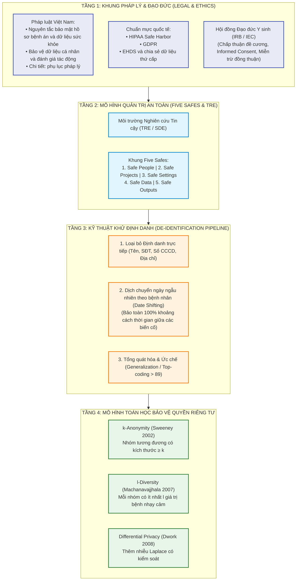

<!-- generated by scripts/sync_from_source.py from docs/chapters/ch05_privacy_and_deidentification.md; do not edit -->
# CHƯƠNG 5. BẢO MẬT DỮ LIỆU Y TẾ, KHỬ ĐỊNH DANH (DE-IDENTIFICATION) VÀ KHUNG PHÁP LÝ VIỆT NAM

> **Thời lượng ước lượng:** 3 giờ (1 giờ lý thuyết và 2 giờ thực hành Lab 5)
> **Bộ tài liệu:** *Giáo trình Quản lý Dữ liệu Nghiên cứu Y sinh học (Biomedical Research Data Management)*  
> **Phiên bản:** `v2.0.0_20261121` | **Chuẩn trích dẫn:** SSoT BibTeX (`references/references.bib`)

---

## 1. MỤC TIÊU HỌC TẬP VÀ KHUNG NĂNG LỰC (LEARNING OBJECTIVES)

Sau khi hoàn thành Chương 5, người học đạt được các chuẩn năng lực đầu ra (CLOs):

1. **Hiểu và Phân biệt (Bloom Mức 2 - CLO1):**
   - Phân tích khung pháp lý quốc tế về quyền riêng tư dữ liệu y tế: **HIPAA Privacy Rule** [115](/course/book/references#ref-115), **GDPR** [113](/course/book/references#ref-113) và **EHDS** [114](/course/book/references#ref-114).
   - Phân biệt rõ sự khác nhau về mặt pháp lý và kỹ thuật giữa: Dữ liệu định danh (*Identifiable*), Dữ liệu giả danh (*Pseudonymized*), và Dữ liệu ẩn danh hoàn toàn (*Anonymized*).
   - Nhận diện các nguyên tắc pháp lý hiện hành của Việt Nam; chi tiết cập nhật xem [Phụ lục pháp lý](/course/book/appendices/legal) (chốt 21/11/2026).

2. **Áp dụng và Thực hành (Bloom Mức 3 - CLO3):**
   - Phân loại chính xác 4 nhóm thuộc tính trong tập dữ liệu y sinh: Định danh trực tiếp (*Direct Identifiers*), Thuộc tính bán định danh (*Quasi-Identifiers - QIs*), Thuộc tính nhạy cảm (*Sensitive Attributes*), và Thuộc tính không nhạy cảm.
   - Xây dựng và thực thi đường ống khử định danh tự động bằng Python: loại bỏ 18 định danh trực tiếp theo HIPAA, che giấu độ tuổi người cao tuổi ($> 89$), và áp dụng thuật toán **Dịch chuyển ngày tháng ngẫu nhiên theo từng bệnh nhân (Patient-Level Date Shifting)** để bảo toàn khoảng cách thời gian lâm sàng.
   - Đo lường và kiểm chứng các chỉ số an toàn quyền riêng tư toán học: **$k$-Anonymity** [68](/course/book/references#ref-68) và **$l$-Diversity** [69](/course/book/references#ref-69).

3. **Phân tích và Đánh giá (Bloom Mức 4 - CLO3):**
   - Đánh giá các rủi ro bị tấn công liên kết dữ liệu (*Linkage Attack*) và tái định danh người bệnh khi chia sẻ dữ liệu nghiên cứu ra cộng đồng khoa học mở.
   - Thiết kế mô hình quản trị dữ liệu an toàn dựa trên khung **Five Safes** và kiến trúc Môi trường Nghiên cứu Tin cậy (**Trusted Research Environments - TREs**); nguồn Five Safes cụ thể vẫn `CONTENT_PENDING`.

---

## 2. BẢN ĐỒ KHÁI NIỆM (CONCEPT MAP)

Sơ đồ dưới đây minh họa hệ thống các lớp phòng vệ bảo mật dữ liệu y tế từ khung pháp lý, đạo đức, kiến trúc hạ tầng cho đến các thuật toán khử định danh chuyên sâu:



---

## 3. CƠ SỞ LÝ THUYẾT VÀ CHUẨN MỰC NGÀNH

### 3.1. Nghịch lý Bảo mật và Chia sẻ Dữ liệu Y sinh học

Trong kỷ nguyên Y học Chính xác (*Precision Medicine*) và Trí tuệ Nhân tạo, việc tiếp cận các bộ dữ liệu lâm sàng quy mô lớn là điều kiện tiên quyết để thúc đẩy các phát kiến khoa học mới. Tuy nhiên, dữ liệu sức khỏe mang tính chất cá nhân sâu sắc:
- Dữ liệu y tế chứa đựng những thông tin nhạy cảm nhất về tình trạng sinh học, bệnh lý mạn tính, khuynh hướng di truyền, thói quen sinh hoạt và hành vi xã hội của con người.
- Nếu bị lộ lọt, người bệnh có thể phải đối mặt với nguy cơ bị phân biệt đối xử trong tuyển dụng lao động, từ chối cấp bảo hiểm, hoặc bị xâm phạm nghiêm trọng đời tư.
- **Nghịch lý căn bản:** Làm thế nào để vừa bảo vệ tuyệt đối quyền riêng tư của người bệnh, vừa không làm biến dạng hoặc phá hủy giá trị khoa học của tập dữ liệu phục vụ nghiên cứu?

---

### 3.2. Khung Pháp lý Quốc tế về Dữ liệu Y tế

#### 3.2.1. Đạo luật HIPAA và Tiêu chuẩn 45 CFR §164.514 (Hoa Kỳ)
Đạo luật HIPAA đặt ra các quy định về Thông tin Y tế được Bảo vệ (**PHI**). 45 CFR 164.514 nêu hai phương pháp khử định danh; việc áp dụng cụ thể phải đối chiếu văn bản gốc [115](/course/book/references#ref-115).

1. **Safe Harbor:** loại bỏ các nhóm định danh được liệt kê trong 45 CFR 164.514(b)(2)(i)(A)–(R): tên; địa chỉ địa lý nhỏ hơn bang; mọi yếu tố ngày tháng (trừ năm) và tuổi trên 89; số điện thoại; fax; email; số an sinh xã hội; số hồ sơ y tế; số bảo hiểm y tế; số tài khoản; số giấy phép/chứng chỉ; biển số và định danh phương tiện; định danh thiết bị; URL; địa chỉ IP; định danh sinh trắc học; ảnh toàn mặt; và mọi mã định danh duy nhất khác. Quy định có ngoại lệ giới hạn cho ba chữ số đầu của ZIP khi khu vực tương ứng có hơn 20.000 dân. Điều kiện đi kèm gồm không có hiểu biết thực tế rằng thông tin còn lại có thể nhận diện cá nhân.
   - (A) Họ và tên;
   - (B) Mọi đơn vị địa lý nhỏ hơn một bang (địa chỉ, thành phố, quận/huyện, mã bưu chính ZIP và mã địa lý tương đương). Ngoại lệ: được giữ 3 chữ số đầu của ZIP nếu đơn vị địa lý gộp mọi ZIP có cùng 3 chữ số đầu có trên 20.000 dân theo dữ liệu Census công bố hiện hành; 3 chữ số đầu của các đơn vị có từ 20.000 dân trở xuống phải đổi thành `000`;
   - (C) Mọi yếu tố ngày tháng (trừ năm) liên quan trực tiếp đến cá nhân (ngày sinh, nhập viện, xuất viện, tử vong); mọi độ tuổi trên 89 và mọi yếu tố ngày (kể cả năm) cho biết độ tuổi đó, trừ khi gộp thành một nhóm duy nhất "90 tuổi trở lên";
   - (D) Số điện thoại; (E) Số fax; (F) Địa chỉ thư điện tử;
   - (G) Số an sinh xã hội; (H) Số hồ sơ y tế; (I) Số thẻ bảo hiểm/thụ hưởng; (J) Số tài khoản;
   - (K) Số chứng chỉ/giấy phép; (L) Định danh và số seri phương tiện, kể cả biển số xe; (M) Định danh và số seri thiết bị;
   - (N) Địa chỉ URL; (O) Địa chỉ IP;
   - (P) Định danh sinh trắc học, gồm vân tay và dấu giọng nói; (Q) Ảnh chụp toàn khuôn mặt và ảnh tương tự;
   - (R) Mọi số, đặc điểm hoặc mã định danh duy nhất khác (trừ mã tái định danh được phép theo mục (c) của điều khoản).
   - **Điều kiện bổ sung:** đơn vị chịu điều chỉnh không có hiểu biết thực tế rằng thông tin còn lại có thể dùng riêng lẻ hoặc kết hợp để nhận diện cá nhân (45 CFR 164.514(b)(2)(ii)) [115](/course/book/references#ref-115).

2. **Phương pháp Expert Determination (Thẩm định Chuyên gia):** Một chuyên gia có kiến thức khoa học và thống kê sâu rộng tiến hành áp dụng các thuật toán toán học và chứng minh bằng văn bản rằng xác suất để một người nhận được dữ liệu có thể tái định danh đối tượng nghiên cứu là "cực kỳ nhỏ" (*very small risk*).

#### 3.2.2. Quy định GDPR (Châu Âu) và Khái niệm Dữ liệu Giả danh
Quy định Bảo vệ Dữ liệu Chung của Liên minh Châu Âu (**GDPR** - Regulation 2016/679) [113](/course/book/references#ref-113) thiết lập một sự phân biệt pháp lý cốt tử:
- **Dữ liệu giả danh (Pseudonymised Data):** Dữ liệu đã thay thế họ tên bệnh nhân bằng một mã số nghiên cứu (Subject ID), nhưng nhà nghiên cứu vẫn giữ một "Bảng liên kết đối chiếu" (*Key file / Master linking log*) ở một nơi an toàn. **GDPR khẳng định: Dữ liệu giả danh VẪN LÀ DỮ LIỆU CÁ NHÂN** và phải tuân thủ đầy đủ các quy định ngặt nghèo của luật, bởi vì người giữ chìa khóa vẫn có khả năng tái định danh người bệnh.
- **Dữ liệu ẩn danh hoàn toàn (Anonymised Data):** Dữ liệu đã bị xóa bỏ liên kết vĩnh viễn, không một ai (kể cả nhóm nghiên cứu ban đầu) có thể tái định danh được cá nhân bằng bất kỳ biện pháp kỹ thuật hợp lý nào. Chỉ có dữ liệu ẩn danh hoàn toàn mới nằm ngoài phạm vi điều chỉnh của GDPR.
- **EHDS:** Quy định có hiệu lực ngày 26/03/2025 và áp dụng từ 26/03/2027; một số phần áp dụng theo các mốc 2029, 2031 và 2035. Lộ trình chi tiết nằm trong [Phụ lục pháp lý](/course/book/appendices/legal) (chốt 21/11/2026) [114](/course/book/references#ref-114).

---

### 3.3. Khung Pháp lý và Đạo đức Nghiên cứu Y tế tại Việt Nam

Tại Việt Nam, các quy định pháp luật về bảo mật dữ liệu y tế đã có bước chuyển mình mang tính lịch sử, chuyển từ các quy định hành chính đơn lẻ sang một khung pháp lý hoàn chỉnh, đồng bộ và có chế tài nghiêm khắc:

1. **Pháp luật về khám bệnh, chữa bệnh:** hồ sơ bệnh án và thông tin sức khỏe phải được bảo mật; việc khai thác cho nghiên cứu cần căn cứ nguồn chính thống và phê duyệt phù hợp. Chi tiết điều khoản được giữ ở [Phụ lục pháp lý](/course/book/appendices/legal) (chốt 21/11/2026).

2. **Bảo vệ dữ liệu cá nhân:** dữ liệu sức khỏe cần được xử lý theo mục đích, quyền truy cập, bảo mật, đánh giá tác động và trách nhiệm giải trình theo nguồn hiện hành. Xem trạng thái kiểm chứng, giới hạn và URL ở [Phụ lục pháp lý](/course/book/appendices/legal) (chốt 21/11/2026).

3. **Bệnh án điện tử:** các yêu cầu về hệ thống, phân quyền và kiểm soát truy cập phải được đối chiếu theo văn bản hiện hành ở [Phụ lục pháp lý](/course/book/appendices/legal) (chốt 21/11/2026).

4. **Vai trò của Hội đồng Đạo đức trong Nghiên cứu Y sinh học (IRB / IEC):**
   - Mọi đề cương nghiên cứu y sinh học có liên quan đến việc thu thập hoặc khai thác dữ liệu bệnh nhân đều phải được thông qua Hội đồng Đạo đức cấp cơ sở hoặc cấp Quốc gia.
   - Hội đồng Đạo đức xem xét: chấp thuận tham gia, cơ chế mã hóa và khử định danh, nơi lưu trữ khóa, quyền truy cập và kế hoạch lưu trữ/hủy dữ liệu. Chi tiết cập nhật xem [Phụ lục lưu trữ](/course/book/appendices/retention) (chốt 21/11/2026).

---

### 3.4. Các Mô hình Kỹ thuật Khử định danh và Ẩn danh Toán học

#### 3.4.1. Phân Loại Thuộc Tính Dữ Liệu
Để thực hiện khử định danh, trước tiên nhà nghiên cứu phải phân loại các cột trong bảng dữ liệu thành 4 nhóm:
1. **Thuộc tính định danh trực tiếp (Direct Identifiers):** Nhận diện trực tiếp một cá nhân không cần thông tin bổ sung (Họ tên, SĐT, Số CCCD, Mã bệnh nhân, Email). *Biện pháp:* Loại bỏ hoàn toàn hoặc băm một chiều (Hash) có muối (Salt).
2. **Thuộc tính bán định danh (Quasi-Identifiers - QIs):** Bản thân một thuộc tính không chỉ đích danh ai, nhưng khi kết hợp nhiều thuộc tính lại với nhau thì có thể định danh duy nhất một người (Ngày sinh, Tuổi, Giới tính, Nghề nghiệp, Mã bưu chính ZIP code, Ngày khám bệnh).
3. **Thuộc tính nhạy cảm (Sensitive Attributes):** Thông tin bệnh tật cần bảo vệ mà kẻ tấn công muốn khai thác (Chẩn đoán bệnh, nồng độ virus HIV, mức độ trầm cảm, tình trạng sử dụng ma túy).
4. **Thuộc tính không nhạy cảm (Non-Sensitive Attributes):** Các thông số ít có nguy cơ rò rỉ riêng tư (Trạng thái thiết bị, phiên bản phần mềm).

#### 3.4.2. Kỹ thuật Dịch Chuyển Ngày Tháng Ngẫu Nhiên theo Bệnh Nhân (Patient-Level Date Shifting)
Trong nghiên cứu y học, việc loại bỏ hoàn toàn các cột ngày tháng sẽ phá hủy khả năng phân tích sống còn (*Survival Analysis*), đánh giá khoảng cách giữa các đợt tái phát, hoặc tính toán đáp ứng điều trị theo thời gian.

**Giải pháp kỹ thuật chuẩn mực:**
- Với mỗi bệnh nhân $i$, hệ thống sinh ra một số nguyên ngẫu nhiên duy nhất $\delta_i$ nằm trong khoảng cho trước (ví dụ: $\delta_i \in [-365, +365]$ ngày).
- Tất cả các mốc thời gian liên quan đến bệnh nhân $i$ (ngày sinh, ngày khám, ngày xét nghiệm, ngày xuất hiện biến cố bất lợi) đều được cộng thêm đúng $\delta_i$ ngày:
  $$t_{\text{shifted}} = t_{\text{original}} + \delta_i$$
- **Ưu điểm vượt trội:**
  - Khoảng cách giữa các mốc sự kiện lâm sàng của cùng một bệnh nhân được bảo toàn **chính xác 100%**:
    $$\Delta t = (t_{2} + \delta_i) - (t_{1} + \delta_i) = t_{2} - t_{1}$$
  - Mốc thời gian tuyệt đối trên lịch bị xáo trộn hoàn toàn, khiến kẻ xấu không thể đối chiếu ngày khám với sổ đăng ký vào viện hay camera giám sát của bệnh viện.

#### 3.4.3. Mô hình $k$-Anonymity (Latanya Sweeney 2002)
Một tập dữ liệu thỏa mãn **$k$-Anonymity** nếu mỗi tổ hợp thuộc tính bán định danh (Quasi-Identifiers) xuất hiện ít nhất ở $k$ bản ghi khác nhau trong bảng [68](/course/book/references#ref-68).
- Mỗi nhóm các bản ghi có chung tổ hợp bán định danh được gọi là một **Nhóm tương đương (Equivalence Class)**.
- Khi một tập dữ liệu đạt chuẩn $k$-anonymity, xác suất kẻ tấn công liên kết chính xác một người với một bản ghi không thể vượt quá $1/k$.
- *Kỹ thuật đạt được:*
  - **Tổng quát hóa (Generalization):** Chuyển giá trị chi tiết thành khoảng giá trị (ví dụ: tuổi 34 chuyển thành `[30-39]`; địa chỉ quận Đống Đa chuyển thành `Hà Nội`).
  - **Ức chế (Suppression):** Xóa bỏ một vài ô hoặc dòng dữ liệu cá biệt làm ảnh hưởng đến ngưỡng $k$.

#### 3.4.4. Mô hình $l$-Diversity (Machanavajjhala et al. 2007)
Mặc dù $k$-anonymity bảo vệ danh tính, nó không thể chống lại **Tấn công đồng nhất (Homogeneity Attack)**:
- Giả sử một nhóm tương đương có $k = 5$ bệnh nhân nữ, tuổi 30-39, ở Hà Nội. Nhưng cả 5 bệnh nhân này đều có chẩn đoán nhạy cảm là `HIV dương tính`.
- Kẻ tấn công biết nạn nhân là nữ, 32 tuổi, sống tại Hà Nội $\rightarrow$ Kẻ tấn công chắc chắn 100% nạn nhân bị nhiễm HIV dù bảng dữ liệu đạt $5$-anonymity!
- **Giải pháp $l$-Diversity:** Yêu cầu trong mỗi nhóm tương đương, thuộc tính nhạy cảm phải chứa ít nhất **$l$ giá trị khác nhau** và phân bố đều nhau [69](/course/book/references#ref-69).

#### 3.4.5. Bảo Mật Vi Sai (Differential Privacy - Cynthia Dwork 2008)
Là một mô hình toán học với tham số và giả định phải được công bố; không có một mô hình duy nhất phù hợp cho mọi bối cảnh [70](/course/book/references#ref-70):
- Đảm bảo rằng việc có mặt hay vắng mặt của một cá nhân duy nhất trong cơ sở dữ liệu sẽ không làm thay đổi đáng kể xác suất xuất hiện của kết quả truy vấn thống kê đầu ra.
- Cơ chế thực hiện: Thêm nhiễu ngẫu nhiên được điều chỉnh cẩn thận (Laplace Noise hoặc Gaussian Noise) vào kết quả tổng hợp dựa trên **Độ nhạy của truy vấn (Sensitivity)** và **Ngân sách bảo mật $\epsilon$ (Epsilon)**.

---

### 3.5. Kiến trúc Môi trường Nghiên cứu Tin cậy (TREs) và Khung Five Safes

Trong các nghiên cứu lâm sàng, có thể tổ chức quyền truy cập theo mô hình **"đưa thuật toán đến dữ liệu" (Code-to-Data)** thông qua **Môi trường Nghiên cứu Tin cậy (Trusted Research Environments - TREs)** và nguyên tắc **Five Safes**. Nguồn cụ thể cho Five Safes chưa được chốt, nên không suy rộng thành yêu cầu pháp lý:

1. **Safe People (Con người an toàn):** Chỉ những nhà nghiên cứu đã được đào tạo, sát hạch về đạo đức dữ liệu y sinh và ký cam kết pháp lý mới được cấp tài khoản truy cập.
2. **Safe Projects (Dự án an toàn):** Dự án phải có đề cương nghiên cứu rõ ràng, phục vụ lợi ích công cộng và được Hội đồng Đạo đức (IRB) phê duyệt.
3. **Safe Settings (Môi trường an toàn):** Nghiên cứu viên làm việc trên một máy ảo cô lập (Virtual Desktop Infrastructure - VDI), không có kết nối internet tự do, bị khóa cổng USB và vô hiệu hóa tính năng copy-paste dữ liệu ra máy tính cá nhân.
4. **Safe Data (Dữ liệu an toàn):** Dữ liệu nạp vào môi trường đã được khử toàn bộ các định danh trực tiếp.
5. **Safe Outputs (Kết quả an toàn):** Mọi biểu đồ, bảng số liệu thống kê hoặc mô hình AI trước khi trích xuất ra khỏi TRE đều phải trải qua quy trình kiểm duyệt tự động và thủ công của Cán bộ Quản trị Dữ liệu (Air-lock review) để bảo đảm không chứa bất kỳ tế bào thống kê nào có cỡ mẫu quá nhỏ ($N < 5$ hoặc $N < 10$) có nguy cơ tái định danh.

---

## 4. NGHIÊN CỨU TÌNH HUỐNG VÀ BÀI HỌC THẤT BẠI (FAILURE ANALYSIS)

### Case Study 1: Minh họa tấn công liên kết
- **Bối cảnh:** Cơ quan Bảo hiểm Y tế bang Massachusetts (GIC) quyết định công bố một bộ dữ liệu đã được "khử định danh" bao gồm thông tin khám chữa bệnh của toàn bộ công chức bang cho các nhà nghiên cứu học thuật. GIC đã xóa bỏ tên, địa chỉ, số an sinh xã hội và mã bệnh án của bệnh nhân, và khẳng định công khai rằng quyền riêng tư của mọi người đã được bảo vệ tuyệt đối.
- **Cuộc tấn công của Sweeney:**
  1. Tiến sĩ Latanya Sweeney (lúc đó là nghiên cứu sinh tại MIT) biết rằng Thống đốc bang lúc bấy giờ là ông William Weld cư trú tại thành phố Cambridge.
  2. Sweeney bỏ ra \$20 để mua danh sách cử tri công khai của thành phố Cambridge (trong đó có chứa họ tên, địa chỉ, mã bưu chính ZIP code, ngày tháng năm sinh và giới tính của cử tri).
  3. Sweeney tiến hành **Tấn công liên kết (Linkage Attack)** giữa tập dữ liệu y tế của GIC và danh sách cử tri thông qua 3 thuộc tính bán định danh chung: **Mã ZIP (5 chữ số), Ngày sinh đầy đủ (ngày/tháng/năm), và Giới tính**.
  4. *Kết quả gây sốc:* Chỉ duy nhất một người trong toàn bộ thành phố Cambridge có tổ hợp 3 thuộc tính này trùng khớp với Thống đốc. Sweeney đã trích xuất được toàn bộ hồ sơ chẩn đoán bệnh, các toa thuốc điều trị và các đợt nằm viện phẫu thuật bí mật của Thống đốc Weld và gửi thẳng hồ sơ y tế này tới văn phòng của ông.
- **Bài học:** xóa tên không đủ để loại bỏ rủi ro liên kết; kết quả định danh phụ thuộc vào dữ liệu đối chiếu, bối cảnh và giả định tấn công. Không sử dụng tỷ lệ phần trăm khi chưa đọc và kiểm chứng nguồn gốc trực tiếp.

### Case Study 2: Tình huống giả định minh họa về chia sẻ dữ liệu
- **Bối cảnh:** Một nhóm nghiên cứu tại một bệnh viện thực hiện đề tài đánh giá đáp ứng điều trị mày đay mạn tính kháng thuốc. Để tiện trao đổi công việc hàng ngày giữa nghiên cứu viên và điều phối viên lâm sàng (CRC), nhóm đã tạo một nhóm chat Zalo.
- **Sai sót cần thảo luận:** dữ liệu sức khỏe được chia sẻ qua kênh không phù hợp, thiếu kiểm soát quyền truy cập và thiếu đánh giá rủi ro. Người học xác định biện pháp giảm thiểu và căn cứ pháp lý cần kiểm chứng; không suy đoán chế tài hay hậu quả thực tế.

---

## Quiz tự kiểm tra — Bài 5 (4 câu hỏi)

### **Câu 5.1. Vì sao khử định danh không đồng nghĩa với loại bỏ mọi rủi ro riêng tư?**
- A. Vì dữ liệu giảm định danh vẫn có thể liên kết nguồn khác hoặc suy luận.
- B. Vì nhiều dữ liệu khử định danh bị xem như dữ liệu giả, giảm giá trị phân tích.
- C. Vì khử định danh thường làm giảm một phần giá trị phân tích của bộ dữ liệu.
- D. Vì dữ liệu giấy thường có rủi ro riêng tư, còn dữ liệu số thì ít hơn.
> **Đáp án đúng: A.**
> *Giải thích:* Chương nhấn mạnh giới hạn của các kỹ thuật khử định danh và nguy cơ tấn công liên kết. Xem §3.1 và §3.4.

### **Câu 5.2. Khi dịch chuyển ngày theo từng bệnh nhân, nguyên tắc nào giúp giữ được thông tin thời gian tương đối?**
- A. Dịch mỗi ngày bằng một số ngẫu nhiên độc lập, không giữ quan hệ thời gian.
- B. Dùng cùng một dịch chuyển cho các ngày của một bệnh nhân.
- C. Xóa toàn bộ ngày trước khi phân tích để tránh sai lệch thời gian.
- D. Thay nhiều ngày bằng ngày hiện tại để đơn giản hóa dữ liệu.
> **Đáp án đúng: B.**
> *Giải thích:* Dùng một dịch chuyển nhất quán theo bệnh nhân có thể bảo toàn khoảng cách tương đối giữa các mốc, nhưng không tự động biến phương pháp thành Safe Harbor. Xem §3.4.2.

### **Câu 5.3. k-anonymity chủ yếu hạn chế loại nguy cơ nào?**
- A. Mất điện của máy chủ lưu trữ trong thời gian xử lý dữ liệu.
- B. Sai định dạng tệp dữ liệu khi xuất dữ liệu để phân tích.
- C. Quasi-identifier có thể phân biệt cá nhân; vẫn còn nguy cơ suy luận.
- D. Nhiều hình thức truy cập trái phép, kể cả không liên quan đến định danh.
> **Đáp án đúng: C.**
> *Giải thích:* k-anonymity làm các tổ hợp quasi-identifier xuất hiện đủ số lần theo k, nhưng vẫn có giới hạn trước thông tin nền và đa dạng thuộc tính. Xem §3.4.3–§3.4.4.

### **Câu 5.4. Vai trò của môi trường nghiên cứu tin cậy (TRE) phù hợp nhất là gì?**
- A. Đăng toàn bộ dữ liệu nhạy cảm lên mạng công khai để tăng khả năng tái sử dụng.
- B. Thay thế nhiều đánh giá đạo đức bằng một phần mềm kiểm soát truy cập.
- C. Xóa dữ liệu gốc ngay khi nhận được, không cần quy trình lưu giữ.
- D. Cung cấp môi trường kiểm soát để truy cập, phân tích và xuất kết quả an toàn.
> **Đáp án đúng: D.**
> *Giải thích:* TRE và Five Safes hỗ trợ quản trị không gian, người dùng, dữ liệu, đầu ra và dự án khi làm việc với dữ liệu nhạy cảm. Xem §3.5.

## 5. HƯỚNG DẪN THỰC HÀNH PHÒNG MÁY - LAB 5 (2 GIỜ)

### 5.1. Bối cảnh Nghiên cứu và Đề bài
Trong bài thực hành này, người học xử lý một tập dữ liệu tổng hợp minh họa về mày đay mạn tính (tệp `csu_raw_identifiable_lab5.csv`).

**Nhiệm vụ:**
1. Lập danh mục phân loại thuộc tính (Direct Identifiers, Quasi-Identifiers, Sensitive Attributes).
2. Xây dựng đường ống khử định danh tự động bằng Python; đây là bài tập minh họa, không phải kết luận rằng đầu ra đạt Safe Harbor.
   - Loại bỏ triệt để các trường định danh trực tiếp theo HIPAA.
   - Ứng dụng kỹ thuật **Generalization** (Top-coding tuổi: các bệnh nhân tuổi $> 89$ được chuyển thành `90+`).
   - Cài đặt thuật toán **Dịch chuyển ngày ngẫu nhiên theo từng bệnh nhân (Patient-Level Date Shifting)** với biên độ $[-180, +180]$ ngày.
3. Đo lường mức độ an toàn quyền riêng tư: Tính toán chỉ số $k$ trên các thuộc tính bán định danh (`gender`, `age_group`, `city`).
4. Kiểm chứng tính bảo toàn của dữ liệu lâm sàng: chứng minh khoảng cách thời gian giữa ngày khám đầu tiên và ngày tái khám không đổi sau dịch chuyển ngày. Dữ liệu giữ city và ngày đã dịch nên đầu ra **không đạt Safe Harbor**; Safe Harbor thật chỉ giữ năm và bỏ city/ZIP.

---

### 5.2. Mẫu Dữ Liệu Lâm Sàng Thô Định Danh (`csu_raw_identifiable_lab5.csv`)
Cấu trúc tập dữ liệu đầu vào:

```csv
record_id,patient_name,national_id,phone_number,dob,gender,city,zip_code,initial_visit_date,followup_visit_date,diagnosis,uas7_score
101,Nguyen Van An,001085001234,0912345678,1985-04-12,M,Hanoi,10000,2025-01-10,2025-04-10,Chronic Urticaria,34
102,Tran Thi Binh,001192005678,0987654321,1992-09-25,F,Hanoi,10000,2025-02-15,2025-05-15,Chronic Urticaria,22
103,Le Van Cuong,079032009876,0903123456,1932-11-03,M,HCMC,70000,2025-01-20,2025-04-20,Chronic Urticaria,40
104,Pham Thi Dung,001088002468,0918987654,1988-06-18,F,Danang,55000,2025-03-01,2025-06-01,Chronic Urticaria,18
105,Hoang Van Em,001085009999,0977112233,1985-12-05,M,Hanoi,10000,2025-02-01,2025-05-01,Chronic Urticaria,28
```

---

### 5.3. Script Python Đường Ống Khử Định Danh (`deidentify_csu_lab5.py`)

Học viên xây dựng mã nguồn Python hoàn chỉnh để thực thi quy trình chuẩn:

```python
"""
Mô-đun thực hành Lab 5: Đường ống Khử định danh Dữ liệu Y sinh học (De-identification Pipeline)
Áp dụng HIPAA Safe Harbor, Patient-Level Date Shifting và Đo lường k-Anonymity
Khóa học: Quản lý Dữ liệu Nghiên cứu Y sinh học (Biomedical RDM)
"""

import pandas as pd
import numpy as np
from datetime import datetime, timedelta

# 1. Nạp dữ liệu thô định danh
df = pd.read_csv('csu_raw_identifiable_lab5.csv')
print(f"Tổng số bản ghi ban đầu: {len(df)}")

# 2. BƯỚC 1: LOẠI BỎ ĐỊNH DANH TRỰC TIẾP (DIRECT IDENTIFIERS REMOVAL)
# Theo HIPAA Safe Harbor: Loại bỏ Họ tên, Số CCCD, Số điện thoại, Mã bưu chính chi tiết
direct_identifiers = ['patient_name', 'national_id', 'phone_number', 'zip_code']
df_clean = df.drop(columns=direct_identifiers).copy()
print(f"Đã loại bỏ các cột định danh trực tiếp: {direct_identifiers}")

# 3. BƯỚC 2: TÍNH TUỔI VÀ TỔNG QUÁT HÓA (AGE TOP-CODING)
# Chuyển đổi ngày sinh sang đối tượng datetime
df_clean['dob_dt'] = pd.to_datetime(df_clean['dob'])
ref_date = pd.to_datetime('2026-01-01')
df_clean['age_years'] = ((ref_date - df_clean['dob_dt']).dt.days // 365.25).astype(int)

# Quy tắc minh họa theo Safe Harbor: Tuổi > 89 phải gộp thành '90+'
df_clean['age_display'] = df_clean['age_years'].apply(lambda x: '90+' if x > 89 else str(x))

# Tạo nhóm tuổi (Age Bins) 10 năm để hỗ trợ k-Anonymity
bins = [0, 18, 30, 45, 60, 75, 89, 120]
labels = ['<18', '18-29', '30-44', '45-59', '60-74', '75-89', '90+']
df_clean['age_group'] = pd.cut(df_clean['age_years'], bins=bins, labels=labels, right=True)

# 4. BƯỚC 3: THUẬT TOÁN DỊCH CHUYỂN NGÀY NGẪU NHIÊN THEO BỆNH NHÂN (DATE SHIFTING)
np.random.seed(42)  # Seed cố định chỉ để tái lập bài lab; không dùng trong vận hành thực tế

# Tạo bảng tra cứu ngày dịch chuyển ngẫu nhiên cho từng bệnh nhân (-180 đến +180 ngày)
unique_records = df_clean['record_id'].unique()
shift_days_map = {rec_id: np.random.randint(-180, 181) for rec_id in unique_records}
df_clean['shift_days'] = df_clean['record_id'].map(shift_days_map)

# Chuyển các cột ngày tháng sang datetime
date_columns = ['dob', 'initial_visit_date', 'followup_visit_date']
for col in date_columns:
    df_clean[col + '_dt'] = pd.to_datetime(df_clean[col])
    # Thực hiện dịch chuyển ngày theo từng cá nhân
    df_clean[col + '_shifted'] = df_clean[col + '_dt'] + pd.to_timedelta(df_clean['shift_days'], unit='D')
    # Định dạng lại chuỗi ngày YYYY-MM-DD
    df_clean[col + '_shifted_str'] = df_clean[col + '_shifted'].dt.strftime('%Y-%m-%d')

# 5. BƯỚC 4: KIỂM CHỨNG TÍNH TOÀN VẸN LÂM SÀNG (VALIDATION)
# Tính khoảng cách giữa lần khám đầu và lần tái khám (trước và sau dịch chuyển)
df_clean['gap_original'] = (pd.to_datetime(df_clean['followup_visit_date']) - pd.to_datetime(df_clean['initial_visit_date'])).dt.days
df_clean['gap_shifted'] = (df_clean['followup_visit_date_shifted'] - df_clean['initial_visit_date_shifted']).dt.days

# Kiểm tra xem khoảng cách ngày có khớp 100% không
is_gap_preserved = (df_clean['gap_original'] == df_clean['gap_shifted']).all()
print(f"Khoảng cách lâm sàng có được bảo toàn hoàn hảo không? -> {is_gap_preserved}")

# 6. BƯỚC 5: ĐO LƯỜNG k-ANONYMITY TRÊN CÁC THUỘC TÍNH BÁN ĐỊNH DANH (QIs)
qi_columns = ['gender', 'age_group', 'city']
grouped_qi = df_clean.groupby(qi_columns, observed=False).size().reset_index(name='count')
k_anonymity_value = grouped_qi['count'].min()

print("\n--- PHÂN TÍCH k-ANONYMITY TRÊN NHÓM QUASI-IDENTIFIERS ---")
print(f"Các biến QIs được đánh giá: {qi_columns}")
print(f"Mức k-Anonymity đạt được của tập dữ liệu: k = {k_anonymity_value}")
print("Phân phối kích thước các nhóm tương đương:")
print(grouped_qi[grouped_qi['count'] > 0].sort_values(by='count').head(5))

# 7. Xuất dữ liệu minh họa; đầu ra không được gọi là đạt Safe Harbor
final_columns = [
    'record_id', 'gender', 'city', 'age_display', 'age_group',
    'initial_visit_date_shifted_str', 'followup_visit_date_shifted_str',
    'diagnosis', 'uas7_score'
]
df_deidentified = df_clean[final_columns].rename(columns={
    'initial_visit_date_shifted_str': 'initial_visit_date',
    'followup_visit_date_shifted_str': 'followup_visit_date'
})

df_deidentified.to_csv('csu_deidentified_lab5.csv', index=False, encoding='utf-8')
print("\nĐã xuất thành công tệp khử định danh: csu_deidentified_lab5.csv")
```

---

### 5.4. Rubric tự đối chiếu kết quả thực hành Lab 5 (20 điểm)

| Tiêu chí | Trọng số | Mức Đạt Tối Đa (Xuất sắc - 100%) | Mức Đạt Trung Bình (Cần bổ sung - 50%) | Mức Không Đạt (0%) |
| :--- | :---: | :--- | :--- | :--- |
| **1. Phân loại Thuộc tính theo Chuẩn HIPAA** | **4 điểm** | Nhận diện chính xác 100% các trường định danh trực tiếp và bán định danh; giải thích rõ vì sao mã bưu chính và ngày tháng là QIs. | Nhận diện được họ tên và SĐT nhưng bỏ sót ngày khám và mã ZIP trong danh mục thuộc tính nhạy cảm. | Không phân biệt được giữa Direct Identifiers và Quasi-Identifiers. |
| **2. Thuật toán Dịch chuyển Ngày (Date Shifting)** | **5 điểm** | Cài đặt đúng thuật toán dịch chuyển ngẫu nhiên ở cấp độ từng cá nhân ($\delta_i$ duy nhất cho mỗi người); chứng minh được khoảng cách lâm sàng ($\Delta t$) bảo toàn 100%. | Dịch chuyển ngày bằng một số cố định chung cho toàn bộ bảng dữ liệu, hoặc làm sai lệch khoảng cách giữa các lần khám. | Xóa bỏ toàn bộ cột ngày tháng hoặc không dịch chuyển ngày. |
| **3. Tổng quát hóa & Xử lý Tuổi Cao (Top-coding)** | **4 điểm** | Áp dụng đúng quy định Safe Harbor: che giấu tuổi $> 89$ thành `90+`; tạo được các nhóm tuổi (Age Bins) khoa học phục vụ nghiên cứu. | Có tính tuổi nhưng không che giấu độ tuổi $> 89$. | Để nguyên ngày sinh chi tiết hoặc tính sai tuổi. |
| **4. Đo lường $k$-Anonymity & Đánh giá Rủi ro** | **4 điểm** | Tính toán chính xác giá trị $k$ của tập dữ liệu; chỉ ra được nhóm tương đương có kích thước nhỏ nhất và đề xuất cách tăng $k$ (ứng dụng Suppression/Generalization). | Tính được $k$ nhưng chưa phân tích được ý nghĩa bảo mật của nhóm tương đương. | Không tính toán được chỉ số $k$-Anonymity. |
| **5. Tuân thủ nguyên tắc pháp lý Việt Nam** | **3 điểm** | Đối chiếu đúng nguyên tắc bảo mật, mục đích, quyền truy cập và đánh giá tác động với [Phụ lục pháp lý](/course/book/appendices/legal) (chốt 21/11/2026). | Có nêu nguyên tắc nhưng chưa chỉ ra giới hạn nguồn. | Suy đoán nghĩa vụ hoặc chế tài. |

---

## 6. CÂU HỎI THẢO LUẬN VÀ BÀI TẬP TÌNH HUỐNG (DISCUSSION & EXERCISES)

### 6.1. Câu hỏi Thảo luận trên Lớp
1. *"Một nghiên cứu sinh cho rằng: 'Sau khi tôi xóa cột Họ và tên và Số điện thoại, tập dữ liệu đã ẩn danh hoàn toàn'. Hãy phản biện bằng khái niệm thuộc tính bán định danh, nguy cơ liên kết và các nguyên tắc pháp lý đang có hiệu lực; nêu rõ nguồn nào cần kiểm chứng trước khi kết luận."*
2. *"Tại sao trong mô hình $k$-Anonymity, việc tăng giá trị $k$ lên quá cao (ví dụ $k = 50$) sẽ giúp bảo vệ quyền riêng tư tốt hơn nhưng lại làm suy giảm nghiêm trọng giá trị sử dụng khoa học (Data Utility) của tập dữ liệu? Nhà quản trị dữ liệu cần cân bằng bài toán này như thế nào?"*

### 6.2. Bài tập Tình huống Nâng cao (Hospital Data Governance Audit)
Bệnh viện Đa khoa Tỉnh dự định phối hợp với một công ty công nghệ y tế (HealthTech) để cùng phát triển mô hình Trí tuệ Nhân tạo chẩn đoán sớm tổn thương da liễu tự miễn.
- Công ty đề xuất bệnh viện chuyển giao 10.000 hồ sơ bệnh án điện tử và 20.000 hình ảnh tổn thương da chụp bằng điện thoại thông minh.
- Phía công ty cam kết: *"Chúng tôi sẽ tự khử định danh trên máy chủ của công ty và ký hợp đồng bảo mật (NDA)"*.

**Yêu cầu:** Với vai trò là Cán bộ Bảo vệ Dữ liệu (DPO) của Bệnh viện:
1. Hãy chỉ ra ít nhất 3 rủi ro pháp lý và an ninh dữ liệu nghiêm trọng theo **Luật Khám bệnh, chữa bệnh 2023** và **Luật Bảo vệ Dữ liệu Cá nhân 91/2025/QH15** nếu bệnh viện đồng ý với đề xuất của công ty.
2. Hãy thiết kế một giải pháp kỹ thuật và pháp lý thay thế an toàn dựa trên mô hình **Môi trường Nghiên cứu Tin cậy (TRE)** và quy trình khử định danh dữ liệu tại nguồn (*In-hospital De-identification Pipeline*) trước khi cấp quyền truy cập cho đối tác.

---

## 7. TÀI LIỆU THAM KHẢO CHUẨN (REFERENCES)

Toàn bộ các chuẩn mực pháp lý và công trình khoa học trong chương được đối chiếu từ cơ sở dữ liệu thư mục SSoT (`references/references.bib`):

1. **European Parliament & Council of the European Union.** (2016). *Regulation (EU) 2016/679 (General Data Protection Regulation - GDPR)*. `[113](/course/book/references#ref-113)`.
2. **European Parliament & Council of the European Union.** (2025). *Regulation (EU) 2025/327 on the European Health Data Space (EHDS)*. `[114](/course/book/references#ref-114)`.
3. **U.S. Department of Health and Human Services.** (current). *45 CFR 164.514 — Other requirements relating to uses and disclosures of protected health information*. `[115](/course/book/references#ref-115)`.
4. **Sweeney, L.** (2002). k-Anonymity: A model for protecting privacy. *International Journal of Uncertainty, Fuzziness and Knowledge-Based Systems*, 10(05), 557–570. DOI: [10.1142/S0218488502001648](https://doi.org/10.1142/S0218488502001648) `[68](/course/book/references#ref-68)`.
5. **Machanavajjhala, A., Kifer, D., Gehrke, J., & Venkitasubramaniam, M.** (2007). ℓ-Diversity: Privacy beyond k-anonymity. *ACM Transactions on Knowledge Discovery from Data (TKDD)*, 1(1), 3-es. DOI: [10.1145/1217299.1217302](https://doi.org/10.1145/1217299.1217302) `[69](/course/book/references#ref-69)`.
6. **Dwork, C.** (2008). Differential privacy: A survey of results. *International Conference on Theory and Applications of Models of Computation*, 1–19. Springer. `[70](/course/book/references#ref-70)`.
7. **Five Safes:** khung được dùng như một mô hình quản trị minh họa; nguồn thư mục cụ thể `CONTENT_PENDING`.
8. **Ban Chấp hành Trung ương Đảng.** (2024). *Nghị quyết số 57-NQ/TW về đột phá phát triển khoa học, công nghệ, đổi mới sáng tạo và chuyển đổi số quốc gia*. `[79](/course/book/references#ref-79)`.
9. **Ban Chấp hành Trung ương Đảng.** (2025). *Nghị quyết số 72-NQ/TW về một số giải pháp đột phá, tăng cường bảo vệ, chăm sóc và nâng cao sức khỏe nhân dân*. `[80](/course/book/references#ref-80)`.
10. **Thủ tướng Chính phủ.** (2024). *Quyết định số 1308/QĐ-TTg phê duyệt Chiến lược dữ liệu quốc gia giai đoạn 2026–2030, tầm nhìn đến năm 2045*. `[81](/course/book/references#ref-81)`.
11. **Bộ Y tế.** (2024). *Quyết định số 3218/QĐ-BYT ban hành Quy chế quản lý, vận hành, sử dụng, khai thác, chia sẻ dữ liệu và bảo đảm an ninh mạng Cổng dữ liệu sức khỏe của Bộ Y tế*. `[82](/course/book/references#ref-82)`.
