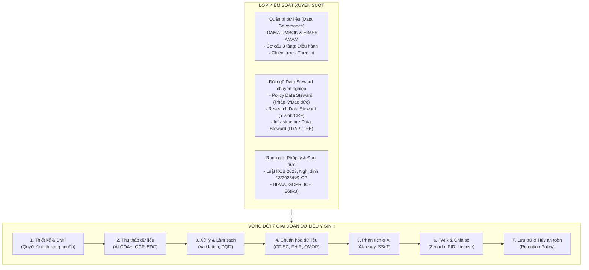
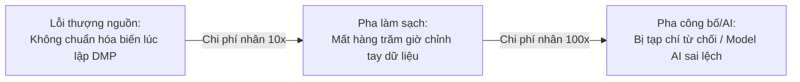

# CHƯƠNG 1. TỔNG QUAN RDM, VÒNG ĐỜI DỮ LIỆU VÀ KẾ HOẠCH QUẢN LÝ DỮ LIỆU (DMP)

> **Thuộc học phần:** Quản lý dữ liệu nghiên cứu y sinh (Biomedical RDM)  
> **Mã học phần dự kiến:** BME-3040 / CS-4080  
> **Thời lượng phân bổ:** 3 giờ (1 giờ Lý thuyết + 2 giờ Thực hành phòng máy Lab 1)  
> **Tài liệu tham khảo nền tảng:** `references/references.bib` (`[@ref_004]`, `[@ref_005]`, `[@ref_007]`, `[@ref_008]`, `[@ref_012]`, `[@ref_013]`, `[@ref_014]`, `[@ref_015]`, `[@ref_016]`, `[@ref_017]`, `[@ref_018]`, `[@ref_021]`, `[@ref_022]`, `[@ref_023]`).

---

## 1. MỤC TIÊU HỌC TẬP & KHUNG NĂNG LỰC (LEARNING OBJECTIVES)

Sau khi hoàn thành chương này, người học đạt được các năng lực cụ thể sau:

1. **Hiểu & Phân tích (Bloom 2 & 4):**
   * Giải thích được bản chất của cuộc khủng hoảng khả năng tái lập trong nghiên cứu y sinh và cơ chế khuếch đại lỗi từ thượng nguồn (Upstream Error Amplification).
   * Phân biệt rạch ròi bản chất và vai trò của bộ ba tài liệu: **Protocol (Đề cương)**, **DMP (Kế hoạch quản lý dữ liệu)**, và **CRF (Biểu mẫu thu thập dữ liệu)**.
   * Trình bày được cấu trúc khung quản trị dữ liệu y tế (DAMA-DMBOK, HIMSS AMAM) và mô hình 3 hồ sơ Data Steward chuyên nghiệp (Policy, Research, Infrastructure).
2. **Áp dụng & Thiết kế (Bloom 3):**
   * Xác định đúng 6 thành phần cốt lõi của một bản Kế hoạch Quản lý và Chia sẻ Dữ liệu (DMSP) theo chuẩn mới nhất của Viện Y tế Quốc gia Hoa Kỳ (NIH NOT-OD-26-046) và Horizon Europe.
   * Tự tay xây dựng được một bản DMSP hoàn chỉnh ($\le 2$ trang) trên nền tảng **DMPTool** cho một đề tài nghiên cứu y sinh cụ thể.

---

## 2. BẢN ĐỒ KHÁI NIỆM & KIẾN TRÚC TỔNG QUAN (CONCEPT MAP)

---

## 3. CƠ SỞ LÝ THUYẾT & CHUẨN MỰC NGÀNH

### 3.1. Khủng hoảng khả năng tái lập và sự ra đời của RDM y sinh
Trong suốt hai thập kỷ qua, cộng đồng khoa học y sinh toàn cầu rung chuyển bởi **cuộc khủng hoảng khả năng tái lập (Reproducibility Crisis)**. Một khảo sát mang tính bước ngoặt của tạp chí *Nature* trên 1.500 nhà nghiên cứu cho thấy hơn **70% nhà khoa học thừa nhận từng thất bại khi cố gắng tái lập thí nghiệm của người khác**, và hơn 50% thất bại khi tái lập chính thí nghiệm của mình.

Trong nghiên cứu tiền lâm sàng và phát triển thuốc, phân tích chấn động của Begley & Ellis (2012) tại tập đoàn Amgen chỉ ra rằng: trong 53 công trình "bước ngoặt" về ung thư được công bố trên các tạp chí đỉnh cao, **chỉ có 6 công trình (11%) có thể tái lập được kết quả**. Ước tính của Freedman và cộng sự (2015) cho thấy tại riêng Hoa Kỳ, khoảng **28 tỷ USD mỗi năm** bị lãng phí vào các nghiên cứu tiền lâm sàng không thể tái lập.

Nguyên nhân cốt lõi không chỉ nằm ở sai số sinh học hay thiết kế thực nghiệm, mà phần lớn xuất phát từ sự yếu kém trong quản trị dữ liệu:
- Dữ liệu thô bị thất lạc sau khi nghiên cứu sinh tốt nghiệp hoặc sau khi bài báo xuất bản.
- Tập tin bảng tính Excel bị lỗi định dạng tự động (ví dụ: tự động đổi tên gen `SEPT2` thành ngày tháng `2-Sep`).
- Không có từ điển dữ liệu (Data Dictionary); sau 2 năm chính tác giả cũng không nhớ các cột mã hóa `0`, `1`, `99` nghĩa là gì.
- Thiếu nhật ký kiểm toán (Audit Trail) ghi lại quá trình tiền xử lý, gạn lọc ngoại lai và kiểm định thống kê.

**Quản lý dữ liệu nghiên cứu y sinh (Biomedical RDM)** ra đời như một đòi hỏi tất yếu của phương pháp luận khoa học hiện đại, nhằm đảm bảo mọi dữ liệu y sinh phải toàn vẹn, có thể kiểm chứng độc lập và có khả năng tái sử dụng an toàn.

---

### 3.2. Vòng đời dữ liệu y sinh & Nguyên lý khuếch đại lỗi thượng nguồn
Dữ liệu y sinh không phải là một tập tin tĩnh được lưu trữ một lần, mà là một thực thể vận động liên tục qua **vòng đời 7 giai đoạn tương thuộc**:

1. **Thiết kế & Lập kế hoạch (Plan):** Xác định loại dữ liệu, khối lượng dự kiến, công cụ thu thập, chuẩn dữ liệu, ngân sách và soạn thảo Kế hoạch Quản lý Dữ liệu (DMP).
2. **Thu thập dữ liệu (Collect):** Triển khai biểu mẫu điện tử (eCRF), nhập liệu tuân thủ chuẩn ALCOA+ và GCP, kiểm soát quyền truy cập.
3. **Xử lý & Làm sạch (Process & Clean):** Kiểm tra tính hợp chuẩn, xử lý dữ liệu khuyết (missing data), phát hiện và hiệu chỉnh bất thường có vết kiểm toán.
4. **Chuẩn hóa & Tích hợp (Standardize):** Ánh xạ cấu trúc sang CDISC SDTM, HL7 FHIR hoặc OMOP CDM; mã hóa thuật ngữ bằng SNOMED CT, LOINC, RxNorm.
5. **Phân tích & Huấn luyện AI (Analyze & Model):** Thực hiện phân tích thống kê suy luận, phân chia tập dữ liệu độc lập (Train/Val/Test), đảm bảo tính minh bạch thuật toán.
6. **Chia sẻ & Công bố (Share & Publish):** Đóng gói siêu dữ liệu theo nguyên tắc FAIR `[@ref_012]`, cấp định danh số vĩnh viễn (DOI/Zenodo), thiết lập điều khoản cấp phép (Open Data License).
7. **Lưu trữ dài hạn & Hủy an toàn (Preserve & Dispose):** Duy trì kho lưu trữ bảo mật (ít nhất 10–15 năm theo quy định thử nghiệm lâm sàng) hoặc tiêu hủy an toàn theo quy định pháp lý.

> **Nguyên lý then chốt:** *Hiệu ứng khuếch đại lỗi từ thượng nguồn (Upstream Error Amplification).* Một quyết định sai lầm hoặc thiếu sót ở giai đoạn lập kế hoạch (ví dụ: không quy định trường bắt buộc, không gắn mã định danh bệnh nhân duy nhất, không xin thỏa thuận chấp thuận cho sử dụng dữ liệu thứ cấp) sẽ làm phát sinh chi phí khắc phục gấp hàng chục lần ở khâu làm sạch, và có thể dẫn tới hậu quả chết người: toàn bộ tập dữ liệu bị Hội đồng Đạo đức (IRB) hoặc Tạp chí cấm sử dụng vì vi phạm quy định pháp lý!

---

### 3.3. Khung Quản trị Dữ liệu Y tế (Data Governance Frameworks)
Quản trị dữ liệu là hệ thống các quyền quyết định, trách nhiệm giải trình và chính sách điều phối nhằm đảm bảo dữ liệu y tế được bảo vệ và khai thác như một tài sản chiến lược. ICH E6(R3) đã chính thức dành riêng **Mục 4 của Phụ lục 1** để quy định bắt buộc về quản trị dữ liệu đối với nhà tài trợ và nghiên cứu viên `[@ref_004]`.

Trong môi trường viện nghiên cứu và bệnh viện đại học, hai khung tham chiếu quốc tế được áp dụng rộng rãi:

#### 1. Mô hình bánh xe DAMA-DMBOK (2nd Edition) `[@ref_014]`
DAMA-DMBOK đặt **Quản trị dữ liệu (Data Governance)** ở vị trí trục tâm trung tâm, chỉ huy và điều phối 10 miền tri thức chức năng:
* Kiến trúc dữ liệu (Data Architecture)
* Mô hình hóa & Thiết kế (Data Modeling & Design)
* Lưu trữ & Vận hành (Data Storage & Operations)
* An toàn dữ liệu (Data Security)
* Tích hợp & Liên thông (Data Integration & Interoperability)
* Tài liệu & Nội dung (Document & Content Management)
* Dữ liệu chủ & Dữ liệu tham chiếu (Master & Reference Data)
* Kho dữ liệu & Phân tích nghiệp vụ (Data Warehousing & BI)
* Quản lý Siêu dữ liệu (Metadata Management)
* Chất lượng dữ liệu (Data Quality)

#### 2. Thước đo trưởng thành phân tích HIMSS AMAM (Analytics Maturity Assessment Model) `[@ref_002]`
HIMSS phân chia năng lực dữ liệu của tổ chức y tế thành 8 cấp độ (từ Cấp 0 đến Cấp 7):
* **Cấp 0–2:** Dữ liệu phân mảnh, lưu trữ cục bộ tại các khoa phòng, phân tích thủ công bằng bảng tính.
* **Cấp 3–4:** Có kho dữ liệu tập trung (Data Warehouse), chuẩn hóa báo cáo nội bộ và theo dõi chỉ số lâm sàng.
* **Cấp 5–7:** Quản trị dữ liệu toàn diện; dữ liệu sẵn sàng cho học máy (AI), phân tích dự báo thời gian thực và liên thông đa trung tâm an toàn.

#### 3. Cơ cấu quản trị 3 tầng tại Bệnh viện Đại học `[@ref_015]`
Để vận hành được khung quản trị, các trung tâm y học hàn lâm thiết lập cơ cấu tổ chức 3 tầng:
1. **Tầng điều hành (Executive Data Council):** Ban Giám đốc viện/trường, phê duyệt chiến lược, ngân sách và chính sách dữ liệu tổng thể.
2. **Tầng chiến lược (Data Stewardship Steering Committee):** Các trưởng khoa lâm sàng, trưởng phòng CNTT, chủ tịch Hội đồng Đạo đức; giải quyết xung đột chia sẻ dữ liệu và định hướng chuẩn hóa.
3. **Tầng thực thi (Operational Data Stewards):** Các cán bộ chuyên trách trực tiếp giám sát từ điển biến số, quy trình làm sạch và cấp phát quyền dữ liệu hàng ngày.

---

### 3.4. Chuyên nghiệp hóa nhân lực: Mô hình 3 hồ sơ Data Steward `[@ref_017]`
Một hạ tầng CNTT đắt đỏ sẽ trở nên vô dụng nếu thiếu con người vận hành. Chương trình Khoa học Mở Quốc gia Hà Lan (NPOS) qua công trình của Jetten và cộng sự (2021) đã định hình chuẩn mực nghề nghiệp **Data Steward** trong nghiên cứu y sinh với 3 hồ sơ năng lực chuyên biệt:

| Hồ sơ Data Steward | Vai trò trọng tâm | Năng lực cốt lõi | Bối cảnh làm việc |
| :--- | :--- | :--- | :--- |
| **Policy Data Steward** *(Chính sách & Tuân thủ)* | Xây dựng quy chế dữ liệu cơ sở; giám sát tuân thủ đạo đức nghiên cứu, pháp luật bảo vệ dữ liệu cá nhân (Nghị định 13/2023, HIPAA, GDPR). | Am hiểu luật y tế, quy trình IRB, quy định sở hữu trí tuệ và thỏa thuận chuyển giao dữ liệu (DUA/DTA). | Văn phòng Quản lý Nghiên cứu Khoa học, Hội đồng Đạo đức. |
| **Research/Domain Data Steward** *(Chuyên môn Y sinh)* | Đồng hành cùng nhóm nghiên cứu; trực tiếp tư vấn thiết kế DMP, từ điển biến số, lựa chọn eCRF và chuẩn hóa thuật ngữ lâm sàng. | Trình độ Thạc sĩ/Tiến sĩ y sinh; hiểu sâu về logic bệnh học, phương pháp dịch tễ và thống kê sinh học. | Nhúng trực tiếp trong các Bộ môn, Khoa lâm sàng hoặc Viện nghiên cứu. |
| **Infrastructure Data Steward** *(Hạ tầng & Kỹ thuật)* | Thiết lập và bảo trì môi trường kỹ thuật: hệ thống REDCap, cổng API FHIR, đường ống ETL OMOP, môi trường nghiên cứu tin cậy (TRE). | Kỹ sư CNTT/Khoa học máy tính; thành thạo SQL, Python/R, Docker, bảo mật mạng và hạ tầng máy chủ y tế. | Trung tâm CNTT, Phòng Tin học Y tế. |

---

### 3.5. Kế hoạch Quản lý và Chia sẻ Dữ liệu (DMP / DMSP)

#### 1. Phân biệt Protocol vs DMP vs CRF
Ba khái niệm này thường xuyên bị người làm nghiên cứu nhầm lẫn:

| Thuộc tính | Protocol (Đề cương nghiên cứu) | DMP (Kế hoạch quản lý dữ liệu) | CRF / eCRF (Biểu mẫu thu thập) |
| :--- | :--- | :--- | :--- |
| **Bản chất** | Hợp đồng khoa học và lâm sàng | Hợp đồng dữ liệu và bảo mật | Công cụ thu thập dữ liệu cụ thể |
| **Câu hỏi trả lời** | *Nghiên cứu làm gì, vì sao, trên ai, can thiệp thế nào?* | *Dữ liệu là gì, lưu ở đâu, chuẩn nào, chia sẻ ra sao, lưu bao lâu?* | *Mỗi bệnh nhân có giá trị biến số nào tại thời điểm nào?* |
| **Người đọc chính** | Hội đồng Khoa học, Hội đồng Đạo đức, Bác sĩ nghiên cứu | Tổ quản trị dữ liệu, Nhà tài trợ, Kỹ sư hệ thống | Nghiên cứu viên, Điều phối viên (CRC), Giám sát viên (CRA) |

#### 2. Yêu cầu của các Nhà tài trợ quốc tế lớn
* **Chính sách NIH DMSP `[@ref_007]`, `[@ref_008]`:**
  - Từ ngày 25/01/2023, mọi hồ sơ xin tài trợ từ NIH tạo ra dữ liệu khoa học đều bắt buộc phải nộp bản DMSP $\le 2$ trang. Bản DMSP được phê duyệt sẽ trở thành một **điều khoản bắt buộc trong hợp đồng tài trợ**.
  - Ngày 25/02/2026, NIH ban hành thông tri **NOT-OD-26-046** tinh giản cấu trúc mẫu DMSP `[@ref_005]`, áp dụng bắt buộc cho các hồ sơ nộp từ ngày 25/05/2026.
* **Chính sách Horizon Europe (Ủy ban châu Âu) `[@ref_003]`:**
  - Áp dụng nguyên tắc vàng: *"Càng mở càng tốt, chỉ đóng khi cần thiết"* (As open as possible, as closed as necessary).
  - Bản DMP sơ bộ nộp cùng hồ sơ; bản DMP chi tiết phải nộp chậm nhất vào tháng thứ 6 của dự án. Dữ liệu công bố phải đi kèm giấy phép mở (CC-BY hoặc CC0).

#### 3. Sáu thành tố bắt buộc của NIH DMSP ($\le 2$ trang)
Một bản DMSP chuẩn mực phải giải trình đầy đủ 6 phần:
1. **Loại dữ liệu (Data Type):** Tóm tắt dữ liệu sẽ được tạo ra (số lượng, định dạng text, hình ảnh, tín hiệu, dữ liệu omics); phân biệt dữ liệu thô và dữ liệu phân tích.
2. **Công cụ, Phần mềm và Mã nguồn liên quan (Related Tools, Software, Code):** Nêu rõ phần mềm chuyên dụng cần thiết để mở, xử lý hoặc tái lập dữ liệu (ví dụ: Python, R script, REDCap, Docker container).
3. **Tiêu chuẩn dữ liệu (Standards):** Các chuẩn cấu trúc và từ vựng sẽ áp dụng (ví dụ: CDISC SDTM, HL7 FHIR, SNOMED CT, LOINC).
4. **Bảo tồn dữ liệu, Kho lưu trữ và Thời hạn chia sẻ (Data Preservation, Repositories, Timelines):** Tên kho lưu trữ dữ liệu mở được chỉ định (Zenodo, PhysioNet, dbGaP); cam kết thời điểm mở dữ liệu (chậm nhất khi bài báo xuất bản).
5. **Hạn chế tiếp cận, Ràng buộc đạo đức và Bảo vệ quyền riêng tư (Access, Distribution, or Reuse Considerations):** Biện pháp khử định danh (HIPAA Safe Harbor, Nghị định 13/2023/NĐ-CP); thỏa thuận chấp thuận của bệnh nhân (Informed Consent); kiểm soát rủi ro tái định danh.
6. **Giám sát và Thực thi Kế hoạch (Oversight of Data Management and Sharing):** Nêu đích danh người hoặc tổ chức chịu trách nhiệm giám sát định kỳ (Data Steward, Principal Investigator).

#### 4. Xu hướng Kế hoạch Quản lý Dữ liệu Máy đọc được (Machine-actionable DMPs - maDMPs) `[@ref_021]`, `[@ref_022]`
DMP truyền thống là một tài liệu tĩnh (Word/PDF). Xu hướng hiện đại chuyển đổi sang **maDMP**: dữ liệu hóa chính bản DMP dưới định dạng JSON có cấu trúc (theo chuẩn của Research Data Alliance - RDA). Điều này cho phép hệ thống tự động:
- Thông báo cho phòng IT cấp dung lượng máy chủ trước khi pha thu thập bắt đầu.
- Tự động đồng bộ thông tin đề tài sang hệ thống kho lưu trữ (Zenodo API) mà không cần nhập liệu lại.

---

## 4. NGHIÊN CỨU TÌNH HUỐNG THỰC TẾ & BÀI HỌC THẤT BẠI (CASE STUDIES)

### Case Study 1: Thảm họa rút bài Surgisphere (Lancet & NEJM, 2020)
* **Bối cảnh:** Trong giai đoạn cao điểm của đại dịch COVID-19, hai tạp chí y khoa danh giá nhất thế giới là *The Lancet* và *The New England Journal of Medicine (NEJM)* đã xuất bản hai công trình chấn động dựa trên cơ sở dữ liệu của công ty Surgisphere, tuyên bố phân tích dữ liệu trên gần 100.000 bệnh nhân từ hàng trăm bệnh viện toàn cầu về thuốc Hydroxychloroquine.
* **Khủng hoảng nổ ra:** Các nhà khoa học độc lập phát hiện dữ liệu có sự đồng nhất bất thường, số ca bệnh tại Úc vượt quá tổng số ca nhiễm thực tế của cả nước. Khi các tạp chí yêu cầu một đơn vị kiểm toán độc lập đối soát dữ liệu thô, Surgisphere từ chối cung cấp dữ liệu với lý do "bảo mật hợp đồng với khách hàng".
* **Hậu quả:** Cả *The Lancet* và *NEJM* phải cay đắng ra thông báo **rút bài (Retraction)**. Sự kiện trở thành một trong những vụ bê bối khoa học lớn nhất thế kỷ 21, làm gián đoạn các thử nghiệm điều trị của WHO.
* **Bài học RDM cốt lõi:** Một công trình nghiên cứu dù tầm cỡ đến đâu cũng sẽ sụp đổ nếu **không có cơ chế truy vết dữ liệu gốc (Data Provenance), không có Kế hoạch Quản lý Dữ liệu minh bạch và không thể kiểm chứng độc lập**.

---

## 5. HƯỚNG DẪN THỰC HÀNH PHÒNG MÁY (HANDS-ON LAB 1 GUIDE)

### Bài thực hành: Soạn thảo DMSP chuẩn NIH trên DMPTool

* **Mục tiêu:** Sử dụng công cụ trực tuyến **DMPTool** (dmptool.org) để soạn thảo một bản Kế hoạch Quản lý và Chia sẻ Dữ liệu $\le 2$ trang cho một nghiên cứu thử nghiệm lâm sàng giả định.
* **Đề bài tình huống:** Bạn là Research Data Steward cho đề tài: *"Nghiên cứu ứng dụng Trí tuệ Nhân tạo đa phương thức hỗ trợ chẩn đoán và theo dõi bệnh mày đay mạn tính tại Việt Nam"* (Cỡ mẫu: 1.000 bệnh nhân, thu thập hình ảnh tổn thương da, chỉ số UAS7, xét nghiệm IgE và dữ liệu bệnh án điện tử).

#### Các bước thực hiện:
1. **Bước 1:** Truy cập `https://dmptool.org`, đăng ký tài khoản (sử dụng email tổ chức hoặc ORCID).
2. **Bước 2:** Bấm **Create Plan**, nhập tên đề tài và chọn nhà tài trợ **National Institutes of Health (NIH)** $\rightarrow$ Chọn mẫu **NIH-Default DMSP (Updated / 2026 template)**.
3. **Bước 3: Điền 6 mục nội dung:**
   - *Data Type:* Nêu rõ dữ liệu số gồm bảng lâm sàng (.csv), ảnh tổn thương sẩn phù (.jpeg, có thước đo chuẩn), kết quả xét nghiệm (.csv). Dự kiến dung lượng: ~50 GB.
   - *Tools/Code:* Phần mềm REDCap thu thập dữ liệu; Python 3.12 (thư viện PyTorch, OpenCV) để xử lý ảnh; R 4.4 để phân tích thống kê. Mã nguồn công khai trên GitHub.
   - *Standards:* Phân loại bệnh theo ICD-10; thuật ngữ tổn thương theo SNOMED CT; xét nghiệm theo LOINC; cấu trúc bảng theo OMOP CDM v5.4.
   - *Repositories:* Dữ liệu ẩn danh công bố trên kho dữ liệu mở **Zenodo** khi bài báo được chấp nhận xuất bản; cấp DOI cố định.
   - *Privacy:* Khử toàn bộ 18 định danh HIPAA; xóa khuôn mặt và đặc điểm nhận dạng cá nhân trên ảnh; Date Shifting ngẫu nhiên 1–30 ngày; tuân thủ Nghị định 13/2023/NĐ-CP và Luật KCB 2023. Bệnh nhân ký Informed Consent cho phép chia sẻ dữ liệu thứ cấp ẩn danh.
   - *Oversight:* TS. Nguyễn Văn A (Chủ nhiệm đề tài) và Data Steward khoa chịu trách nhiệm kiểm tra định kỳ 6 tháng/lần.
4. **Bước 4:** Xuất bản tài liệu ra định dạng PDF.

#### Bảng Checklist tự chấm điểm bản DMSP (Self-Assessment Rubric):
- [ ] Dung lượng không vượt quá 2 trang A4 (font chữ 11pt, lề 0.5 inch).
- [ ] Đầy đủ 6 đề mục theo đúng thông tri NIH.
- [ ] Tên kho lưu trữ dữ liệu (Repository) là kho được cộng đồng công nhận, có cấp DOI.
- [ ] Có phương án bảo vệ quyền riêng tư và đối chiếu văn bản pháp luật cụ thể.

---

## 6. CÂU HỎI THẢO LUẬN & BÀI TẬP TÌNH HUỐNG

1. **Câu hỏi thảo luận 1:** Một bác sĩ lâm sàng cho rằng: *"Tôi chỉ cần tập trung khám chữa bệnh và lấy mẫu cho bệnh nhân, còn việc dữ liệu lưu ở đâu và quản lý thế nào là việc của phòng CNTT"*. Bạn dùng những luận điểm nào của Chương 1 để thuyết phục bác sĩ này thay đổi quan điểm?
2. **Bài tập tình huống 2:** Nhóm nghiên cứu của bạn nộp bài báo cho tạp chí quốc tế. Ban biên tập yêu cầu: *"Tác giả phải công khai toàn bộ dữ liệu thô của bệnh nhân lên kho lưu trữ mở để bạn đọc tái lập phân tích, nếu không bài báo sẽ bị từ chối"*. Tuy nhiên, trong thỏa thuận đồng thuận (Informed Consent) ký với bệnh nhân cách đây 2 năm, nhóm bạn quên không ghi điều khoản cho phép chia sẻ dữ liệu thứ cấp. Nhóm bạn đang đối mặt với nguy cơ gì và cách xử lý trong khuôn khổ đạo đức/pháp lý?

---

## 7. DANH MỤC TÀI LIỆU THAM KHẢO

1. **Wilkinson, M. D., et al. (2016).** The FAIR Guiding Principles for scientific data management and stewardship. *Scientific Data*, 3, 160018. `[@ref_012]`
2. **International Council for Harmonisation. (2025).** *ICH E6(R3) Guideline for Good Clinical Practice — Final Guideline Step 4*. `[@ref_004]`
3. **National Institutes of Health. (2020).** Final NIH Policy for Data Management and Sharing. *Notice NOT-OD-21-013*. `[@ref_007]`
4. **National Institutes of Health. (2020).** Supplemental Information: Elements of an NIH Data Management and Sharing Plan. *Notice NOT-OD-21-014*. `[@ref_008]`
5. **National Institutes of Health. (2026).** Updated Elements of an NIH Data Management and Sharing Plan. *Notice NOT-OD-26-046*. `[@ref_005]`
6. **European Commission. (n.d.).** *Horizon Europe Data Management Plan Template*. `[@ref_003]`
7. **DAMA International. (2017).** *DAMA-DMBOK: Data Management Body of Knowledge* (2nd ed.). Technics Publications. `[@ref_014]`
8. **Jetten, M., et al. (2021).** *Professionalising data stewardship in the Netherlands: competences, training and education*. National Programme Open Science (NPOS). `[@ref_017]`
9. **The Turing Way Community. (2022).** *The Turing Way: A handbook for reproducible, ethical and collaborative data science*. Zenodo. `[@ref_018]`
10. **Miksa, T., et al. (2019).** Ten simple rules for machine-actionable data management plans. *PLOS Computational Biology*, 15(11), e1007447. `[@ref_022]`
11. **Society for Clinical Data Management. (n.d.).** *Good Clinical Data Management Practices (GCDMP)*. `[@ref_013]`
12. **Cheah, P. Y., et al. (2021).** Data governance in academic medical centers: A three-tier institutional model. *Journal of Clinical and Translational Science*. `[@ref_015]`
