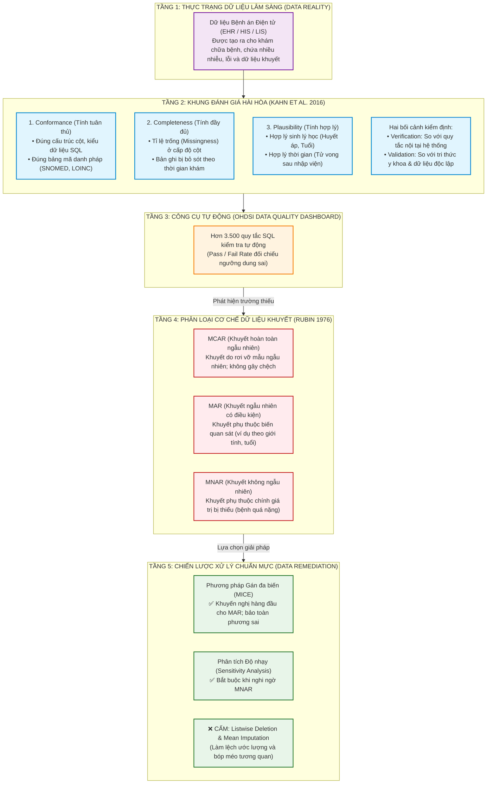
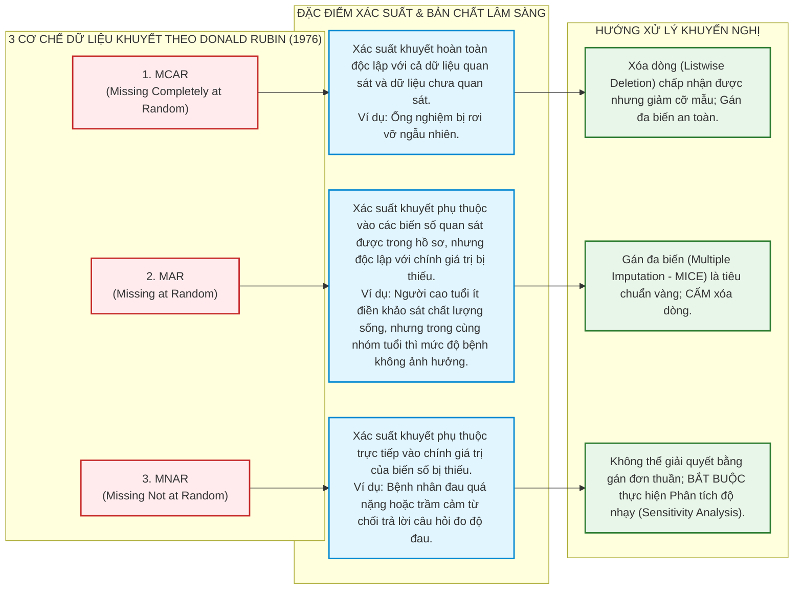

# CHƯƠNG 4. ĐÁNH GIÁ CHẤT LƯỢNG DỮ LIỆU, DATA QUALITY DASHBOARD (DQD) VÀ XỬ LÝ DỮ LIỆU KHUYẾT

> **Mã học phần:** BIO-RDM-2026 | **Thời lượng:** 3 giờ tín chỉ (1 giờ Lý thuyết + 2 giờ Thực hành phòng máy Lab 4)  
> **Bộ tài liệu:** *Giáo trình Quản lý Dữ liệu Nghiên cứu Y sinh học (Biomedical Research Data Management)*  
> **Phiên bản:** `v2.0.0_20261121` | **Chuẩn trích dẫn:** SSoT BibTeX (`references/references.bib`)

---

## 1. MỤC TIÊU HỌC TẬP VÀ KHUNG NĂNG LỰC (LEARNING OBJECTIVES)

Sau khi hoàn thành Chương 4, người học đạt được các chuẩn năng lực đầu ra (CLOs):

1. **Hiểu và Phân biệt (Bloom Mức 2 - CLO1):**
   - Phân tích được các đặc tính dị biệt và nguyên nhân gây "bẩn" của dữ liệu bệnh án điện tử (EHR) khi tái sử dụng cho mục đích nghiên cứu thứ cấp.
   - Trình bày thông suốt khung đánh giá chất lượng dữ liệu hài hòa của **Kahn và cộng sự (2016)**, bao gồm 3 chiều kích cốt lõi: **Tính tuân thủ (Conformance)**, **Tính đầy đủ (Completeness)**, và **Tính hợp lý (Plausibility)**, được đối chiếu qua 2 bối cảnh: **Xác minh nội tại (Verification)** và **Thẩm định ngoại tại (Validation)**.
   - Phân biệt bản chất toán học, giả định thống kê và hệ quả dịch tễ học của ba cơ chế dữ liệu khuyết theo **Donald Rubin (1976)**: **MCAR** (*Missing Completely at Random*), **MAR** (*Missing at Random*), và **MNAR** (*Missing Not at Random*).

2. **Áp dụng và Thực hành (Bloom Mức 3 - CLO3):**
   - Khai thác và đọc hiểu kết quả kiểm thử tự động từ công cụ **Data Quality Dashboard (DQD)** của mạng lưới OHDSI trên các cơ sở dữ liệu y tế quy chuẩn.
   - Nhận diện các quy luật khuyết trong tập dữ liệu lâm sàng thực tế và lựa chọn kỹ thuật xử lý phù hợp; áp dụng phương pháp **Gán đa biến (Multiple Imputation - MICE)** theo hướng dẫn của **Sterne và cộng sự (2009)**.
   - Tránh các sai lầm suy luận thống kê nghiêm trọng do tự ý xóa dòng bỏ sót (*Listwise Deletion*) hoặc điền giá trị trung bình (*Mean Substitution*).

3. **Phân tích và Đánh giá (Bloom Mức 4 - CLO3):**
   - Đánh giá tác động tiêu cực của dữ liệu sai lệch và dữ liệu khuyết đối với "Khủng hoảng tái lập" (*Reproducibility Crisis*) trong nghiên cứu y sinh học.
   - Thiết kế quy trình kiểm soát chất lượng dữ liệu nhiều tầng và xây dựng phân tích độ nhạy (*Sensitivity Analysis*) để kiểm chứng độ vững của kết luận khoa học.

---

## 2. BẢN ĐỒ KHÁI NIỆM (CONCEPT MAP)

Sơ đồ dưới đây trực quan hóa mối quan hệ giữa khung đánh giá chất lượng dữ liệu Kahn 3x2, công cụ kiểm thử DQD và chiến lược xử lý dữ liệu khuyết:



---

## 3. CƠ SỞ LÝ THUYẾT VÀ CHUẨN MỰC NGÀNH

### 3.1. Nghịch lý Dữ liệu Thứ cấp: Vì sao Dữ liệu Y tế lại "Bẩn"?

Một trong những sai lầm phổ biến nhất của các nhà khoa học dữ liệu khi bước vào lĩnh vực y tế là giả định rằng dữ liệu bệnh án điện tử (EHR) phản ánh trung thực và hoàn hảo tình trạng sức khỏe của người bệnh. Trên thực tế:
- **Mục đích sinh ra:** Hệ thống EHR được thiết kế nhằm phục vụ quy trình chăm sóc lâm sàng tại giường bệnh và thanh quyết toán bảo hiểm y tế, hoàn toàn **không được thiết kế để phục vụ nghiên cứu khoa học**.
- **Hiệu ứng đo lường phụ thuộc vào chăm sóc (Informing Presence):** Bệnh nhân càng nặng thì số lượng bản ghi xét nghiệm, đo lường sinh tồn và đơn thuốc càng nhiều; ngược lại, người khỏe mạnh hoặc bệnh nhẹ hầu như không có dữ liệu. Do đó, "dữ liệu bị thiếu" trong bệnh án thường đồng nghĩa với việc "bác sĩ không thấy cần thiết phải chỉ định xét nghiệm", chứ không phải là một hiện tượng ngẫu nhiên.
- Theo khảo sát tổng quan của **Weiskopf & Weng (2013)** [@ref_028], chất lượng dữ liệu EHR dao động rất lớn giữa các cơ sở y tế và luôn tồn tại các lỗi có hệ thống về độ đầy đủ và tính nhất quán.

---

### 3.2. Khung Đánh giá Hài hòa của Kahn và Cộng sự (2016)

Để chuẩn hóa việc đánh giá chất lượng dữ liệu y tế trên phạm vi toàn cầu, **Kahn và cộng sự (2016)** đã công bố khung đánh giá chất lượng hài hòa (*Harmonized Data Quality Framework*) [@ref_030], phân chia việc kiểm định thành ma trận giữa **3 Chiều kích chất lượng** và **2 Bối cảnh kiểm tra**:

#### 3.2.1. Ba Chiều Kích Chất Lượng Cốt Lõi
1. **Tính Tuân Thủ (Conformance):** Dữ liệu có tuân thủ đúng các quy tắc kỹ thuật và chuẩn mực đã xác định trước hay không?
   - *Tuân thủ quan hệ (Relational Conformance):* Các bảng có đúng khóa chính, khóa ngoại, không có bản ghi mồ côi (*orphan records*).
   - *Tuân thủ tính toán (Computational Conformance):* Đúng kiểu dữ liệu quy định (ví dụ trường ngày tháng không chứa chuỗi văn bản lạ).
   - *Tuân thủ từ vựng (Value Conformance):* Giá trị các trường mã hóa phải thuộc danh mục chuẩn (ví dụ mã giới tính chỉ được phép là `8507`, `8532` trong OMOP CDM).
2. **Tính Đầy Đủ (Completeness):** Sự hiện diện đầy đủ của dữ liệu:
   - Tỉ lệ ô bị bỏ trống (*null value rate*) tại các trường dữ liệu quan trọng.
   - Sự vắng mặt của toàn bộ một khoảng thời gian dữ liệu (ví dụ hệ thống máy chủ bị mất điện trong 3 ngày khiến toàn bộ dữ liệu xét nghiệm của tuần đó bị khuyết).
3. **Tính Hợp Lý (Plausibility):** Dữ liệu có đáng tin cậy và phản ánh đúng quy luật sinh học, lâm sàng và thời gian hay không?
   - *Hợp lý về giá trị đơn lẻ (Univariate Plausibility):* Giá trị đo lường nằm trong giới hạn sinh tồn con người (ví dụ nhịp tim từ 30 đến 220 lần/phút; tuổi không thể là số âm hoặc lớn hơn 130).
   - *Hợp lý thời gian (Temporal Plausibility):* Trật tự thời gian logic (ngày tử vong phải sau ngày sinh; ngày xuất viện phải sau ngày nhập viện).
   - *Hợp lý chéo giữa các biến (Multivariate / Atemporal Plausibility):* Mối liên hệ logic giữa hai thuộc tính (ví dụ chẩn đoán ung thư tuyến tiền liệt không thể xuất hiện ở bệnh nhân có giới tính sinh học là nữ).

#### 3.2.2. Hai Bối Cảnh Kiểm Tra: Verification vs Validation
- **Xác minh (Verification):** Kiểm tra xem dữ liệu có khớp đúng với các quy định kỹ thuật được mô tả trong tài liệu thiết kế hệ thống hay không (kiểm tra nội tại dữ liệu, không cần nguồn đối chiếu bên ngoài).
- **Thẩm định (Validation):** Kiểm tra xem dữ liệu có phản ánh đúng thế giới thực hay không bằng cách đối chiếu với một nguồn dữ liệu độc lập hoặc tri thức chuyên gia y khoa (ví dụ: so sánh tỉ lệ mắc bệnh tiểu đường trong cơ sở dữ liệu bệnh viện với tỉ lệ dịch tễ học quốc gia được công bố bởi Bộ Y tế).

---

### 3.3. Công cụ Data Quality Dashboard (DQD) của Hiệp hội OHDSI

Dựa trên khung lý thuyết của Kahn et al., hiệp hội OHDSI đã phát triển phần mềm mã nguồn mở **Data Quality Dashboard (DQD)** [@ref_011, @ref_038].
- **Cơ chế vận hành:** DQD thực thi hơn 3.500 câu truy vấn SQL chuẩn hóa trực tiếp trên cơ sở dữ liệu OMOP CDM. Mỗi câu truy vấn tương ứng với một phép thử cụ thể thuộc ma trận Kahn.
- **Ngưỡng thất bại (Fail Thresholds):** Với mỗi quy tắc, nhóm nghiên cứu thiết lập một ngưỡng dung sai chấp nhận được (ví dụ: trường `birthDate` được phép khuyết tối đa 1%, nhưng trường `gender_concept_id` phải đạt 0% lỗi).
- **Kết quả đầu ra:** DQD xuất ra một tệp JSON tổng hợp và một giao diện web trực quan hiển thị tỉ lệ tổng thể:
  $$\text{Pass Rate} = \frac{\text{Số phép kiểm đạt (Passed Checks)}}{\text{Tổng số phép kiểm thực thi (Total Checks)}} \times 100\%$$
- Các cơ sở nghiên cứu bắt buộc phải công bố báo cáo DQD trước khi chia sẻ dữ liệu hoặc tham gia vào các phân tích dịch tễ học quốc tế.

---

### 3.4. Cơ Chế Dữ Liệu Khuyết (Missing Data Mechanisms) theo Donald Rubin

Khi phát hiện dữ liệu bị khuyết, câu hỏi quan trọng nhất mang tính quyết định đến phương pháp xử lý không phải là *"Điền giá trị gì vào ô trống?"*, mà là **"Tại sao dữ liệu này lại bị khuyết?"** [@ref_031]. 

Theo lý thuyết kinh điển của Donald Rubin (1976), dữ liệu khuyết được phân làm 3 cơ chế:



#### 3.4.1. Những Sai Lầm Phổ Biến Cần Tránh Tuyệt Đối
1. **Phân tích ca hoàn chỉnh / Xóa dòng (Complete Case Analysis / Listwise Deletion):**
   - Loại bỏ bất kỳ bệnh nhân nào có ít nhất một giá trị bị khuyết.
   - *Hậu quả:* Nếu nghiên cứu có 20 biến số và mỗi biến chỉ khuyết ngẫu nhiên 5%, việc xóa dòng có thể làm mất hơn 60% cỡ mẫu nghiên cứu. Đặc biệt nếu dữ liệu thuộc dạng MAR hoặc MNAR, việc xóa dòng sẽ làm **lệch hoàn toàn ước lượng thống kê (Selection Bias)**, biến một kết luận nghiên cứu thành sai sự thật.
2. **Điền giá trị trung bình (Mean Substitution):**
   - Lấy giá trị trung bình của các bệnh nhân có dữ liệu để điền vào ô trống.
   - *Hậu quả:* Làm suy giảm phương sai tự nhiên của dữ liệu một cách giả tạo, làm hẹp khoảng tin cậy (*Confidence Intervals*) dẫn đến sai lầm loại I (kết luận có ý nghĩa thống kê trong khi thực tế không có), đồng thời phá vỡ mối tương quan hiệp phương sai giữa các biến.
3. **Kế thừa giá trị quan sát cuối cùng (Last Observation Carried Forward - LOCF):**
   - Lấy kết quả lần khám trước gán cho lần khám sau bị khuyết.
   - *Hậu quả:* Giả định vô căn cứ rằng tình trạng bệnh nhân không thay đổi, che giấu các chuyển biến xấu hoặc tác dụng phụ nguy hiểm của thuốc.

#### 3.4.2. Tiêu Chuẩn Vàng: Phương Pháp Gán Đa Biến (Multiple Imputation - MICE)
Theo khuyến nghị từ báo cáo phương pháp luận của **Sterne và cộng sự (2009)** trên tạp chí BMJ [@ref_032], phương pháp **Gán Đa biến qua Phương trình Chuỗi (Multiple Imputation by Chained Equations - MICE)** là giải pháp tối ưu cho dữ liệu MAR:
1. **Giai đoạn Gán (Imputation):** Thay vì tạo ra một giá trị duy nhất, MICE ước lượng phân phối xác suất có điều kiện và tạo ra $m$ bộ dữ liệu hoàn chỉnh khác nhau ($m$ thường từ 5 đến 20), trong đó mỗi ô khuyết được điền bằng một giá trị có tính đến sai số ngẫu nhiên.
2. **Giai đoạn Phân tích (Analysis):** Chạy mô hình hồi quy thống kê riêng biệt trên từng bộ dữ liệu trong số $m$ bộ dữ liệu vừa tạo.
3. **Giai đoạn Gộp kết quả (Pooling):** Sử dụng **Quy tắc gộp của Rubin (Rubin's Rules)** để kết hợp các ước lượng tham số và tính toán sai số chuẩn tổng hợp, phản ánh đầy đủ cả sai số lấy mẫu lẫn sự không chắc chắn do dữ liệu khuyết gây ra.

---

## 4. NGHIÊN CỨU TÌNH HUỐNG VÀ BÀI HỌC THẤT BẠI (FAILURE ANALYSIS)

### Case Study 1: Thảm họa rút lui bài báo do xóa dòng dữ liệu tùy tiện (Selection Bias)
- **Bối cảnh:** Một nhóm nghiên cứu lâm sàng thực hiện thử nghiệm quan sát đánh giá nguy cơ biến cố tim mạch của một loại thuốc hạ đường huyết mới trên 5.000 bệnh nhân. Trong bảng dữ liệu theo dõi, biến số "Mức độ đau ngực" bị khuyết ở 35% bệnh nhân.
- **Sai sót:** Nhóm tác giả đã áp dụng phương pháp *Listwise Deletion* (xóa bỏ toàn bộ 1.750 bệnh nhân có thông tin đau ngực bị khuyết) và chạy mô hình trên 3.250 bệnh nhân còn lại. Kết quả cho thấy tỷ lệ biến cố tim mạch ở nhóm dùng thuốc mới thấp hơn có ý nghĩa thống kê ($p < 0.01$). Bài báo được xuất bản trên một tạp chí tim mạch danh tiếng.
- **Hậu quả thanh tra:** Sau khi xuất bản, các nhà dịch tễ học độc lập phân tích lại bộ dữ liệu gốc và phát hiện cơ chế khuyết là **MNAR kết hợp MAR**: Những bệnh nhân bị đau ngực dữ dội thường được chuyển khẩn cấp sang phòng can thiệp mạch vành hoặc tử vong trước khi kịp điền phiếu câu hỏi theo dõi. Do đó, việc xóa dòng đã vô tình "lọc sạch" những bệnh nhân nặng nhất ra khỏi nghiên cứu. Khi phân tích lại toàn bộ đoàn hệ bằng phương pháp gán dữ liệu và phân tích độ nhạy, loại thuốc mới thực chất làm **tăng 1.8 lần nguy cơ tử vong do tim mạch**. Bài báo bị tạp chí rút lui (*retraction*) và nhóm tác giả bị điều tra đạo đức nghiên cứu.

### Case Study 2: Phát hiện sai lệch Plausibility do thay đổi đơn vị đo xét nghiệm
- **Bối cảnh:** Một bệnh viện đa khoa nâng cấp hệ thống máy xét nghiệm sinh hóa tự động. Trước đây, chỉ số Creatinine huyết thanh được đo bằng đơn vị `mg/dL` (giá trị sinh lý bình thường khoảng 0.7 - 1.3 mg/dL). Thiết bị mới xuất kết quả theo đơn vị quốc tế SI là `µmol/L` (giá trị bình thường khoảng 62 - 115 µmol/L, với hệ số chuyển đổi là $1 \text{ mg/dL} \approx 88.4 \text{ µmol/L}$).
- **Sai sót:** Bộ phận IT khi mapping dữ liệu vào kho nghiên cứu đã quên cập nhật trường đơn vị đo và giữ nguyên tên cột `creatinine_value`.
- **Hậu quả:** Khi công cụ DQD được chạy, quy tắc kiểm tra *Plausibility (Univariate Value Range)* đã lập tức kích hoạt cảnh báo đỏ: hơn 95% bệnh nhân sau ngày chuyển giao thiết bị có nồng độ Creatinine huyết thanh > 60 mg/dL (ngưỡng mà người bình thường đã tử vong vì suy thận giai đoạn cuối). Nhờ kiểm thử tự động DQD, lỗi mapping ngữ nghĩa nghiêm trọng này đã được phát hiện và khắc phục trước khi dữ liệu được đưa vào phân tích dịch tễ học.

---

## 5. HƯỚNG DẪN THỰC HÀNH PHÒNG MÁY - LAB 4 (2 GIỜ)

### 5.1. Bối cảnh Nghiên cứu và Đề bài
Trong bài thực hành này, học viên đóng vai trò là **Chuyên viên Đảm bảo Chất lượng Dữ liệu Y tế (Data Quality Analyst)** cho đề tài nghiên cứu đoàn hệ bệnh Mày đay Mạn tính (**DrMayDay Cohort**). Học viên nhận được một tập dữ liệu thô gồm 500 bệnh nhân theo dõi trong 6 tháng (`csu_quality_lab4.csv`).

**Mục tiêu bài Lab:**
1. Khảo sát và phân loại các lỗi dữ liệu theo khung ma trận Kahn (Conformance, Completeness, Plausibility).
2. Phát hiện và phân tích quy luật dữ liệu khuyết trên các biến: Tuổi (`age`), Điểm hoạt động mày đay (`uas7`), Nồng độ IgE huyết thanh (`ige_level`), và Tình trạng đáp ứng điều trị (`response_status`).
3. Xây dựng script Python so sánh 3 phương pháp xử lý dữ liệu khuyết:
   - Phương pháp 1: Phân tích ca hoàn chỉnh (*Listwise Deletion*).
   - Phương pháp 2: Điền giá trị trung bình (*Mean Imputation*).
   - Phương pháp 3: Gán đa biến qua phương trình chuỗi (*Multiple Imputation using MICE / IterativeImputer*).
4. Nhận xét sự sai lệch về giá trị trung bình ước lượng, phương sai và sai số chuẩn giữa các phương pháp.

---

### 5.2. Mẫu Dữ Liệu Lâm Sàng Giả Lập (`csu_quality_lab4.csv`)
Dưới đây là cấu trúc tệp dữ liệu thực hành mẫu:

```csv
patient_id,age,gender,sys_bp,uas7,ige_level,response_status
CSU-001,34,F,120,28,145.2,1
CSU-002,45,M,135,NA,320.0,0
CSU-003,29,F,110,14,NA,1
CSU-004,180,M,125,36,89.5,0
CSU-005,52,F,140,NA,NA,0
CSU-006,41,M,800,22,210.4,1
CSU-007,38,F,118,19,165.0,1
CSU-008,61,M,145,40,450.8,0
CSU-009,48,F,130,NA,190.2,1
CSU-010,33,M,122,16,112.0,1
```

*(Lưu ý các dị biệt cố ý: `CSU-004` có tuổi = 180 (vi phạm Plausibility); `CSU-006` có huyết áp tâm thu = 800 (vi phạm Plausibility); biến `uas7` và `ige_level` có giá trị `NA` cần kiểm định).*

---

### 5.3. Script Python Thực Hành Phân Tích & Gán Đa Biến (MICE)

Học viên xây dựng tệp mã nguồn `data_quality_mice_lab4.py` như sau:

```python
"""
Mô-đun thực hành Lab 4: Đánh giá Chất lượng Dữ liệu & So sánh Phương pháp Xử lý Dữ liệu Khuyết
Khóa học: Quản lý Dữ liệu Nghiên cứu Y sinh học (Biomedical RDM)
"""

import numpy as np
import pandas as pd
from sklearn.experimental import enable_iterative_imputer
from sklearn.impute import IterativeImputer, SimpleImputer

# 1. Đọc dữ liệu nghiên cứu mày đay mạn tính
df = pd.read_csv('csu_quality_lab4.csv')
print(f"Tổng số bản ghi ban đầu: {len(df)}")

# 2. BƯỚC 1: KIỂM ĐỊNH TÍNH HỢP LÝ (PLAUSIBILITY CHECK) THEO KHUNG KAHN
# Lọc và làm sạch các giá trị ngoài giới hạn sinh học người
invalid_age = df[(df['age'] < 0) | (df['age'] > 120)]
invalid_bp = df[(df['sys_bp'] < 60) | (df['sys_bp'] > 250)]

print("\n--- PHÁT HIỆN LỖI PLAUSIBILITY (KHUNG KAHN) ---")
print(f"Bản ghi sai tuổi: {len(invalid_age)} trường hợp (Ví dụ ID: {invalid_age['patient_id'].tolist()})")
print(f"Bản ghi sai huyết áp tâm thu: {len(invalid_bp)} trường hợp (Ví dụ ID: {invalid_bp['patient_id'].tolist()})")

# Chuyển các giá trị vi phạm sinh lý thành NaN (Missing) để xử lý chuẩn tắc
df.loc[(df['age'] < 0) | (df['age'] > 120), 'age'] = np.nan
df.loc[(df['sys_bp'] < 60) | (df['sys_bp'] > 250), 'sys_bp'] = np.nan

# 3. BƯỚC 2: PHÂN TÍCH TỶ LỆ DỮ LIỆU KHUYẾT (COMPLETENESS CHECK)
print("\n--- BÁO CÁO TỶ LỆ DỮ LIỆU KHUYẾT (MISSING RATE) ---")
missing_summary = df.isnull().sum()
missing_percent = (df.isnull().sum() / len(df)) * 100
missing_report = pd.DataFrame({'Missing Count': missing_summary, 'Percentage (%)': missing_percent})
print(missing_report[missing_report['Missing Count'] > 0])

# Chọn các biến số định lượng quan trọng để chạy thử nghiệm so sánh
features = ['age', 'sys_bp', 'uas7', 'ige_level']
df_features = df[features].copy()

# 4. SO SÁNH PHƯƠNG PHÁP 1: LISTWISE DELETION (XÓA DÒNG BỎ SÓT)
df_listwise = df_features.dropna()
n_dropped = len(df_features) - len(df_listwise)
print(f"\n--- PHƯƠNG PHÁP 1: LISTWISE DELETION ---")
print(f"Số bản ghi bị loại bỏ: {n_dropped} ({n_dropped/len(df_features)*100:.1f}%)")
print(f"Cỡ mẫu còn lại: {len(df_listwise)}")
print("Ước lượng trung bình uas7:", df_listwise['uas7'].mean())
print("Độ lệch chuẩn uas7:", df_listwise['uas7'].std())

# 5. SO SÁNH PHƯƠNG PHÁP 2: MEAN IMPUTATION (ĐIỀN TRUNG BÌNH)
mean_imp = SimpleImputer(strategy='mean')
df_mean_imputed = pd.DataFrame(mean_imp.fit_transform(df_features), columns=features)
print(f"\n--- PHƯƠNG PHÁP 2: MEAN IMPUTATION ---")
print("Ước lượng trung bình uas7:", df_mean_imputed['uas7'].mean())
print("Độ lệch chuẩn uas7 (bị sụt giảm nhân tạo):", df_mean_imputed['uas7'].std())

# 6. SO SÁNH PHƯƠNG PHÁP 3: MULTIPLE IMPUTATION BẰNG MICE (ITERATIVE IMPUTER)
# Sử dụng mô hình hồi quy lặp qua chuỗi để bảo toàn mối quan hệ hiệp phương sai
mice_imp = IterativeImputer(max_iter=10, random_state=42)
df_mice_imputed = pd.DataFrame(mice_imp.fit_transform(df_features), columns=features)
print(f"\n--- PHƯƠNG PHÁP 3: MICE (TIÊU CHUẨN VÀNG CHO MAR) ---")
print("Ước lượng trung bình uas7:", df_mice_imputed['uas7'].mean())
print("Độ lệch chuẩn uas7 (bảo toàn phương sai tự nhiên):", df_mice_imputed['uas7'].std())

# 7. TỔNG HỢP VÀ ĐỐI CHIẾU
comparison_df = pd.DataFrame({
    'Metric': ['Cỡ mẫu (N)', 'Mean UAS7', 'SD UAS7', 'Mean IgE', 'SD IgE'],
    'Listwise Deletion': [len(df_listwise), df_listwise['uas7'].mean(), df_listwise['uas7'].std(), df_listwise['ige_level'].mean(), df_listwise['ige_level'].std()],
    'Mean Imputation': [len(df_mean_imputed), df_mean_imputed['uas7'].mean(), df_mean_imputed['uas7'].std(), df_mean_imputed['ige_level'].mean(), df_mean_imputed['ige_level'].std()],
    'MICE Imputation': [len(df_mice_imputed), df_mice_imputed['uas7'].mean(), df_mice_imputed['uas7'].std(), df_mice_imputed['ige_level'].mean(), df_mice_imputed['ige_level'].std()]
})

print("\n--- BẢNG ĐỐI CHIẾU HIỆU NĂNG BA PHƯƠNG PHÁP ---")
print(comparison_df.to_string(index=False))
```

---

### 5.4. Rubric Tự Đánh Giá Kết Quả Thực Hành Lab 4 (Thang điểm 20)

| Tiêu chí | Trọng số | Mức Đạt Tối Đa (Xuất sắc - 100%) | Mức Đạt Trung Bình (Cần bổ sung - 50%) | Mức Không Đạt (0%) |
| :--- | :---: | :--- | :--- | :--- |
| **1. Phân loại Lỗi theo Khung Kahn (3x2)** | **4 điểm** | Nhận diện chính xác 100% các lỗi trong tệp dữ liệu mẫu; phân định rõ ràng lỗi nào thuộc Conformance, Completeness và Plausibility. | Nhận diện được lỗi nhưng phân loại nhầm giữa Plausibility và Conformance. | Không nhận diện được các giá trị bất thường về tuổi và huyết áp. |
| **2. Đánh giá Cơ chế Dữ liệu Khuyết** | **4 điểm** | Lập luận sắc bén về cơ chế khuyết của biến `uas7` và `ige_level` (liên hệ giữa mức độ ngứa nặng và việc bỏ sót đo lường); xác định đúng giả định MAR/MNAR. | Nêu được định nghĩa MCAR/MAR nhưng chưa liên hệ được với bối cảnh dữ liệu bệnh nhân mày đay. | Cho rằng mọi dữ liệu khuyết đều là ngẫu nhiên hoàn toàn (MCAR). |
| **3. Cài đặt Script Xử lý & So sánh** | **5 điểm** | Script Python chạy chính xác cả 3 phương pháp; xử lý chuyển đổi giá trị lỗi thành NaN trước khi đưa vào mô hình gán MICE. | Script chạy được nhưng chưa cấu hình đúng `IterativeImputer` hoặc để sót lỗi trong dữ liệu thô. | Script bị lỗi cú pháp hoặc thư viện không chạy được. |
| **4. Phân tích Tác động Phương sai & Sai số** | **4 điểm** | Chỉ ra rõ ràng hiện tượng sụt giảm phương sai giả tạo của *Mean Imputation* và sự sụt giảm cỡ mẫu nghiêm trọng của *Listwise Deletion* thông qua bảng số liệu thực nghiệm. | Có bảng kết quả nhưng phần phân tích nhận xét còn sơ sài, chưa chỉ ra được rủi ro thống kê. | Không đối chiếu được kết quả giữa 3 phương pháp. |
| **5. Kết luận & Đề xuất Quy trình Quản trị** | **3 điểm** | Đề xuất được quy trình 4 bước kiểm định chất lượng dữ liệu nguồn và khuyến nghị phương pháp gán phù hợp trong đề cương nghiên cứu. | Có đề xuất nhưng thiếu tính thực tế trong môi trường y tế bệnh viện. | Không có phần đề xuất giải pháp. |

---

## 6. CÂU HỎI THẢO LUẬN VÀ BÀI TẬP TÌNH HUỐNG (DISCUSSION & EXERCISES)

### 6.1. Câu hỏi Thảo luận trên Lớp
1. *"Một nhà nghiên cứu lâm sàng lập luận rằng: 'Để bảo đảm tính khách quan tuyệt đối, tôi chỉ phân tích những bệnh nhân có đầy đủ 100% dữ liệu (Complete Case Analysis) và loại bỏ tất cả các hồ sơ có ô trống. Việc này tuyệt đối không thể gây sai lệch vì tôi không tự ý bịa thêm dữ liệu'. Bạn hãy dùng lý thuyết của Rubin (1976) và Sterne et al. (2009) để phản biện lập luận trên?"*
2. *"Công cụ OHDSI Data Quality Dashboard (DQD) kiểm tra hơn 3.500 quy tắc. Nếu một cơ sở dữ liệu đạt tỷ lệ đạt (Pass Rate) là 98.5%, liệu chúng ta có thể khẳng định chắc chắn 100% dữ liệu này không còn sai sót lâm sàng hay không? Phân biệt giữa Verification và Validation trong trường hợp này?"*

### 6.2. Bài tập Tình huống Nâng cao (Clinical Audit Scenario)
Trong một nghiên cứu sổ bộ về hiệu quả điều trị bệnh mày đay mạn tính kháng thuốc tại 3 bệnh viện, biến số "Điểm số chất lượng cuộc sống DLQI" bị khuyết tới 45% ở tháng thứ 6 theo dõi.
- Bệnh viện A: Điều dưỡng gọi điện thoại nhắc nhở bệnh nhân điền form trước ngày khám $\rightarrow$ Tỷ lệ khuyết chỉ 10%.
- Bệnh viện B: Để tờ giấy khảo sát ở bàn tiếp đón, bệnh nhân tự nguyện điền $\rightarrow$ Tỷ lệ khuyết 50%.
- Bệnh viện C: Bệnh nhân nào tái khám mà triệu chứng đã khỏi hoàn toàn thì bác sĩ không phát phiếu khảo sát nữa $\rightarrow$ Tỷ lệ khuyết 75%.

**Yêu cầu:** Dưới góc độ của một Chuyên viên Quản lý Dữ liệu Nghiên cứu Y sinh học (Data Steward):
1. Hãy phân tích cơ chế dữ liệu khuyết (MCAR, MAR, hay MNAR) tương ứng tại từng bệnh viện A, B, và C.
2. Tại sao việc gộp chung dữ liệu của cả 3 bệnh viện mà không hiệu chỉnh cơ chế khuyết sẽ dẫn tới kết luận sai lệch nghiêm trọng về hiệu quả điều trị của thuốc? Đề xuất chiến lược phân tích độ nhạy (*Sensitivity Analysis*) để kiểm định giả định nghiên cứu.

---

## 7. TÀI LIỆU THAM KHẢO CHUẨN (REFERENCES)

Toàn bộ các luận điểm khoa học và khung phương pháp luận trong chương được đối chiếu từ cơ sở dữ liệu thư mục SSoT (`references/references.bib`):

1. **Kahn, M. G., Callahan, T. J., Barnard, J., Bauck, A. E., Brown, J., Bruce, B. B., Desai, S., Downs, M., Fiechtner, C., Groeneveld, P. W., Kittel, C., Kitzmiller, R. R., et al.** (2016). A harmonized data quality assessment terminology and framework for the secondary use of electronic health record data. *eGEMs (Generating Evidence & Methods to improve patient outcomes)*, 4(1), 1244. DOI: [10.13063/2327-9214.1244](https://doi.org/10.13063/2327-9214.1244) `[@ref_030]`.
2. **Weiskopf, N. G., & Weng, C.** (2013). Methods and dimensions of electronic health record data quality assessment: Enabling reuse for clinical research. *Journal of the American Medical Informatics Association*, 20(1), 144–151. DOI: [10.1136/amiajnl-2011-000681](https://doi.org/10.1136/amiajnl-2011-000681) `[@ref_028]`.
3. **Rubin, D. B.** (1976). Inference and missing data. *Biometrika*, 63(3), 581–592. DOI: [10.1093/biomet/63.3.581](https://doi.org/10.1093/biomet/63.3.581) `[@ref_031]`.
4. **Sterne, J. A., White, I. R., Carlin, J. B., Spratt, M., Royston, P., Kenward, M. G., Wood, A. M., & Carpenter, J. R.** (2009). Multiple imputation for missing data in epidemiological and clinical research: Potential and pitfalls. *BMJ*, 338, b2393. DOI: [10.1136/bmj.b2393](https://doi.org/10.1136/bmj.b2393) `[@ref_032]`.
5. **Baker, M.** (2016). 1,500 scientists lift the lid on reproducibility. *Nature*, 533(7604), 452–454. DOI: [10.1038/533452a](https://doi.org/10.1038/533452a) `[@ref_033]`.
6. **Hripcsak, G., Duke, J. D., Shah, N. H., Reich, C. G., Huser, V., Schuemie, M. J., Suchard, M. A., Park, R. W., Wong, I. C., Rijnbeek, P. R., van der Lei, J., Pratt, N., Norén, G. N., Li, Y. C., Stang, P. E., Madigan, D., & Ryan, P. B.** (2015). Observational Health Data Sciences and Informatics (OHDSI): Opportunities for observational researchers. *Studies in Health Technology and Informatics*, 216, 574–578. `[@ref_038]`.
7. **OHDSI Community.** (2021). *The Book of OHDSI: Observational Health Data Sciences and Informatics*. OHDSI Consortium. `[@ref_011]`.
