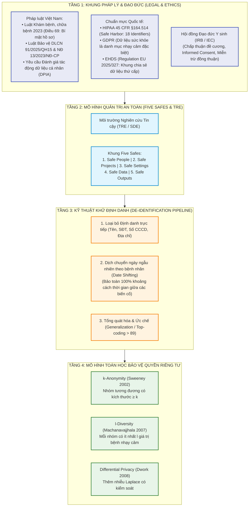

# CHƯƠNG 5. BẢO MẬT DỮ LIỆU Y TẾ, KHỬ ĐỊNH DANH (DE-IDENTIFICATION) VÀ KHUNG PHÁP LÝ VIỆT NAM

> **Mã học phần:** BIO-RDM-2026 | **Thời lượng:** 3 giờ tín chỉ (1 giờ Lý thuyết + 2 giờ Thực hành phòng máy Lab 5)  
> **Bộ tài liệu:** *Giáo trình Quản lý Dữ liệu Nghiên cứu Y sinh học (Biomedical Research Data Management)*  
> **Phiên bản:** `v2.0.0_20261121` | **Chuẩn trích dẫn:** SSoT BibTeX (`references/references.bib`)

---

## 1. MỤC TIÊU HỌC TẬP VÀ KHUNG NĂNG LỰC (LEARNING OBJECTIVES)

Sau khi hoàn thành Chương 5, người học đạt được các chuẩn năng lực đầu ra (CLOs):

1. **Hiểu và Phân biệt (Bloom Mức 2 - CLO1):**
   - Phân tích cặn kẽ khung pháp lý quốc tế về quyền riêng tư dữ liệu y tế: Tiêu chuẩn **HIPAA Privacy Rule** (Hoa Kỳ) với hai lộ trình *Safe Harbor* và *Expert Determination* [@ref_052]; Quy định bảo vệ dữ liệu chung Châu Âu (**GDPR** - Regulation 2016/679 [@ref_051]) và Không gian Dữ liệu Y tế Châu Âu (**EHDS** - Regulation 2025/327 [@ref_053]).
   - Phân biệt rõ sự khác nhau về mặt pháp lý và kỹ thuật giữa: Dữ liệu định danh (*Identifiable*), Dữ liệu giả danh (*Pseudonymized*), và Dữ liệu ẩn danh hoàn toàn (*Anonymized*).
   - Làm chủ các quy định pháp luật hiện hành của Việt Nam: **Luật Khám bệnh, chữa bệnh số 15/2023/QH15**; **Luật Bảo vệ dữ liệu cá nhân số 91/2025/QH15**; **Nghị định 13/2023/NĐ-CP** và **Nghị định 356/2025/NĐ-CP**; Thông tư 46/2018/TT-BYT và Thông tư 13/2025/TT-BYT về bệnh án điện tử.

2. **Áp dụng và Thực hành (Bloom Mức 3 - CLO3):**
   - Phân loại chính xác 4 nhóm thuộc tính trong tập dữ liệu y sinh: Định danh trực tiếp (*Direct Identifiers*), Thuộc tính bán định danh (*Quasi-Identifiers - QIs*), Thuộc tính nhạy cảm (*Sensitive Attributes*), và Thuộc tính không nhạy cảm.
   - Xây dựng và thực thi đường ống khử định danh tự động bằng Python: loại bỏ 18 định danh trực tiếp theo HIPAA, che giấu độ tuổi người cao tuổi ($> 89$), và áp dụng thuật toán **Dịch chuyển ngày tháng ngẫu nhiên theo từng bệnh nhân (Patient-Level Date Shifting)** để bảo toàn khoảng cách thời gian lâm sàng.
   - Đo lường và kiểm chứng các chỉ số an toàn quyền riêng tư toán học: **$k$-Anonymity** [@ref_068] và **$l$-Diversity** [@ref_069].

3. **Phân tích và Đánh giá (Bloom Mức 4 - CLO3):**
   - Đánh giá các rủi ro bị tấn công liên kết dữ liệu (*Linkage Attack*) và tái định danh người bệnh khi chia sẻ dữ liệu nghiên cứu ra cộng đồng khoa học mở.
   - Thiết kế mô hình quản trị dữ liệu an toàn dựa trên khung **Five Safes** và kiến trúc Môi trường Nghiên cứu Tin cậy (**Trusted Research Environments - TREs**) [@ref_075].

---

## 2. BẢN ĐỒ KHÁI NIỆM (CONCEPT MAP)

Sơ đồ dưới đây minh họa hệ thống các lớp phòng vệ bảo mật dữ liệu y tế từ khung pháp lý, đạo đức, kiến trúc hạ tầng cho đến các thuật toán khử định danh chuyên sâu:



---

## 3. CƠ SỞ LÝ THUYẾT VÀ CHUẨN MỰC NGÀNH

### 3.1. Nghịch lý Bảo mật và Chia sẻ Dữ liệu Y sinh học

Trong kỷ nguyên Y học Chính xác (*Precision Medicine*) và Trí tuệ Nhân tạo, việc tiếp cận các bộ dữ liệu lâm sàng quy mô lớn là điều kiện tiên quyết để thúc đẩy các phát kiến khoa học mới. Tuy nhiên, dữ liệu sức khỏe mang tính chất cá nhân sâu sắc:
- Dữ liệu y tế chứa đựng những thông tin nhạy cảm nhất về tình trạng sinh học, bệnh lý mạn tính, khuynh hướng di truyền, thói quen sinh hoạt và hành vi xã hội của con người.
- Nếu bị lộ lọt, người bệnh có thể phải đối mặt với nguy cơ bị phân biệt đối xử trong tuyển dụng lao động, từ chối cấp bảo hiểm, hoặc bị xâm phạm nghiêm trọng đời tư.
- **Nghịch lý căn bản:** Làm thế nào để vừa bảo vệ tuyệt đối quyền riêng tư của người bệnh, vừa không làm biến dạng hoặc phá hủy giá trị khoa học của tập dữ liệu phục vụ nghiên cứu?

---

### 3.2. Khung Pháp lý Quốc tế về Dữ liệu Y tế

#### 3.2.1. Đạo luật HIPAA và Tiêu chuẩn 45 CFR §164.514 (Hoa Kỳ)
Đạo luật về Trách nhiệm giải trình và Khả năng chuyển đổi Bảo hiểm Y tế của Hoa Kỳ (**HIPAA**) đặt ra các quy định nghiêm ngặt về Thông tin Y tế được Bảo vệ (**PHI - Protected Health Information**) [@ref_052]. Để một tập dữ liệu y tế được coi là đã khử định danh và có thể chia sẻ tự do cho nghiên cứu, HIPAA đưa ra hai phương pháp:

1. **Phương pháp Safe Harbor (Bến đỗ an toàn):** Yêu cầu loại bỏ bắt buộc **18 yếu tố định danh** trực tiếp và gián tiếp của bệnh nhân và thân nhân:
   - (1) Họ và tên;
   - (2) Tất cả các đơn vị địa lý nhỏ hơn một bang (địa chỉ nhà, thành phố, quận huyện, mã bưu chính ZIP code — ngoại trừ 3 chữ số đầu của ZIP code nếu khu vực đó có trên 20.000 dân);
   - (3) Mọi yếu tố ngày tháng liên quan trực tiếp đến một cá nhân (ngày sinh, ngày nhập viện, ngày xuất viện, ngày tử vong) — chỉ được phép giữ lại **Năm**;
   - (4) Giới hạn tuổi: Mọi lứa tuổi từ **90 trở lên** phải được gộp chung thành một nhóm duy nhất mang nhãn `90+` để tránh việc nhận diện các cụ già đại thọ hiếm có trong cộng đồng;
   - (5) Số điện thoại;
   - (6) Số Fax;
   - (7) Địa chỉ thư điện tử (Email);
   - (8) Số an sinh xã hội (SSN / CCCD);
   - (9) Số hồ sơ bệnh án (Medical Record Number - MRN);
   - (10) Số thẻ bảo hiểm y tế;
   - (11) Số tài khoản ngân hàng;
   - (12) Số chứng chỉ / bằng lái xe;
   - (13) Biển số xe hoặc số định danh phương tiện;
   - (14) Số seri hoặc định danh thiết bị y tế cấy ghép;
   - (15) Địa chỉ URL trang web cá nhân;
   - (16) Địa chỉ Giao thức Internet (IP Address);
   - (17) Dấu vân tay, hình ảnh võng mạc hoặc dữ liệu sinh trắc học;
   - (18) Ảnh chụp khuôn mặt có thể nhận diện được; và bất kỳ mã định danh duy nhất nào khác.

2. **Phương pháp Expert Determination (Thẩm định Chuyên gia):** Một chuyên gia có kiến thức khoa học và thống kê sâu rộng tiến hành áp dụng các thuật toán toán học và chứng minh bằng văn bản rằng xác suất để một người nhận được dữ liệu có thể tái định danh đối tượng nghiên cứu là "cực kỳ nhỏ" (*very small risk*).

#### 3.2.2. Quy định GDPR (Châu Âu) và Khái niệm Dữ liệu Giả danh
Quy định Bảo vệ Dữ liệu Chung của Liên minh Châu Âu (**GDPR** - Regulation 2016/679) [@ref_051] thiết lập một sự phân biệt pháp lý cốt tử:
- **Dữ liệu giả danh (Pseudonymised Data):** Dữ liệu đã thay thế họ tên bệnh nhân bằng một mã số nghiên cứu (Subject ID), nhưng nhà nghiên cứu vẫn giữ một "Bảng liên kết đối chiếu" (*Key file / Master linking log*) ở một nơi an toàn. **GDPR khẳng định: Dữ liệu giả danh VẪN LÀ DỮ LIỆU CÁ NHÂN** và phải tuân thủ đầy đủ các quy định ngặt nghèo của luật, bởi vì người giữ chìa khóa vẫn có khả năng tái định danh người bệnh.
- **Dữ liệu ẩn danh hoàn toàn (Anonymised Data):** Dữ liệu đã bị xóa bỏ liên kết vĩnh viễn, không một ai (kể cả nhóm nghiên cứu ban đầu) có thể tái định danh được cá nhân bằng bất kỳ biện pháp kỹ thuật hợp lý nào. Chỉ có dữ liệu ẩn danh hoàn toàn mới nằm ngoài phạm vi điều chỉnh của GDPR.
- **Không gian Dữ liệu Y tế Châu Âu (EHDS - Regulation (EU) 2025/327):** Có hiệu lực từ 26/03/2025 và áp dụng bắt buộc từ 26/03/2027 [@ref_053], thiết lập hành lang pháp lý thống nhất toàn khối cho việc khai thác thứ cấp (*secondary use*) dữ liệu sức khỏe trong các môi trường điện toán an toàn.

---

### 3.3. Khung Pháp lý và Đạo đức Nghiên cứu Y tế tại Việt Nam

Tại Việt Nam, các quy định pháp luật về bảo mật dữ liệu y tế đã có bước chuyển mình mang tính lịch sử, chuyển từ các quy định hành chính đơn lẻ sang một khung pháp lý hoàn chỉnh, đồng bộ và có chế tài nghiêm khắc:

1. **Luật Khám bệnh, chữa bệnh số 15/2023/QH15 (Có hiệu lực từ 01/01/2024):**
   - **Điều 69 (Hồ sơ bệnh án):** Quy định hồ sơ bệnh án là tài liệu pháp lý và tài sản bảo mật nghiêm ngặt.
   - Nghiêm cấm mọi hành vi tự ý sao chép, làm lộ lọt thông tin của người bệnh.
   - Khoản 4 Điều 69 quy định rõ: Người đứng đầu cơ sở khám bệnh, chữa bệnh chỉ được cho phép khai thác hồ sơ bệnh án phục vụ nghiên cứu khoa học khi thông tin định danh cá nhân của người bệnh **đã được mã hóa an toàn** và nghiên cứu viên cam kết bảo mật tuyệt đối.

2. **Luật Bảo vệ Dữ liệu Cá nhân số 91/2025/QH15 và Nghị định 13/2023/NĐ-CP / Nghị định 356/2025/NĐ-CP:**
   - Phân loại rõ ràng: **Dữ liệu về tình trạng sức khỏe, hồ sơ bệnh án, đời tư y tế và dữ liệu sinh trắc học là DỮ LIỆU CÁ NHÂN NHẠY CẢM** (Điều 2 Nghị định 13/2023/NĐ-CP và Luật 91/2025/QH15).
   - **Nguyên tắc Đồng thuận Tường minh (Informed Consent):** Mọi hoạt động thu thập, phân tích và chia sẻ dữ liệu y tế cho nghiên cứu đều phải có sự đồng ý bằng văn bản của chủ thể dữ liệu, nêu rõ phạm vi, mục đích và thời hạn xử lý.
   - **Hồ sơ Đánh giá Tác động Xử lý Dữ liệu Cá nhân (DPIA):** Tổ chức chủ trì nghiên cứu y sinh học bắt buộc phải lập Hồ sơ DPIA và gửi về Cục An ninh mạng và Phòng, chống tội phạm sử dụng công nghệ cao (A05 - Bộ Công an) trong vòng 60 ngày kể từ khi tiến hành xử lý dữ liệu.
   - Bổ nhiệm **Cán bộ Bảo vệ Dữ liệu Cá nhân (DPO)** chuyên trách tại cơ sở nghiên cứu.

3. **Thông tư 46/2018/TT-BYT & Thông tư 13/2025/TT-BYT về Bệnh án Điện tử (EMR):**
   - Quy định lộ trình các bệnh viện hạng I và đặc biệt phải triển khai hoàn tất bệnh án điện tử, đồng thời thiết lập hệ thống tường lửa, phân quyền truy cập và kiểm toán an ninh mạng để ngăn chặn rò rỉ dữ liệu y tế sang các mục đích thương mại trái phép.

4. **Vai trò của Hội đồng Đạo đức trong Nghiên cứu Y sinh học (IRB / IEC):**
   - Mọi đề cương nghiên cứu y sinh học có liên quan đến việc thu thập hoặc khai thác dữ liệu bệnh nhân đều phải được thông qua Hội đồng Đạo đức cấp cơ sở hoặc cấp Quốc gia.
   - Hội đồng Đạo đức xem xét cẩn trọng: Quy trình xin phiếu chấp thuận tham gia nghiên cứu (Informed Consent Form - ICF); cơ chế mã hóa và khử định danh dữ liệu; nơi lưu trữ khóa giải mã; và kế hoạch tiêu hủy dữ liệu an toàn theo **NIST SP 800-88 Rev. 2** (Clear / Purge / Destroy) sau khi kết thúc thời hạn lưu trữ quy định tại **Thông tư 33/2025/TT-BYT**.

---

### 3.4. Các Mô hình Kỹ thuật Khử định danh và Ẩn danh Toán học

#### 3.4.1. Phân Loại Thuộc Tính Dữ Liệu
Để thực hiện khử định danh, trước tiên nhà nghiên cứu phải phân loại các cột trong bảng dữ liệu thành 4 nhóm:
1. **Thuộc tính định danh trực tiếp (Direct Identifiers):** Nhận diện trực tiếp một cá nhân không cần thông tin bổ sung (Họ tên, SĐT, Số CCCD, Mã bệnh nhân, Email). *Biện pháp:* Loại bỏ hoàn toàn hoặc băm một chiều (Hash) có muối (Salt).
2. **Thuộc tính bán định danh (Quasi-Identifiers - QIs):** Bản thân một thuộc tính không chỉ đích danh ai, nhưng khi kết hợp nhiều thuộc tính lại với nhau thì có thể định danh duy nhất một người (Ngày sinh, Tuổi, Giới tính, Nghề nghiệp, Mã bưu chính ZIP code, Ngày khám bệnh).
3. **Thuộc tính nhạy cảm (Sensitive Attributes):** Thông tin bệnh tật cần bảo vệ mà kẻ tấn công muốn khai thác (Chẩn đoán bệnh, nồng độ virus HIV, mức độ trầm cảm, tình trạng sử dụng ma túy).
4. **Thuộc tính không nhạy cảm (Non-Sensitive Attributes):** Các thông số ít có nguy cơ rò rỉ riêng tư (Trạng thái thiết bị, phiên bản phần mềm).

#### 3.4.2. Kỹ thuật Dịch Chuyển Ngày Tháng Ngẫu Nhiên theo Bệnh Nhân (Patient-Level Date Shifting)
Trong nghiên cứu y học, việc loại bỏ hoàn toàn các cột ngày tháng sẽ phá hủy khả năng phân tích sống còn (*Survival Analysis*), đánh giá khoảng cách giữa các đợt tái phát, hoặc tính toán đáp ứng điều trị theo thời gian.

**Giải pháp kỹ thuật chuẩn mực:**
- Với mỗi bệnh nhân $i$, hệ thống sinh ra một số nguyên ngẫu nhiên duy nhất $\delta_i$ nằm trong khoảng cho trước (ví dụ: $\delta_i \in [-365, +365]$ ngày).
- Tất cả các mốc thời gian liên quan đến bệnh nhân $i$ (ngày sinh, ngày khám, ngày xét nghiệm, ngày xuất hiện biến cố bất lợi) đều được cộng thêm đúng $\delta_i$ ngày:
  $$t_{\text{shifted}} = t_{\text{original}} + \delta_i$$
- **Ưu điểm vượt trội:**
  - Khoảng cách giữa các mốc sự kiện lâm sàng của cùng một bệnh nhân được bảo toàn **chính xác 100%**:
    $$\Delta t = (t_{2} + \delta_i) - (t_{1} + \delta_i) = t_{2} - t_{1}$$
  - Mốc thời gian tuyệt đối trên lịch bị xáo trộn hoàn toàn, khiến kẻ xấu không thể đối chiếu ngày khám với sổ đăng ký vào viện hay camera giám sát của bệnh viện.

#### 3.4.3. Mô hình $k$-Anonymity (Latanya Sweeney 2002)
Một tập dữ liệu thỏa mãn **$k$-Anonymity** nếu mỗi tổ hợp thuộc tính bán định danh (Quasi-Identifiers) xuất hiện ít nhất ở $k$ bản ghi khác nhau trong bảng [@ref_068].
- Mỗi nhóm các bản ghi có chung tổ hợp bán định danh được gọi là một **Nhóm tương đương (Equivalence Class)**.
- Khi một tập dữ liệu đạt chuẩn $k$-anonymity, xác suất kẻ tấn công liên kết chính xác một người với một bản ghi không thể vượt quá $1/k$.
- *Kỹ thuật đạt được:*
  - **Tổng quát hóa (Generalization):** Chuyển giá trị chi tiết thành khoảng giá trị (ví dụ: tuổi 34 chuyển thành `[30-39]`; địa chỉ quận Đống Đa chuyển thành `Hà Nội`).
  - **Ức chế (Suppression):** Xóa bỏ một vài ô hoặc dòng dữ liệu cá biệt làm ảnh hưởng đến ngưỡng $k$.

#### 3.4.4. Mô hình $l$-Diversity (Machanavajjhala et al. 2007)
Mặc dù $k$-anonymity bảo vệ danh tính, nó không thể chống lại **Tấn công đồng nhất (Homogeneity Attack)**:
- Giả sử một nhóm tương đương có $k = 5$ bệnh nhân nữ, tuổi 30-39, ở Hà Nội. Nhưng cả 5 bệnh nhân này đều có chẩn đoán nhạy cảm là `HIV dương tính`.
- Kẻ tấn công biết nạn nhân là nữ, 32 tuổi, sống tại Hà Nội $\rightarrow$ Kẻ tấn công chắc chắn 100% nạn nhân bị nhiễm HIV dù bảng dữ liệu đạt $5$-anonymity!
- **Giải pháp $l$-Diversity:** Yêu cầu trong mỗi nhóm tương đương, thuộc tính nhạy cảm phải chứa ít nhất **$l$ giá trị khác nhau** và phân bố đều nhau [@ref_069].

#### 3.4.5. Bảo Mật Vi Sai (Differential Privacy - Cynthia Dwork 2008)
Được xem là tiêu chuẩn vàng toán học về quyền riêng tư hiện đại [@ref_070]:
- Đảm bảo rằng việc có mặt hay vắng mặt của một cá nhân duy nhất trong cơ sở dữ liệu sẽ không làm thay đổi đáng kể xác suất xuất hiện của kết quả truy vấn thống kê đầu ra.
- Cơ chế thực hiện: Thêm nhiễu ngẫu nhiên được điều chỉnh cẩn thận (Laplace Noise hoặc Gaussian Noise) vào kết quả tổng hợp dựa trên **Độ nhạy của truy vấn (Sensitivity)** và **Ngân sách bảo mật $\epsilon$ (Epsilon)**.

---

### 3.5. Kiến trúc Môi trường Nghiên cứu Tin cậy (TREs) và Khung Five Safes

Trong các nghiên cứu lâm sàng quy mô quốc gia, xu hướng toàn cầu hiện nay là chuyển từ mô hình "chia sẻ dữ liệu tải về" (*data sharing / downloading*) sang mô hình **"đưa thuật toán đến dữ liệu" (Code-to-Data)** thông qua các **Môi trường Nghiên cứu Tin cậy (Trusted Research Environments - TREs)**, vận hành trên nguyên tắc **Five Safes** [@ref_075]:

1. **Safe People (Con người an toàn):** Chỉ những nhà nghiên cứu đã được đào tạo, sát hạch về đạo đức dữ liệu y sinh và ký cam kết pháp lý mới được cấp tài khoản truy cập.
2. **Safe Projects (Dự án an toàn):** Dự án phải có đề cương nghiên cứu rõ ràng, phục vụ lợi ích công cộng và được Hội đồng Đạo đức (IRB) phê duyệt.
3. **Safe Settings (Môi trường an toàn):** Nghiên cứu viên làm việc trên một máy ảo cô lập (Virtual Desktop Infrastructure - VDI), không có kết nối internet tự do, bị khóa cổng USB và vô hiệu hóa tính năng copy-paste dữ liệu ra máy tính cá nhân.
4. **Safe Data (Dữ liệu an toàn):** Dữ liệu nạp vào môi trường đã được khử toàn bộ các định danh trực tiếp.
5. **Safe Outputs (Kết quả an toàn):** Mọi biểu đồ, bảng số liệu thống kê hoặc mô hình AI trước khi trích xuất ra khỏi TRE đều phải trải qua quy trình kiểm duyệt tự động và thủ công của Cán bộ Quản trị Dữ liệu (Air-lock review) để bảo đảm không chứa bất kỳ tế bào thống kê nào có cỡ mẫu quá nhỏ ($N < 5$ hoặc $N < 10$) có nguy cơ tái định danh.

---

## 4. NGHIÊN CỨU TÌNH HUỐNG VÀ BÀI HỌC THẤT BẠI (FAILURE ANALYSIS)

### Case Study 1: Vụ tái định danh Thống đốc bang Massachusetts của Latanya Sweeney (2002)
- **Bối cảnh:** Cơ quan Bảo hiểm Y tế bang Massachusetts (GIC) quyết định công bố một bộ dữ liệu đã được "khử định danh" bao gồm thông tin khám chữa bệnh của toàn bộ công chức bang cho các nhà nghiên cứu học thuật. GIC đã xóa bỏ tên, địa chỉ, số an sinh xã hội và mã bệnh án của bệnh nhân, và khẳng định công khai rằng quyền riêng tư của mọi người đã được bảo vệ tuyệt đối.
- **Cuộc tấn công của Sweeney:**
  1. Tiến sĩ Latanya Sweeney (lúc đó là nghiên cứu sinh tại MIT) biết rằng Thống đốc bang lúc bấy giờ là ông William Weld cư trú tại thành phố Cambridge.
  2. Sweeney bỏ ra \$20 để mua danh sách cử tri công khai của thành phố Cambridge (trong đó có chứa họ tên, địa chỉ, mã bưu chính ZIP code, ngày tháng năm sinh và giới tính của cử tri).
  3. Sweeney tiến hành **Tấn công liên kết (Linkage Attack)** giữa tập dữ liệu y tế của GIC và danh sách cử tri thông qua 3 thuộc tính bán định danh chung: **Mã ZIP (5 chữ số), Ngày sinh đầy đủ (ngày/tháng/năm), và Giới tính**.
  4. *Kết quả gây sốc:* Chỉ duy nhất một người trong toàn bộ thành phố Cambridge có tổ hợp 3 thuộc tính này trùng khớp với Thống đốc. Sweeney đã trích xuất được toàn bộ hồ sơ chẩn đoán bệnh, các toa thuốc điều trị và các đợt nằm viện phẫu thuật bí mật của Thống đốc Weld và gửi thẳng hồ sơ y tế này tới văn phòng của ông.
- **Tác động lịch sử:** Nghiên cứu của Sweeney chứng minh rằng **87% dân số Hoa Kỳ có thể bị định danh duy nhất chỉ bằng bộ 3 thuộc tính: Mã ZIP + Ngày sinh + Giới tính**. Đây chính là bằng chứng thực nghiệm quan trọng nhất dẫn tới việc Bộ Y tế Hoa Kỳ đưa ra quy tắc nghiêm ngặt của HIPAA Safe Harbor.

### Case Study 2: Bài học về chia sẻ dữ liệu y tế qua mạng xã hội tại Việt Nam
- **Bối cảnh:** Một nhóm nghiên cứu tại một bệnh viện thực hiện đề tài đánh giá đáp ứng điều trị mày đay mạn tính kháng thuốc. Để tiện trao đổi công việc hàng ngày giữa nghiên cứu viên và điều phối viên lâm sàng (CRC), nhóm đã tạo một nhóm chat Zalo.
- **Sai sót:** Nghiên cứu viên đã chụp ảnh các phiếu xét nghiệm sinh hóa và gửi trực tiếp tệp Excel danh sách 150 bệnh nhân (chứa đầy đủ Họ tên, Số điện thoại, Mã BHYT và kết quả xét nghiệm IgE) lên nhóm Zalo không bật tính năng mã hóa đầu cuối. Một thành viên trong nhóm bị mất điện thoại và toàn bộ danh sách dữ liệu bệnh nhân bị phát tán trên một diễn đàn mạng xã hội.
- **Hậu quả pháp lý:** Cơ sở y tế bị xử phạt vi phạm hành chính về an toàn an ninh mạng và bảo vệ dữ liệu cá nhân theo quy định pháp luật; đề tài nghiên cứu bị Hội đồng Đạo đức đình chỉ vĩnh viễn; nghiên cứu viên chính bị kỷ luật và công khai xin lỗi các bệnh nhân bị lộ lọt thông tin.

---

## 5. HƯỚNG DẪN THỰC HÀNH PHÒNG MÁY - LAB 5 (2 GIỜ)

### 5.1. Bối cảnh Nghiên cứu và Đề bài
Trong bài thực hành này, học viên đóng vai trò là **Chuyên viên Bảo mật Dữ liệu Nghiên cứu Y sinh học (Healthcare Data Privacy Officer)**. Học viên được giao xử lý tập dữ liệu lâm sàng thô chứa thông tin định danh của 1.000 bệnh nhân Mày đay Mạn tính (**DrMayDay Cohort** - tệp `csu_raw_identifiable_lab5.csv`).

**Nhiệm vụ:**
1. Lập danh mục phân loại thuộc tính (Direct Identifiers, Quasi-Identifiers, Sensitive Attributes).
2. Xây dựng đường ống khử định danh tự động bằng Python:
   - Loại bỏ triệt để các trường định danh trực tiếp theo HIPAA.
   - Ứng dụng kỹ thuật **Generalization** (Top-coding tuổi: các bệnh nhân tuổi $> 89$ được chuyển thành `90+`).
   - Cài đặt thuật toán **Dịch chuyển ngày ngẫu nhiên theo từng bệnh nhân (Patient-Level Date Shifting)** với biên độ $[-180, +180]$ ngày.
3. Đo lường mức độ an toàn quyền riêng tư: Tính toán chỉ số $k$ trong mô hình **$k$-Anonymity** trên các thuộc tính bán định danh (`gender`, `age_group`, `city`).
4. Kiểm chứng tính bảo toàn của dữ liệu lâm sàng: Chứng minh rằng khoảng cách thời gian giữa ngày khám đầu tiên và ngày tái khám của mỗi bệnh nhân không bị thay đổi sau khi dịch chuyển ngày.

---

### 5.2. Mẫu Dữ Liệu Lâm Sàng Thô Định Danh (`csu_raw_identifiable_lab5.csv`)
Cấu trúc tập dữ liệu đầu vào:

```csv
record_id,patient_name,national_id,phone_number,dob,gender,city,zip_code,initial_visit_date,followup_visit_date,diagnosis,uas7_score
101,Nguyen Van An,001085001234,0912345678,1985-04-12,M,Hanoi,10000,2025-01-10,2025-04-10,Chronic Urticaria,34
102,Tran Thi Binh,001192005678,0987654321,1992-09-25,F,Hanoi,10000,2025-02-15,2025-05-15,Chronic Urticaria,22
103,Le Van Cuong,079032009876,0903123456,1932-11-03,M,HCMC,70000,2025-01-20,2025-04-20,Chronic Urticaria,40
104,Pham Thi Dung,001088002468,0918987654,1988-06-18,F,Danang,55000,2025-03-01,2025-06-01,Chronic Urticaria,18
105,Hoang Van Em,001085009999,0977112233,1985-12-05,M,Hanoi,10000,2025-02-01,2025-05-01,Chronic Urticaria,28
```

---

### 5.3. Script Python Đường Ống Khử Định Danh (`deidentify_csu_lab5.py`)

Học viên xây dựng mã nguồn Python hoàn chỉnh để thực thi quy trình chuẩn:

```python
"""
Mô-đun thực hành Lab 5: Đường ống Khử định danh Dữ liệu Y sinh học (De-identification Pipeline)
Áp dụng HIPAA Safe Harbor, Patient-Level Date Shifting và Đo lường k-Anonymity
Khóa học: Quản lý Dữ liệu Nghiên cứu Y sinh học (Biomedical RDM)
"""

import pandas as pd
import numpy as np
from datetime import datetime, timedelta

# 1. Nạp dữ liệu thô định danh
df = pd.read_csv('csu_raw_identifiable_lab5.csv')
print(f"Tổng số bản ghi ban đầu: {len(df)}")

# 2. BƯỚC 1: LOẠI BỎ ĐỊNH DANH TRỰC TIẾP (DIRECT IDENTIFIERS REMOVAL)
# Theo HIPAA Safe Harbor: Loại bỏ Họ tên, Số CCCD, Số điện thoại, Mã bưu chính chi tiết
direct_identifiers = ['patient_name', 'national_id', 'phone_number', 'zip_code']
df_clean = df.drop(columns=direct_identifiers).copy()
print(f"Đã loại bỏ các cột định danh trực tiếp: {direct_identifiers}")

# 3. BƯỚC 2: TÍNH TUỔI VÀ TỔNG QUÁT HÓA (AGE TOP-CODING)
# Chuyển đổi ngày sinh sang đối tượng datetime
df_clean['dob_dt'] = pd.to_datetime(df_clean['dob'])
ref_date = pd.to_datetime('2026-01-01')
df_clean['age_years'] = ((ref_date - df_clean['dob_dt']).dt.days // 365.25).astype(int)

# Quy tắc HIPAA: Tuổi > 89 phải gộp thành '90+'
df_clean['age_display'] = df_clean['age_years'].apply(lambda x: '90+' if x > 89 else str(x))

# Tạo nhóm tuổi (Age Bins) 10 năm để hỗ trợ k-Anonymity
bins = [0, 18, 30, 45, 60, 75, 89, 120]
labels = ['<18', '18-29', '30-44', '45-59', '60-74', '75-89', '90+']
df_clean['age_group'] = pd.cut(df_clean['age_years'], bins=bins, labels=labels, right=True)

# 4. BƯỚC 3: THUẬT TOÁN DỊCH CHUYỂN NGÀY NGẪU NHIÊN THEO BỆNH NHÂN (DATE SHIFTING)
np.random.seed(42)  # Cố định seed để có thể kiểm chứng tái lập

# Tạo bảng tra cứu ngày dịch chuyển ngẫu nhiên cho từng bệnh nhân (-180 đến +180 ngày)
unique_records = df_clean['record_id'].unique()
shift_days_map = {rec_id: np.random.randint(-180, 181) for rec_id in unique_records}
df_clean['shift_days'] = df_clean['record_id'].map(shift_days_map)

# Chuyển các cột ngày tháng sang datetime
date_columns = ['dob', 'initial_visit_date', 'followup_visit_date']
for col in date_columns:
    df_clean[col + '_dt'] = pd.to_datetime(df_clean[col])
    # Thực hiện dịch chuyển ngày theo từng cá nhân
    df_clean[col + '_shifted'] = df_clean[col + '_dt'] + pd.to_timedelta(df_clean['shift_days'], unit='D')
    # Định dạng lại chuỗi ngày YYYY-MM-DD
    df_clean[col + '_shifted_str'] = df_clean[col + '_shifted'].dt.strftime('%Y-%m-%d')

# 5. BƯỚC 4: KIỂM CHỨNG TÍNH TOÀN VẸN LÂM SÀNG (VALIDATION)
# Tính khoảng cách giữa lần khám đầu và lần tái khám (trước và sau dịch chuyển)
df_clean['gap_original'] = (pd.to_datetime(df_clean['followup_visit_date']) - pd.to_datetime(df_clean['initial_visit_date'])).dt.days
df_clean['gap_shifted'] = (df_clean['followup_visit_date_shifted'] - df_clean['initial_visit_date_shifted']).dt.days

# Kiểm tra xem khoảng cách ngày có khớp 100% không
is_gap_preserved = (df_clean['gap_original'] == df_clean['gap_shifted']).all()
print(f"Khoảng cách lâm sàng có được bảo toàn hoàn hảo không? -> {is_gap_preserved}")

# 6. BƯỚC 5: ĐO LƯỜNG k-ANONYMITY TRÊN CÁC THUỘC TÍNH BÁN ĐỊNH DANH (QIs)
qi_columns = ['gender', 'age_group', 'city']
grouped_qi = df_clean.groupby(qi_columns, observed=False).size().reset_index(name='count')
k_anonymity_value = grouped_qi['count'].min()

print("\n--- PHÂN TÍCH k-ANONYMITY TRÊN NHÓM QUASI-IDENTIFIERS ---")
print(f"Các biến QIs được đánh giá: {qi_columns}")
print(f"Mức k-Anonymity đạt được của tập dữ liệu: k = {k_anonymity_value}")
print("Phân phối kích thước các nhóm tương đương:")
print(grouped_qi[grouped_qi['count'] > 0].sort_values(by='count').head(5))

# 7. XUẤT TẬP DỮ LIỆU ĐÃ KHỬ ĐỊNH DANH ĐẠT CHUẨN (DE-IDENTIFIED DATASET)
final_columns = [
    'record_id', 'gender', 'city', 'age_display', 'age_group',
    'initial_visit_date_shifted_str', 'followup_visit_date_shifted_str',
    'diagnosis', 'uas7_score'
]
df_deidentified = df_clean[final_columns].rename(columns={
    'initial_visit_date_shifted_str': 'initial_visit_date',
    'followup_visit_date_shifted_str': 'followup_visit_date'
})

df_deidentified.to_csv('csu_deidentified_lab5.csv', index=False, encoding='utf-8')
print("\nĐã xuất thành công tệp khử định danh: csu_deidentified_lab5.csv")
```

---

### 5.4. Rubric Tự Đánh Giá Kết Quả Thực Hành Lab 5 (Thang điểm 20)

| Tiêu chí | Trọng số | Mức Đạt Tối Đa (Xuất sắc - 100%) | Mức Đạt Trung Bình (Cần bổ sung - 50%) | Mức Không Đạt (0%) |
| :--- | :---: | :--- | :--- | :--- |
| **1. Phân loại Thuộc tính theo Chuẩn HIPAA** | **4 điểm** | Nhận diện chính xác 100% các trường định danh trực tiếp và bán định danh; giải thích rõ vì sao mã bưu chính và ngày tháng là QIs. | Nhận diện được họ tên và SĐT nhưng bỏ sót ngày khám và mã ZIP trong danh mục thuộc tính nhạy cảm. | Không phân biệt được giữa Direct Identifiers và Quasi-Identifiers. |
| **2. Thuật toán Dịch chuyển Ngày (Date Shifting)** | **5 điểm** | Cài đặt đúng thuật toán dịch chuyển ngẫu nhiên ở cấp độ từng cá nhân ($\delta_i$ duy nhất cho mỗi người); chứng minh được khoảng cách lâm sàng ($\Delta t$) bảo toàn 100%. | Dịch chuyển ngày bằng một số cố định chung cho toàn bộ bảng dữ liệu, hoặc làm sai lệch khoảng cách giữa các lần khám. | Xóa bỏ toàn bộ cột ngày tháng hoặc không dịch chuyển ngày. |
| **3. Tổng quát hóa & Xử lý Tuổi Cao (Top-coding)** | **4 điểm** | Áp dụng đúng quy định Safe Harbor: che giấu tuổi $> 89$ thành `90+`; tạo được các nhóm tuổi (Age Bins) khoa học phục vụ nghiên cứu. | Có tính tuổi nhưng không che giấu độ tuổi $> 89$. | Để nguyên ngày sinh chi tiết hoặc tính sai tuổi. |
| **4. Đo lường $k$-Anonymity & Đánh giá Rủi ro** | **4 điểm** | Tính toán chính xác giá trị $k$ của tập dữ liệu; chỉ ra được nhóm tương đương có kích thước nhỏ nhất và đề xuất cách tăng $k$ (ứng dụng Suppression/Generalization). | Tính được $k$ nhưng chưa phân tích được ý nghĩa bảo mật của nhóm tương đương. | Không tính toán được chỉ số $k$-Anonymity. |
| **5. Tuân thủ Pháp lý Việt Nam (DPIA / Quy trình)** | **3 điểm** | Trình bày thuyết phục quy trình xin phép Hội đồng Đạo đức và các bước lập Hồ sơ DPIA theo Nghị định 13/2023/NĐ-CP và Luật 91/2025/QH15. | Có đề cập đến luật nhưng chưa nắm được khái niệm dữ liệu cá nhân nhạy cảm. | Hoàn toàn không liên hệ với pháp luật Việt Nam. |

---

## 6. CÂU HỎI THẢO LUẬN VÀ BÀI TẬP TÌNH HUỐNG (DISCUSSION & EXERCISES)

### 6.1. Câu hỏi Thảo luận trên Lớp
1. *"Một nghiên cứu sinh cho rằng: 'Sau khi tôi xóa cột Họ và tên và Số điện thoại của bệnh nhân trong tệp Excel, tập dữ liệu của tôi đã trở thành dữ liệu ẩn danh hoàn toàn và tôi có quyền tự do gửi tệp này cho đồng nghiệp ở nước ngoài'. Dựa trên nghiên cứu của Latanya Sweeney (2002) và quy định của Nghị định 13/2023/NĐ-CP, bạn hãy phản biện luận điểm trên?"*
2. *"Tại sao trong mô hình $k$-Anonymity, việc tăng giá trị $k$ lên quá cao (ví dụ $k = 50$) sẽ giúp bảo vệ quyền riêng tư tốt hơn nhưng lại làm suy giảm nghiêm trọng giá trị sử dụng khoa học (Data Utility) của tập dữ liệu? Nhà quản trị dữ liệu cần cân bằng bài toán này như thế nào?"*

### 6.2. Bài tập Tình huống Nâng cao (Hospital Data Governance Audit)
Bệnh viện Đa khoa Tỉnh dự định phối hợp với một công ty công nghệ y tế (HealthTech) để cùng phát triển mô hình Trí tuệ Nhân tạo chẩn đoán sớm tổn thương da liễu tự miễn.
- Công ty đề xuất bệnh viện chuyển giao 10.000 hồ sơ bệnh án điện tử và 20.000 hình ảnh tổn thương da chụp bằng điện thoại thông minh.
- Phía công ty cam kết: *"Chúng tôi sẽ tự khử định danh trên máy chủ của công ty và ký hợp đồng bảo mật (NDA)"*.

**Yêu cầu:** Với vai trò là Cán bộ Bảo vệ Dữ liệu (DPO) của Bệnh viện:
1. Hãy chỉ ra ít nhất 3 rủi ro pháp lý và an ninh dữ liệu nghiêm trọng theo **Luật Khám bệnh, chữa bệnh 2023** và **Luật Bảo vệ Dữ liệu Cá nhân 91/2025/QH15** nếu bệnh viện đồng ý với đề xuất của công ty.
2. Hãy thiết kế một giải pháp kỹ thuật và pháp lý thay thế an toàn dựa trên mô hình **Môi trường Nghiên cứu Tin cậy (TRE)** và quy trình khử định danh dữ liệu tại nguồn (*In-hospital De-identification Pipeline*) trước khi cấp quyền truy cập cho đối tác.

---

## 7. TÀI LIỆU THAM KHẢO CHUẨN (REFERENCES)

Toàn bộ các chuẩn mực pháp lý và công trình khoa học trong chương được đối chiếu từ cơ sở dữ liệu thư mục SSoT (`references/references.bib`):

1. **U.S. Department of Health and Human Services (HHS).** (2012). *Guidance Regarding Methods for De-identification of Protected Health Information in Accordance with the Health Insurance Portability and Accountability Act (HIPAA) Privacy Rule*. 45 CFR §164.514. `[@ref_052]`.
2. **European Parliament & Council of the European Union.** (2016). *Regulation (EU) 2016/679 on the protection of natural persons with regard to the processing of personal data and on the free movement of such data (General Data Protection Regulation - GDPR)*. `[@ref_051]`.
3. **European Parliament & Council of the European Union.** (2025). *Regulation (EU) 2025/327 on the European Health Data Space (EHDS)*. `[@ref_053]`.
4. **Sweeney, L.** (2002). k-Anonymity: A model for protecting privacy. *International Journal of Uncertainty, Fuzziness and Knowledge-Based Systems*, 10(05), 557–570. DOI: [10.1142/S0218488502001648](https://doi.org/10.1142/S0218488502001648) `[@ref_068]`.
5. **Machanavajjhala, A., Kifer, D., Gehrke, J., & Venkitasubramaniam, M.** (2007). ℓ-Diversity: Privacy beyond k-anonymity. *ACM Transactions on Knowledge Discovery from Data (TKDD)*, 1(1), 3-es. DOI: [10.1145/1217299.1217302](https://doi.org/10.1145/1217299.1217302) `[@ref_069]`.
6. **Dwork, C.** (2008). Differential privacy: A survey of results. *International Conference on Theory and Applications of Models of Computation*, 1–19. Springer. `[@ref_070]`.
7. **UK Health Data Research Alliance.** (2021). *Trusted research environments & Five Safes framework: Design principles for health data services*. `[@ref_075]`.
8. **Ban Chấp hành Trung ương Đảng.** (2024). *Nghị quyết số 57-NQ/TW về đột phá phát triển khoa học, công nghệ, đổi mới sáng tạo và chuyển đổi số quốc gia*. `[@ref_079]`.
9. **Ban Chấp hành Trung ương Đảng.** (2025). *Nghị quyết số 72-NQ/TW về một số giải pháp đột phá, tăng cường bảo vệ, chăm sóc và nâng cao sức khỏe nhân dân*. `[@ref_080]`.
10. **Thủ tướng Chính phủ.** (2024). *Quyết định số 1308/QĐ-TTg phê duyệt Chiến lược dữ liệu quốc gia giai đoạn 2026–2030, tầm nhìn đến năm 2045*. `[@ref_081]`.
11. **Bộ Y tế.** (2024). *Quyết định số 3218/QĐ-BYT ban hành Quy chế quản lý, vận hành, sử dụng, khai thác, chia sẻ dữ liệu và bảo đảm an ninh mạng Cổng dữ liệu sức khỏe của Bộ Y tế*. `[@ref_082]`.
