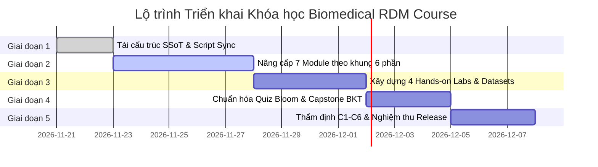

# Kế hoạch Xây dựng và Cập nhật Nội dung Khóa học Biomedical RDM Course theo Quy trình HDBS và KTPMUD

> **Mục tiêu chiến lược:** Chuyển hóa khóa học `biomedical-rdm-course` từ một mini-course sơ khai (6 bài đọc ngắn 1 giờ) thành một **Interactive Practicum-Driven Courseware (Khóa học Thực chiến SSoT)**, áp dụng các chuẩn mực sư phạm từ **HDBS** (*Hệ thống Hướng dẫn Biên soạn Giáo trình Chuẩn học thuật*) và quy trình kỹ thuật - kiểm định thực chiến từ **KTPMUD** (*Kỹ thuật Phần mềm Ứng dụng - LivingBook*).

---

## 1. BỐI CẢNH & ĐỊNH VỊ KIẾN TRÚC HAI REPO CỘNG SINH (SYMBIOTIC DUAL-REPO)

Hệ thống tài liệu RDM y sinh hiện tại bao gồm hai thực thể độc lập nhưng gắn kết chặt chẽ:

```mermaid
flowchart LR
    subgraph Repo_Research["1. REPO CHÂN LÝ Y VĂN (biomedical-rdm)"]
        direction TB
        R1["Tổng quan y văn<br/>(docs/literature-review/index.md)"]
        R2["Master Catalog 334 nguồn<br/>(references-334.bib)"]
        R3["103 Trích dẫn & Báo cáo OpenAlex<br/>(references.bib & citation-audit.csv)"]
        R4["29 Landmark y sinh & Bằng chứng<br/>(Phụ lục A & DECISIONS.md)"]
    end

    subgraph Sync_Engine["BỘ MÁY ĐỒNG BỘ TRI THỨC (CI/CD)"]
        direction TB
        S1["scripts/sync_rdm_knowledge.py"]
        S2["Kiểm tra Knowledge Drift & Cảnh báo lệch mốc thời gian/số liệu"]
        S3["Kế thừa 100% Citekeys [@ref_XXX]"]
    end

    subgraph Repo_Course["2. REPO KHÓA HỌC THỰC CHIẾN (biomedical-rdm-course)"]
        direction TB
        C1["Khung bài giảng 6 phần theo Bloom<br/>(course/modules/mXX_*)"]
        C2["Hands-on Labs y sinh mẫu<br/>(Synthea, DuckDB OMOP, REDCap, ARX)"]
        C3["Ngân hàng Quiz phân tầng Bloom (Aiken)<br/>(course/quizzes/)"]
        C4["Capstone Project / BKT & Rubric chấm<br/>(course/capstone/)"]
    end

    Repo_Research --> Sync_Engine --> Repo_Course
```



### 1.1. Phân định vai trò và ranh giới SSoT
- **`biomedical-rdm` (Research SSoT):** Đóng vai trò là "Kho bằng chứng & Chân lý khoa học". Toàn bộ khẳng định về quy định pháp luật (Luật Khám bệnh, chữa bệnh 2023, Nghị định 13/2023/NĐ-CP, Thông tư 13/2025/TT-BYT, Luật Dữ liệu 2024), mốc chuẩn quốc tế (ICH E6(R3), FHIR R6, OMOP CDM v5.4), và siêu dữ liệu 103/334 nguồn được quản trị tại đây.
- **`biomedical-rdm-course` (Course SSoT & Web Platform):** Đóng vai trò là "Xưởng sư phạm và Thực hành tương tác". Chịu trách nhiệm chuyển hóa tri thức hàn lâm thành bài giảng trực quan, tổ chức bài tập lab code, quiz trắc nghiệm Bloom, và render website (Quarto / VitePress).

### 1.2. Nguyên tắc bất biến kế thừa từ HDBS & KTPMUD
1. **Zero-Hallucination & Evidence-based Teaching:** Tuyệt đối không đưa các số liệu giả định hoặc suy đoán vào bài giảng lý thuyết. 100% phát biểu khoa học phải có citekey trỏ về `references.bib` đã kiểm chứng qua OpenAlex/Crossref.
2. **Kỷ luật phiên bản (Version Discipline):** Khóa học mang số phiên bản ngữ nghĩa (Semantic Versioning, v1.0.0, v1.1.0). Mọi cập nhật nội dung phải gắn với commit hash của repo nghiên cứu gốc.
3. **Phân tách kiểm định độc lập:** Hồ sơ thẩm định chất lượng bài học (`tham_dinh/`) nằm ngoài thư mục xuất bản web (`course/` hoặc `docs/`) để tránh rò rỉ tài liệu nội bộ.

---

## 2. TÁI CẤU TRÚC KIẾN TRÚC THƯ MỤC: CHẤM DỨT FILE ĐƠN LẺ

Chấm dứt việc gộp toàn bộ khóa học vào một file đơn lẻ `docs/course-source/rdm-mini-course-source.md` dài ~500 dòng cắt chuỗi qua marker. Chuyển sang kiến trúc module hóa theo chuẩn `chapters/` của KTPMUD:

```text
biomedical-rdm-course/
├── course/
│   ├── modules/                     # 7 Module bài giảng chuẩn hóa
│   │   ├── m00_intro/
│   │   ├── m01_dmp/                 # Lập kế hoạch & Mẫu DMP (NIH/Horizon)
│   │   ├── m02_collection/          # Thu thập & Thiết kế eCRF REDCap
│   │   ├── m03_standards/           # Chuẩn hóa dữ liệu: CDISC, FHIR, OMOP CDM
│   │   ├── m04_quality/             # Kiểm định chất lượng & Missing Data (Kahn Framework)
│   │   ├── m05_fair/                # FAIR Data & Metadata Schema (DataCite, DCAT)
│   │   └── m06_privacy_ai/          # Bảo mật (k-anonymity), Pháp lý (NĐ 13) & Synthetic Data
│   ├── labs/                        # 4 Bài Lab thực hành hands-on (Mô hình PhysioNet)
│   │   ├── lab1_redcap_ecrf/        # Thiết kế Data Dictionary & Logic check trên REDCap
│   │   ├── lab2_synthea_patient/    # Sinh 10.000 hồ sơ bệnh nhân giả lập với Synthea
│   │   ├── lab3_fhir_omop_duckdb/   # Chuyển đổi FHIR JSON sang OMOP CDM bằng DuckDB/SQL
│   │   └── lab4_anonymization/      # Thực hành khử định danh k-anonymity (k=5, l=3)
│   ├── quizzes/                     # Ngân hàng trắc nghiệm theo định dạng Aiken (Chuẩn Bloom)
│   │   ├── m01_quiz_bloom.txt
│   │   └── ...
│   ├── capstone/                    # Đồ án kết khóa (BKT - Bài kiểm tra 1-2 tuần)
│   │   ├── SCENARIO.md              # Kịch bản thử nghiệm lâm sàng đa trung tâm tại VN
│   │   ├── TEMPLATE_DMP.docx        # Template mẫu DMP cần điền
│   │   └── RUBRIC.md                # Ma trận tiêu chí chấm điểm năng lực thực hành
│   └── glossary.md                  # Thuật ngữ chuẩn hóa song ngữ Anh - Việt
├── tham_dinh/                       # Hồ sơ kiểm định chất lượng (Học tập KTPMUD)
│   ├── C1_C6_AUDIT_LOG.md
│   └── EVIDENCE_MAPPING.md
└── scripts/
    ├── sync_rdm_knowledge.py        # Đồng bộ tự động từ biomedical-rdm
    └── verify_course_integrity.py   # Test tự động: link, citekey, runnable code
```

---

## 3. CHUẨN HÓA CẤU TRÚC MÔ-ĐUN: KHUNG 6 PHẦN THỰC CHIẾN (KTPMUD)

Mỗi module bài giảng (`course/modules/mXX_*.md`) được cấu trúc thống nhất theo **Khung 6 phần thực chiến của KTPMUD**:

| Phần | Nội dung cốt lõi | Chuẩn mực sư phạm & kỹ thuật |
|---|---|---|
| **1. Mục tiêu & Năng lực thực chiến** | Nêu rõ người học ra quyết định được gì, thao tác được gì sau bài học (CLO theo thang đo Bloom). | Bloom Taxonomy: Hiểu $\rightarrow$ Áp dụng $\rightarrow$ Phân tích $\rightarrow$ Đánh giá. |
| **2. Bản đồ khái niệm & Kiến trúc dữ liệu** | Trực quan hóa luồng dữ liệu, quy trình hoặc kiến trúc hệ thống bằng Mermaid. | Mermaid Flowchart / Sequence / State Diagram. |
| **3. Cơ sở lý thuyết & Tiêu chuẩn ngành** | Trình bày lý thuyết gắn với chuẩn mực y sinh (ICH E6(R3), HL7 FHIR, OMOP CDM) và pháp luật VN. | Ràng buộc trích dẫn đóng `[@ref_XXX]` từ `references.bib`. |
| **4. Hiện thực hóa kỹ thuật & Code mẫu** | Hướng dẫn thao tác công cụ hoặc code mẫu (REDCap, Python, SQL/DuckDB). | Runnable code, có dữ liệu mẫu, input, output mong đợi. |
| **5. Case Study thực tế & Phân tích thất bại** | Phân tích bài học thành công hoặc sự cố thực tế trong y sinh (Failure Analysis). | Bám sát 29 tài liệu Landmark Phụ lục A của RDM. |
| **6. Đánh giá, Bài tập Lab & Tham khảo** | Quiz trắc nghiệm 4 mức Bloom, link tới bài Lab thực hành và danh mục tài liệu. | Aiken format cho Quiz; citekey đầy đủ. |

---

## 4. MÔ HÌNH PHỐI HỢP 4 CÔNG CỤ VÀ QUY TRÌNH THẨM ĐỊNH 6 LƯỢT (C1–C6)

### 4.1. Phân vai 4 công cụ (Hub-and-Spoke Architecture)
- **Google Drive (Storage):** Nơi lưu trữ tài liệu thô, dataset y tế mẫu (anonymized/synthetic datasets: Synthea CSV, FHIR JSON bundles, DuckDB tables), slide thuyết trình master.
- **Gemini (Deep Research + Gems):** Nghiên cứu mở rộng bối cảnh lâm sàng, soạn thảo kịch bản giảng dạy (lecture script/slides), thiết kế câu hỏi thảo luận và ca lâm sàng tình huống.
- **Google Antigravity (IDE & Technical Hub):** Quản lý mã nguồn, viết script lab thực hành (Python/DuckDB/REDCap API), chạy pipeline kiểm thử tự động (CI/CD test code, test quiz schema, test link), quản lý Git sync giữa 2 repo, build Quarto/VitePress.
- **Claude / Codex (Biên soạn & Thẩm định QA):** Trung tâm biên tập nội dung, chuẩn hóa văn phong sư phạm (áp dụng humanizer), kiểm toán 6 lượt C1–C6, bảo đảm 100% trích dẫn đúng citekey.

### 4.2. Quy trình thẩm định 6 lượt (C1 – C6 Audit Pipeline)
Áp dụng trực tiếp từ quy trình livingbook của KTPMUD vào khóa học RDM:
- **C1 (Cấu trúc & Khả năng tiếp thu):** Kiểm tra thời lượng đọc mỗi bài (tối ưu 5–7 phút lý thuyết), tính trực quan của sơ đồ Mermaid, tính rõ ràng của mục tiêu CLO.
- **C2 (Khái niệm & Lập luận kỹ thuật):** Rà soát phân biệt rành mạch các khái niệm y tin học phức tạp (như *De-identification* vs *Anonymization*, *MCAR* vs *MAR* vs *MNAR*).
- **C3 (Phát biểu & Bằng chứng - Claim-to-Evidence):** Đối chiếu 100% phát biểu với `references.bib` và `citation-audit.csv`. Tuyệt đối không đưa các mục đang cờ `BIB_PENDING` hoặc `CONTENT_PENDING` vào làm kiến thức khẳng định chắc chắn.
- **C4 (Mã nguồn, Dữ liệu & Thử nghiệm lab):** Chạy kiểm thử tự động script Python và truy vấn SQL trong môi trường sandbox của Antigravity; bảo đảm dataset mẫu 100% là dữ liệu giả lập (Synthea/PhysioNet), không chứa dữ liệu bệnh nhân thực.
- **C5 (Nghiên cứu tình huống & Bài học thực tế):** Đảm bảo case study phản ánh trung thực bài học từ các dự án lớn (OHDSI network studies, OpenSAFELY, UK Biobank, Meloddly).
- **C6 (Đánh giá, Quiz & Rubric chấm):** Đảm bảo câu hỏi trắc nghiệm có giải thích chi tiết đáp án đúng/sai, bẫy tư duy hợp lý, phân loại rõ ràng theo chuẩn Bloom (Aiken format).

---

## 5. ĐÁNH GIÁ NĂNG LỰC: THIẾT KẾ CAPSTONE CASE STUDY (BKT)

Theo kinh nghiệm của KTPMUD, khóa học kỹ thuật chỉ có giá trị khi học viên hoàn thành một **Đồ án thực hành (BKT - Bài kiểm tra 1–2 tuần)**:

### 5.1. Kịch bản thực chiến (Capstone Scenario)
- **Bối cảnh:** Học viên đóng vai trò *Lead Data Steward* của một thử nghiệm lâm sàng ngẫu nhiên có đối chứng (RCT) giả định điều trị bệnh đái tháo đường/tim mạch phối hợp giữa 3 bệnh viện lớn tại Việt Nam.
- **Nhiệm vụ bàn giao (Deliverables):**
  1. **Bản Data Management Plan (DMP):** Viết theo cấu trúc chuẩn NIH NOT-OD-26-046 hoặc Horizon Europe, quy định cụ thể thời hạn lưu trữ hồ sơ bệnh án theo Thông tư 33/2025/TT-BYT và Luật KCB 2023.
  2. **Bộ Data Dictionary & eCRF:** Định nghĩa tối thiểu 15 biến lâm sàng cốt lõi trên biểu mẫu REDCap (sử dụng Common Data Elements và mã hóa SNOMED-CT / ICD-10).
  3. **Kế hoạch Bảo vệ Dữ liệu & FAIR Sharing:** Xây dựng quy trình ẩn danh hóa đạt chuẩn k-anonymity ($k \ge 5$) và Đánh giá tác động xử lý dữ liệu cá nhân (DPIA) theo Nghị định 13/2023/NĐ-CP trước khi chia sẻ dữ liệu nghiên cứu mở.

### 5.2. Ma trận Rubric chấm điểm năng lực (Assessment Rubric)
| Tiêu chí | Xuất sắc (9–10) | Đạt (7–8) | Cần bổ sung (5–6) | Không đạt (<5) |
|---|---|---|---|---|
| **1. Tính chuẩn xác của DMP** | Đầy đủ 6 thành phần NIH/Horizon; xác định đúng căn cứ pháp lý VN; kế hoạch lưu trữ và chia sẻ khả thi. | Đầy đủ các mục chính; căn cứ pháp lý đúng nhưng mô tả biện pháp bảo mật còn chung chung. | Thiếu 1–2 mục thành phần; chưa nêu rõ thời hạn lưu trữ theo Thông tư 33/2025. | Viết sơ sài, sao chép nguyên văn mẫu không chỉnh sửa theo bối cảnh. |
| **2. Chất lượng eCRF & CDEs** | Các biến định nghĩa rõ kiểu dữ liệu, validation range, mã hóa chuẩn SNOMED/ICD; logic branching thông minh. | Định nghĩa đủ biến; có validation cơ bản; mã hóa chuẩn y tế được áp dụng cho biến chính. | Thiếu validation range dẫn đến nguy cơ dữ liệu bẩn; chưa dùng mã chuẩn. | Biến mơ hồ, không có ràng buộc kiểu dữ liệu. |
| **3. Quy trình bảo mật & Đạo đức** | Định danh đúng 18 yếu tố HIPAA và định nghĩa dữ liệu nhạy cảm theo NĐ 13; tính toán được rủi ro tái định danh. | Nhận diện đúng dữ liệu nhạy cảm; quy trình che giấu thông tin hợp lý nhưng chưa có kiểm định toán học. | Hiểu nhầm giữa de-identification và anonymization; bỏ sót thông tin gián tiếp. | Vi phạm nguyên tắc bảo mật, để lộ dữ liệu cá nhân giả định. |

---

## 6. LỘ TRÌNH TRIỂN KHAI 5 GIAI ĐOẠN (IMPLEMENTATION ROADMAP)



### Bảng phân công chi tiết:
1. **Giai đoạn 1 (Tái cấu trúc SSoT):** 
   - Tách file gộp thành cấu trúc module độc lập `course/modules/mXX_*.md`.
   - Viết script `scripts/sync_rdm_knowledge.py` để đồng bộ `references.bib` và kiểm tra knowledge drift.
2. **Giai đoạn 2 (Biên tập 7 Module bài giảng):**
   - Mở rộng nội dung theo Khung 6 phần thực chiến của KTPMUD.
   - Bổ sung sơ đồ Mermaid và trích dẫn đóng `[@ref_XXX]`.
3. **Giai đoạn 3 (Phát triển 4 Hands-on Labs):**
   - Xây dựng 4 notebook/script chạy được trong sandbox Antigravity (REDCap, Synthea, OMOP DuckDB, k-Anonymity).
   - Đóng gói dataset giả lập sạch.
4. **Giai đoạn 4 (Quiz & Đồ án Capstone):**
   - Chuyển đổi toàn bộ quiz sang chuẩn Aiken format có phân tầng Bloom.
   - Biên soạn chi tiết đề bài Capstone BKT và rubric chấm.
5. **Giai đoạn 5 (Kiểm định C1–C6 & Đóng gói Release):**
   - Thực hiện kiểm toán 6 lượt C1–C6, xuất báo cáo `tham_dinh/C1_C6_AUDIT_LOG.md`.
   - Trình TS. Hoàng Quang Huy (Ben) phê duyệt để ban hành phiên bản v1.0.0 chính thức.

---

## 7. KẾT LUẬN & KIẾN NGHỊ

Phương án này tận dụng tối đa:
- **Tài sản học thuật đã hoàn thiện:** 334 nguồn master, 103 trích dẫn đã được kiểm chứng qua OpenAlex/Crossref của Cổng G1 & G2 trong `biomedical-rdm`.
- **Quy trình sư phạm chuẩn mực từ HDBS:** Ma trận chuẩn đầu ra CLO/PLO và mô hình 4 công cụ.
- **Hạ tầng kỹ thuật thực chiến từ KTPMUD:** Khung bài giảng 6 phần, đồ án BKT gắn với dataset y tế mẫu, và quy trình thẩm định 6 lượt C1–C6.

Sau khi kế hoạch này được phê duyệt, Ban Biên soạn và Kỹ thuật viên sẽ bắt tay triển khai ngay Giai đoạn 1 (Tái cấu trúc SSoT và xây dựng bộ máy đồng bộ tri thức).

